# Could expected counts come from one model instead of a stack? (2026-11-05)

Notes alongside the [synonymous-DNM rr report](rr_syn_dnm_followup.md).

## The stack today

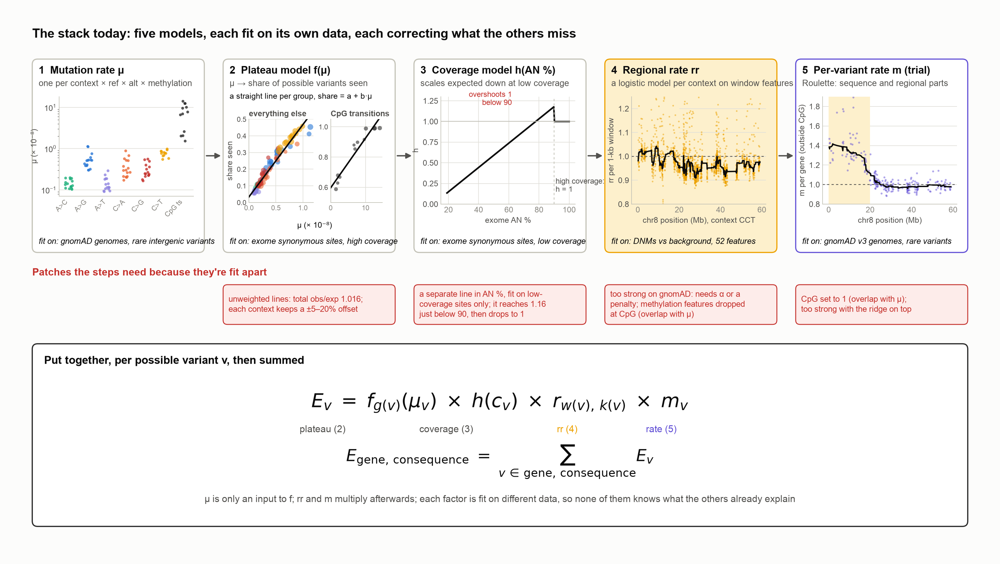

For each possible variant $v$:

1. **Mutation rate** $\mu_v$: one number per (context, ref, alt, methylation level), estimated from rare variants in gnomAD genomes.
2. **Plateau model**: turns $\mu_v$ into the share of such sites seen in exomes, $f_g(\mu_v)$, with a straight line per model group (CpG transitions, everything else), fit on high-coverage synonymous sites.
3. **Coverage model** $h(c_v)$: scales that down at low coverage, fit on low-coverage synonymous sites.
4. **rr** $r_v$: a regional multiplier from a logistic regression of DNM sites on 1-kb window features, normalized per context.
5. (Experimental) **per-variant rate multiplier** $m_v$ (Roulette or home-built).

$$E_v = f_g(\mu_v)\, h(c_v)\, r_v\, m_v$$

Each piece was added to fix what the previous ones got wrong, and each is fit on its own data. That's why it feels like models correcting models: it is.

## Why it ended up this way (the good reasons)

- **Different data for different parts.** The mutation rate comes from genomes in neutral regions, the calibration from exome synonymous sites, rr from DNMs. Keeping them apart keeps each one checkable against the others. Synonymous obs/exp is only a real test because no step was fit on per-gene synonymous counts.
- **No circularity for rr.** Training rr on DNMs rather than gnomAD counts stops it from absorbing coverage, mapping or selection effects that aren't mutation rate.
- **Easy to swap and debug.** Each step has its own table and can be rerun alone; the per-variant expected Table means any change to one factor still sums correctly.

## The costs we keep running into

- **Overlap the steps don't know about.** rr's methylation-linked features overlap the methylation levels already in $\mu$, so a manual rule drops them at CpG. Roulette's CpG rates overlap $\mu$'s methylation, so they're set to 1. Each such fix is a hand-made patch for two models measuring the same thing.
- **Strength has to be tuned.** rr is fit on DNMs and applied to gnomAD with no calibration step, so it comes out too strong (hence α, the ridge penalty, and now Roulette + ridge being too strong).
- **Levels drift.** The unweighted plateau line leaves synonymous obs/exp at about 1.016, and each context keeps its own offset.
- **The coverage line overshoots.** The coverage model is a straight line in exome AN % with no cap, applied below 90% (`coverage_correction_expr` in gnomad_methods). It passes 1 at about 78%, reaches 1.16 just below 90%, then drops back to 1 at 90%. So variants at 78–89% AN get up to 16% more expected than fully covered ones. More on this in the next section.

### Is the stack really using the coverage model?

Yes. The current expected in the exported cells (possible × stored plateau line × stored coverage model) matches the release's `syn.exp` to within 0.1% for 99.4% of 17,637 MANE Select transcripts. That holds for the 7,132 transcripts with sites below AN 90 as well (99.3%). Refitting the coverage model from these cells the way `build_models` does gives (−0.1454, 0.01472), against the stored (−0.1448, 0.01471). So it is the stored model, applied as the pipeline applies it. It just fits badly. (Checks: `followup/coverage_check.py`.)

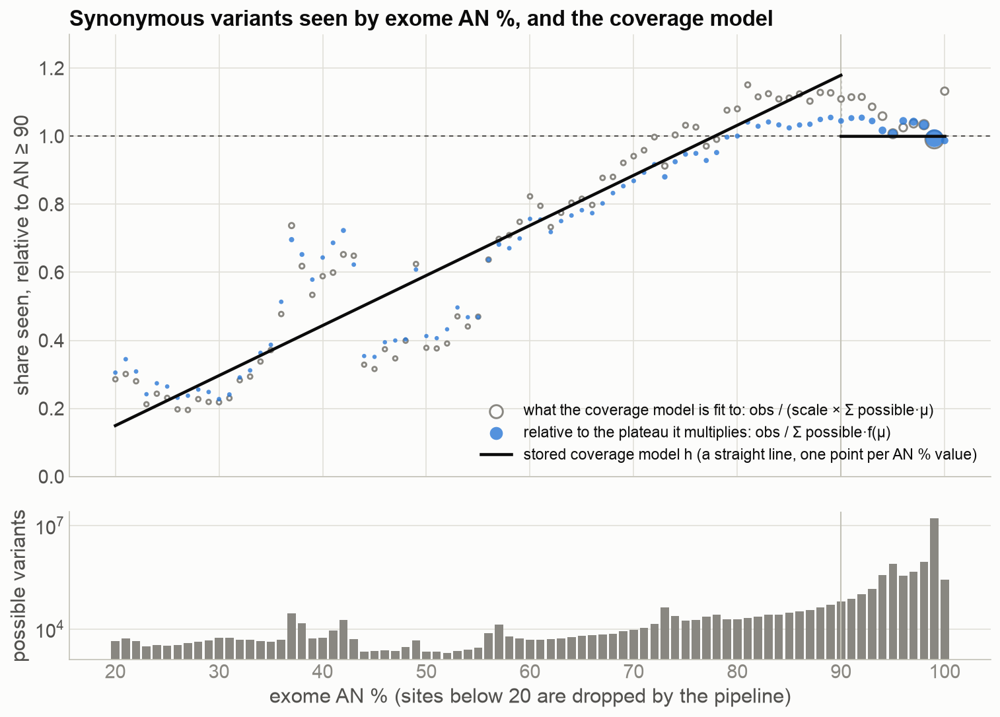

These are the same points as in the coverage diagnostic made for the v4.1 release (obs/exp before the coverage correction, by AN %): the exported cells match it to within 0.02 on average. So the blocks below 56% and the 1.03–1.06 level above 80% are real. What that diagnostic doesn't show is the line fit through the points, on the μ scale.

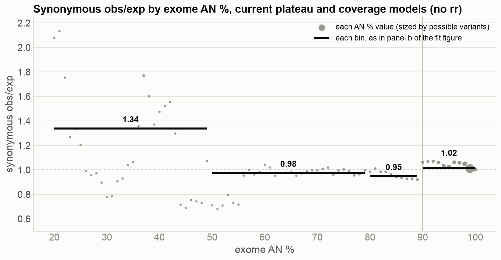

Dividing the points by the line gives synonymous obs/exp after the coverage correction, which is what the released expected counts have. The bars are the bins from panel b of the fit figure below. The dots are each AN % value.

- **20–49%: 1.34.** Within this bin, obs/exp swings from 2.1 at 20–21% down to 0.8 at 30%, back up to 1.8 at 37%, and down to 0.7 at 44–48%. The bin is high because of the 37–43% block. It holds 48% of the bin's possible variants at obs/exp 1.59, and accounts for 5,342 of the bin's 5,567 excess variants. The rest of the bin averages 1.03.
- **50–79%: 0.98.** Close to 1, apart from 0.7 at 50–55%.
- **80–89%: 0.95.** A slow slide from 1.0 to 0.92, where the line overshoots.
- **≥ 90%: 1.02.** The plateau's overall offset.

- **Unweighted, one point per AN % value.** Each AN % value counts the same in the fit. Values below 56% have 2–28 thousand possible variants each and noisy shares; 85–89% have 30–50 thousand each. Weighting the points gives (−0.026, 0.0134) instead.
- **Fit on one scale, applied on another.** The model is fit to obs / (scale × Σ possible·μ), which assumes expected is proportional to μ. It then multiplies the plateau prediction f(μ), which isn't proportional to μ. On the μ scale (hollow points), sites at 80–89% sit at 1.08–1.15, and the line climbs to reach them. Relative to the plateau (blue points), the same sites sit at 1.00–1.06. The μ-scale points are also off 1 at AN ≥ 90 (0.99–1.13 by value), so this is a difference in the sites' mutation-rate mix, not coverage.
- **Not a function of AN % alone below about 56%.** The shares come in blocks:
  - 0.23–0.34 at 20–31%;
  - 0.5–0.7 at 36–43%;
  - mostly 0.35–0.47 at 44–55% (one value at 0.61).

  A guess: these are sites called in only part of the cohort, where what's seen depends on which samples were called, not just how many. No smooth curve in AN % will fit them, and neither does the one-model spline.
- **How much it matters.** Sites below AN 90 are 3.9% of synonymous possible variants: 0.9% at 20–49%, 1.5% at 50–79% and 1.5% at 80–89%. Synonymous obs/exp is 1.34 at 20–50% and 0.95 at 80–90%. The genes this mostly affects are the partly covered ones, because genes with almost no sites at AN 90 or above are flagged `low_exome_coverage`.
- **Shape is assumed, not fit.** Straight plateau lines, a separate coverage line, multiplicative rr: the forms were chosen once, not learned together.

## One model: a variant-level model with a complementary log-log link

Most of the steps multiply a rate. A natural single model makes the probability that each possible variant (a locus and an alt allele, as in the per-variant expected Table) is seen

$$P(\text{seen}_v) = 1 - \exp(-\lambda_v), \qquad \log \lambda_v = \log \mu_v + \beta_{g(v)} + s(c_v) + \mathbf{x}_{w(v)}^\top \boldsymbol\gamma_{k(v)} + \log m_v$$

- $\log \mu_v$ enters as an offset (the genome-based rate, kept as an independent anchor), with $\beta_g$ letting each group's scale differ (what the plateau intercepts and slopes do now; per-substitution-type $\beta$ is the "one line per substitution type" idea).
- $1 - e^{-\lambda}$ is the saturation: the share seen levels off at high rates by itself, so no plateau line is needed. It is the same form as the saturating curve already tried.
- $s(c_v)$ is a smooth function of coverage (AN %): the coverage model becomes one term, fit together with everything else.
- $\mathbf{x}_w^\top \boldsymbol\gamma_k$ are the window features, per context class $k$: rr becomes one term, on the same rate scale as everything else.
- $\log m_v$ is an optional offset for per-variant rates (Roulette).

This is a binomial GLM (or GAM) with a cloglog link. Every current factor becomes one additive term in one linear predictor, fit jointly by likelihood, so:

- overlaps are resolved by the fit instead of by rules (if methylation is already in $\mu$, a methylation feature just gets a small coefficient);
- there is no separate strength to tune: how much the window features move gnomAD counts is estimated directly;
- the level is set by the likelihood (an intercept keeps total expected close to total observed);
- expected counts are still per variant, $E_v = P(\text{seen}_v)$, so they still sum over any set of variants, and the per-variant expected Table still works.

It can be fit on cells rather than individual variants: group possible variants by (window, context, alt, methylation level, coverage) with observed and possible counts. That's the same shape as Ruchit's exported cells, a few tens of millions of rows, which a regularized GLM (statsmodels, glum, or PyTorch) handles.

## Keeping DNMs in it (so it isn't gnomAD fitting gnomAD)

Fit only on gnomAD synonymous counts, the window terms would learn everything regional in gnomAD, mutation or not, and synonymous obs/exp would be about 1 by construction. The way around it is a joint likelihood with two parts that share the mutation-rate terms:

$$\text{DNMs: } D_v \sim \text{Poisson}\big(\theta\, \mu_v\, e^{\mathbf{x}_w^\top \boldsymbol\gamma}\big) \qquad \text{gnomAD: } \text{seen}_v \sim \text{Bernoulli}\big(1 - e^{-\lambda_v}\big)$$

with the same $\boldsymbol\gamma$ in both (or $\boldsymbol\gamma$ shared plus a small gnomAD-only term, penalized). DNMs anchor what is mutation rate; gnomAD adds power and handles saturation and coverage. This is the principled version of what rr + calibration do in two passes, and it answers "how strong should rr be" from the data.

## What it would not fix on its own

- **Position-level noise.** About half of what's left after rr comes from individual positions (coverage and mappability shared by the three possible variants at a position). The model can take position-level covariates: exome AN % is already per position (the coverage term), and mapping quality can come in as a local summary (the mean AS_MQ of called SNVs in the window; a variant's own MQ only exists when it was called, so using it would leak the outcome). Both feed the gene-level QC flags today. The try fits the model with and without them.
- **Gene-level excess the regional features can't see** (histone genes, MAZ, ZFP36L2). A regional term can't single these out, because their neighbours are normal. What could:
  - **a gene term,** each gene's own rate shrunk toward 1 by how much it can be trusted (empirical Bayes). It fits best, but it is learned from the synonymous counts themselves, so synonymous obs/exp stops being a check unless it is estimated on held-out halves of each gene's sites or on DNMs;
  - **a gene-family or paralog term** for the histone cluster: a histone indicator learned from DNMs would overcorrect (DNMs 2.8 times expected against about 1.85 in gnomAD), and the paralog-copying feature explains only about a fifth of the gnomAD excess, so on its own neither is enough;
  - **a flag,** which leaves expected counts alone and stops the metrics being read as constraint.
- **The neutral-calibration premise.** Fitting on synonymous variants and applying the model to LoF and missense assumes the mutation process doesn't depend on consequence. That isn't a gap to close; it is what constraint is: expected is "what would be seen with no selection", and synonymous variants are the stand-in for no selection. Every version of the pipeline, stacked or single, relies on it.

## Related work

Roughly, yes, for the mutation-rate part: Roulette (Seplyarskiy et al. 2023) fits one model of the chance a site stays monomorphic from sequence, methylation, transcription and regional terms, with recurrent mutation built in; Carlson et al. 2018 fit a logistic model of singleton sites on sequence context and genomic features. Neither carries it through to exome calibration and coverage the way the constraint pipeline needs. The pieces we've tried here map onto it: the saturating plateau curve is its link, per-substitution lines are its $\beta_g$, rr is its window term, Roulette is its offset.

## Trying it (2026-11-05)

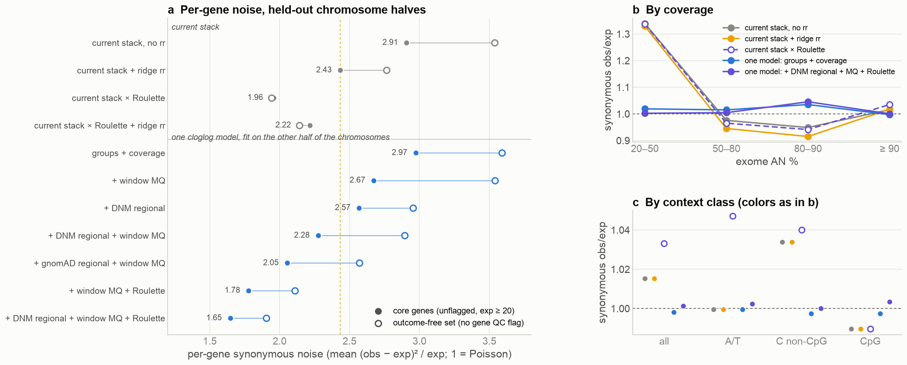

Fit with `followup/one_model_fit.py` on MANE Select synonymous SNVs on the autosomes: 9.4M cells (transcript × 1-kb window × context × alt × methylation level × exome AN %), from `followup/cluster/export_model_cells.py`. Each model is fit on one half of the chromosomes and scored on the other. The current stack's plateau lines, coverage model and ridge rr were fit on all chromosomes, which if anything favours the stack. Per-gene noise is the report's metric: the mean of (obs − exp)² / exp per gene, where 1 is Poisson.

- **Groups + coverage alone fixes the levels, not the noise.** One cloglog fit replaces the plateau and coverage models, with an intercept and a log-μ slope per substitution type plus a coverage spline.
  - Total synonymous obs/exp goes from 1.015 to 0.998, and C non-CpG from 1.034 to 0.997.
  - The spread across contexts halves (weighted sd 0.113 → 0.064).
  - At AN 20–50%, obs/exp goes from 1.34 to 1.02. The current coverage line underpredicts badly there.
  - Per-gene noise barely moves (2.97 vs 2.91), because what's left per gene is regional, not context levels.
- **Window MQ** lowers core noise (2.97 → 2.67) but barely moves the outcome-free set (3.59 → 3.54). Its big effect is on genes the release flags for low mapping quality (panel a of the next figure), and the outcome-free set leaves those genes out.
- **DNM regional term:**
  - On its own it gives 2.57.
  - With MQ it gives 2.28, below current + ridge rr (2.43) on the core set, but not on the outcome-free set (2.90 vs 2.76).
  - Its fitted strength is 0.57–0.83. The DNM-trained score is too strong on gnomAD, which is what α and the ridge penalty found too, but here the fit sets the strength.
- **gnomAD regional term** (the window features fit straight to gnomAD synonymous counts on the other half): 2.05 core, 2.57 outcome-free. This is the best result without Roulette, but it is gnomAD fitting gnomAD: it can absorb anything regional, mutational or not, and synonymous noise can't tell the difference.
- **Roulette is most of the gain, and the joint fit uses it better.**
  - *Current stack × Roulette:* 1.96 core, 1.94 outcome-free, but total obs/exp 1.033 and A/T 1.047. Adding the ridge on top makes it worse (2.22 / 2.14).
  - *Roulette as an offset in the one model, with MQ:* 1.78 / 2.11 at obs/exp 1.000.
  - *Adding the DNM regional term:* 1.65 / 1.91 with 50 outliers, against 186 for stack × Roulette. The DNM strength drops to 0.34–0.47: the fit shrinks the regional term by what Roulette already explains. That is the "too strong with the ridge on top" problem, handled by the fit instead of by hand.

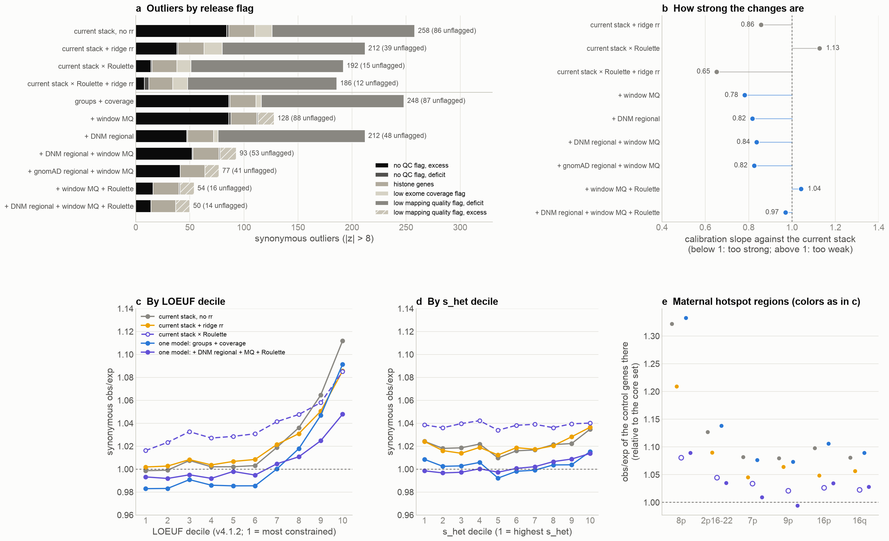

The report's other synonymous checks on the same held-out fits come from `followup/one_model_eval.py`. Outliers here are counted after rescaling expected counts to the core set's level, as in the report, so they differ a little from the table below.

- **a: outliers by release flag.**
  - Window MQ removes the low-mapping-quality outliers. There are 132 deficits under the current stack and 0–1 once MQ is in the model. It overshoots a little: 13–15 of those genes become excess outliers instead.
  - Among genes without a QC flag, outliers drop from 86 under the current stack to 39 with the ridge rr, 15 with stack × Roulette, and 14 with the full one model (DNM regional + MQ + Roulette).
  - The 22–24 histone outliers stay under every model.
- **b: strength.** This is the calibration slope of each model's changes against the current stack, the same measure as the report's rr strength (1 = the right size).
  - The full one model is at 0.97.
  - Stack × Roulette is too weak (1.13), and too strong with the ridge on top (0.65).
  - The one models without Roulette are at 0.78–0.84, a little too strong.
- **c, d: deciles.**
  - By LOEUF, the full one model runs 0.99–1.05. That compares with 1.00–1.11 now, 1.00–1.09 with the ridge rr and 1.02–1.09 with stack × Roulette.
  - By s_het it is 1.00–1.01 throughout. Stack × Roulette is 1.03–1.04, the level it leaves behind.
  - Groups + coverage alone keeps the LOEUF rise (1.09 in the top decile).
- **e: maternal hotspot regions** (control genes there, as in the report). The six regions run:
  - 1.08–1.32 under the current stack;
  - 1.05–1.21 with the ridge rr;
  - 1.02–1.08 with stack × Roulette;
  - 0.98–1.01 with stack × Roulette + ridge rr;
  - 0.99–1.09 with the full one model.

  The full one model keeps 8p at 1.09.

What it doesn't settle:

- **AN 80–90%:** the one-model obs/exp is 1.02–1.05 there. The linear spline, with knots every 10%, is too coarse at that range. The current stack is at 0.95 there because of the overshoot.
- **Outcome-free set:** the best one model (1.91) is only a little better than stack × Roulette (1.94). The core-set gain (1.65 vs 1.96) is bigger, and part of it is MQ.
- **Which pLoF level is right.** The full model lowers expected pLoF by about 7% relative to synonymous, more than any plateau version did. Synonymous variants alone can't tell which level is right.
- **Penalties:** the DNM regional penalty is tuned on held-out DNMs (3000, inside the grid of 300–100,000). The gnomAD-regional penalty is fixed at 1000, not tuned.

<dl><dd>

Click to expand: all models

| Model | Core noise | Outcome-free noise | Outliers (\|z\| > 8) | Outliers without a QC flag | Total obs/exp | A/T | C non-CpG | CpG |
|---|---|---|---|---|---|---|---|---|
| current stack, no rr | 2.91 | 3.54 | 265 | 120 | 1.015 | 1.000 | 1.034 | 0.990 |
| current stack + ridge rr | 2.43 | 2.76 | 213 | 68 | 1.015 | 1.000 | 1.034 | 0.990 |
| current stack × Roulette | 1.96 | 1.94 | 186 | 42 | 1.033 | 1.047 | 1.040 | 0.990 |
| current stack × Roulette + ridge rr | 2.22 | 2.14 | 180 | 35 | 1.031 | 1.047 | 1.036 | 0.990 |
| one model: groups + coverage | 2.97 | 3.59 | 246 | 104 | 0.998 | 1.000 | 0.997 | 0.997 |
| + window MQ | 2.67 | 3.54 | 110 | 95 | 0.998 | 1.000 | 0.998 | 0.997 |
| + DNM regional | 2.57 | 2.95 | 211 | 71 | 1.000 | 1.000 | 1.000 | 1.001 |
| + DNM regional + window MQ | 2.28 | 2.90 | 91 | 75 | 1.000 | 1.000 | 1.000 | 1.000 |
| + gnomAD regional + window MQ | 2.05 | 2.57 | 76 | 64 | 1.000 | 1.001 | 0.999 | 1.002 |
| + window MQ + Roulette | 1.78 | 2.11 | 53 | 39 | 1.000 | 1.002 | 0.998 | 1.001 |
| + DNM regional + window MQ + Roulette | 1.65 | 1.91 | 50 | 37 | 1.001 | 1.002 | 1.000 | 1.003 |

Core genes are unflagged with current expected ≥ 20. The outcome-free set is genes with no release QC flag and current expected ≥ 20. Outputs are in `followup/data/one_model/one_model_full_v2.*`.

</dd></dl>

### pLoF and missense (2026-11-06)

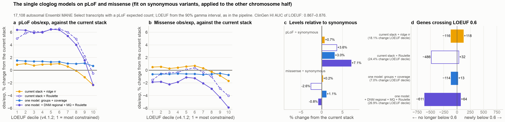

The same fits were applied to every possible missense and pLoF (LOFTEE HC) SNV in the same MANE Select transcripts. Each variant gets the fit from the other chromosome half. The cells come from `followup/cluster/export_model_cells.py --csqs mis lof`, applied with `followup/one_model_fit.py --apply-cells` and scored with `followup/one_model_release_eval.py`.

LOEUF is the upper end of the 90% gamma interval, as in the pipeline. For the current stack this reproduces the released LOEUF for 97.9% of transcripts; the rest differ from the release by a few variants in their counts. Working this way skips the pipeline's metrics step, which takes hours. Missense z isn't computed.

- **a–c: levels.** Relative to synonymous:
  - ridge rr: pLoF +0.7%, missense +0.2%;
  - stack × Roulette: pLoF +3.6%, missense −2.6%;
  - groups + coverage: pLoF +3.0%, missense +1.1%;
  - full one model: pLoF +7.1%, missense −0.8%.

  Groups + coverage moves pLoF the same way as one line per substitution type did in the plateau tests (+3.6%). Under the full model, pLoF obs/exp rises by about 6% in LOEUF deciles 1–6. So expected pLoF falls by about 6% in the constrained genes.
- **d: LOEUF.**
  - Groups + coverage changes the decile of 7.0% of genes: 114 leave LOEUF < 0.6 and 13 join.
  - The full model changes the decile of 26.9% (611 leave, 64 join).
  - Stack × Roulette changes the decile of 24.4% (486 leave, 32 join).

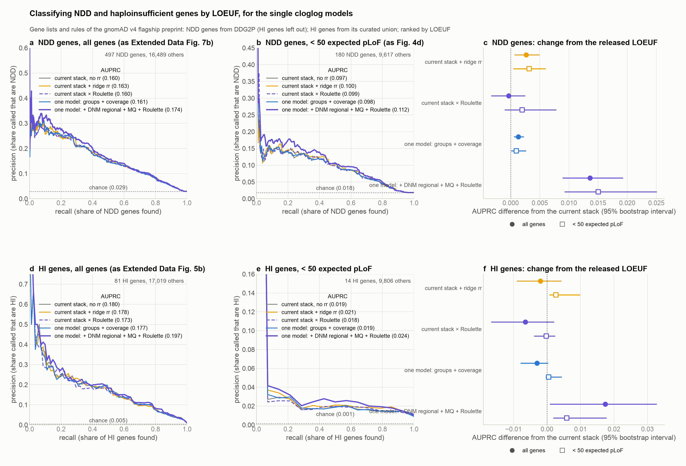

- **NDD and HI precision-recall.** These use the flagship preprint's gene lists and rules, on autosomal MANE Select transcripts with a pLoF expected count. That is why the current stack's NDD AUPRC is 0.160 here, not the 0.144 of the release's gene set.
  - Full one model: NDD +0.014 (interval +0.009 to +0.019), and +0.015 for genes with under 50 expected pLoF; HI +0.017 (+0.001 to +0.033). ClinGen HI AUC goes from 0.868 to 0.874.
  - Groups + coverage: NDD +0.001. Ridge rr: +0.003. Stack × Roulette: no change.
  - **Most of the gain is the window MQ term.** MQ alone gives NDD +0.012. It moves 101 genes out of the most constrained LOEUF decile, and 93% of them carry the release's `low_exome_mapping_quality` flag; their LOEUF about doubles.
  - With QC-flagged genes left out, the full model's gain shrinks to NDD +0.004 (+0.001 to +0.008) and HI +0.005 (−0.009 to +0.018). The ridge rr is at +0.003 and −0.002.
  - So the one model mostly does, on a continuous scale, what the mapping-quality flag does by hand, plus a small gain from the regional and Roulette terms.

## Problems with the current expected counts, and what each fix does

"Current" is the v4.1.1 expected count with no regional correction: possible variants × stored plateau line × coverage model. Each fix is scored on the exported MANE Select synonymous cells:

- the one models out of fold;
- the plateau versions applied as in the pipeline test;
- rr and Roulette from the full run.

The pLoF side effect and the NDD ranking come from the pLoF runs. For the one models, rr and Roulette that is the exported cells; for the plateau versions it is the pipeline runs. The weighted plateau wasn't run through the pipeline (n/t).

Each verdict is the share of the current gap to the target that the fix closes: yes is at least 80%, partly 20–80%, no −10% to 20%, and worse means the gap grows by more than 10%. 1M = one model; full = + DNM regional + MQ + Roulette. The table and its data come from `followup/one_model_issues.py`.

| Problem (metric) | Current | Ridge rr | × Roulette | × Roulette + ridge | Plateau: weighted | Plateau: saturating | Plateau: logistic | Plateau: per substitution | 1M: groups + coverage | 1M: + MQ | 1M: + DNM regional + MQ | 1M: + gnomAD regional + MQ | 1M: full |
|---|---|---|---|---|---|---|---|---|---|---|---|---|---|
| Synonymous level is off 1 (total obs/exp) | 1.015 | no | worse | worse | yes | yes | yes | yes | yes | yes | yes | yes | yes |
| Contexts are offset from each other (weighted SD of the 32 contexts' obs/exp) | 6.7% | no | partly | partly | no | no | worse | partly | partly | partly | partly | partly | partly |
| Low coverage is miscalibrated (obs/exp at AN 20–49% / 80–89%) | 1.34 / 0.95 | no | no | no | no | no | no | no | yes | yes | yes | yes | yes |
| Regional variation: per-gene noise (noise, core / no QC flag (1 = Poisson)) | 2.91 / 3.54 | partly | partly | partly | no | no | no | no | no | no | partly | partly | partly |
| Maternal hotspot regions run high (control genes' obs/exp, highest region (8p)) | 1.32 | partly | partly | yes | no | no | no | no | no | no | partly | partly | partly |
| Least constrained LOEUF decile runs high (obs/exp in decile 10 minus deciles 1–6) | +0.110 | partly | partly | partly | no | no | no | no | no | no | partly | partly | partly |
| Outliers with no QC flag (genes with \|z\| > 8) | 86 | partly | yes | yes | no | no | no | no | no | no | partly | partly | yes |
| Low-mapping-quality genes look depleted (flagged genes with z < −8) | 132 | no | no | no | no | no | no | no | no | yes, overshoots | yes, overshoots | yes, overshoots | yes, overshoots |
| Histone genes run high (outliers) | 24 | no | no | no | no | no | no | no | no | no | no | no | no |
| *Side effect:* pLoF expected vs synonymous | 0 | +0.7% | +3.6% | +4.4% | n/t | +0.9% | -1.9% | +3.6% | +3.0% | +3.0% | +3.1% | +4.3% | +7.1% |
| *Outcome:* NDD AUPRC change | 0 | +0.003 | -0.000 | +0.002 | n/t | +0.001 | -0.000 | -0.000 | +0.001 | +0.012 | +0.014 | +0.017 | +0.014 |

#### Synonymous level

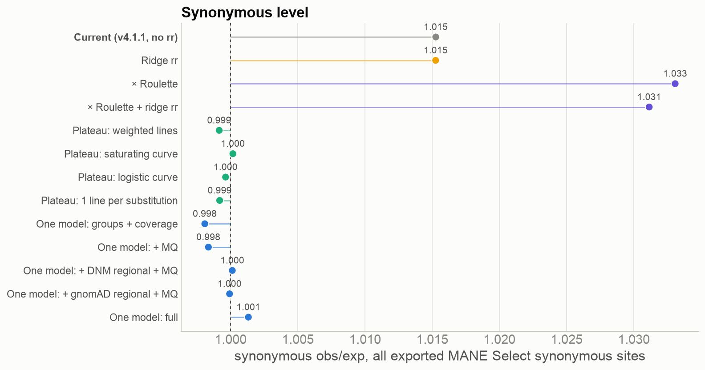

Currently 1.015. rr is normalized per context, so it keeps the level; Roulette raises it to 1.033. Every plateau version and every one model brings it to 1.000 ± 0.002.

#### Offsets between contexts

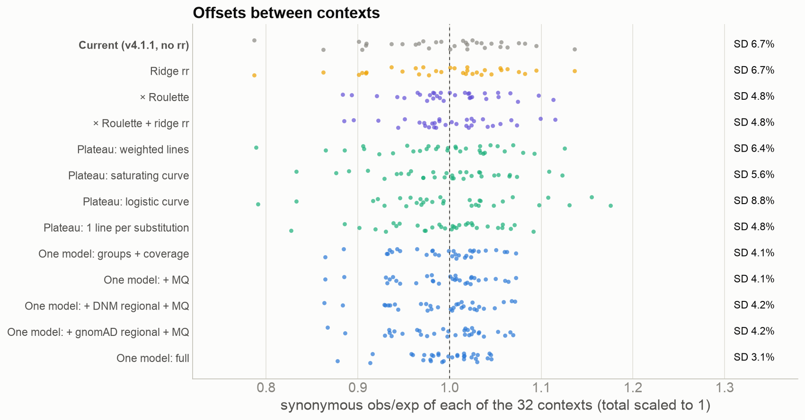

The weighted SD across the 32 contexts is 6.7% now. Among the plateau versions:

- one line per substitution type: 4.8%;
- the saturating curve: 5.6%;
- weighted lines: 6.4%;
- the logistic curve: 8.8%, which is worse.

Roulette gives 4.8%. The one models give 4.1–4.2%, and the full model 3.1%.

#### Low-coverage calibration

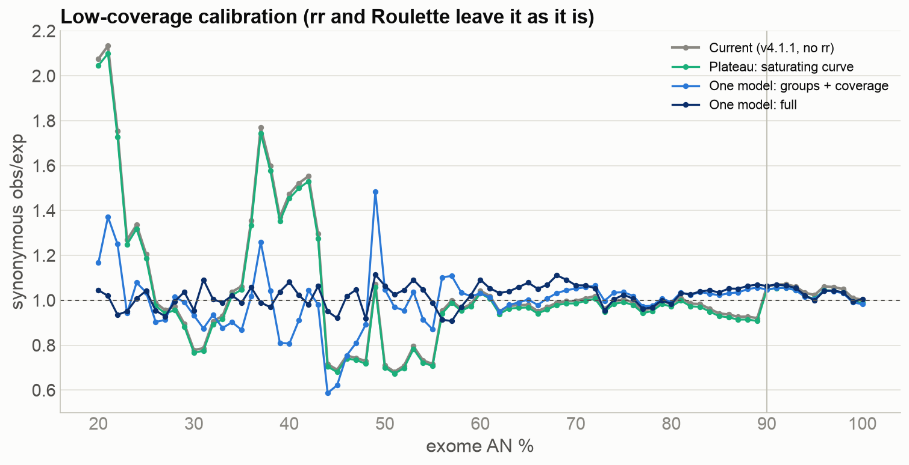

Currently obs/exp is 1.34 at AN 20–49% and 0.95 at 80–89%. rr, Roulette and the plateau versions all keep the coverage model, so they stay at 1.32–1.34 and 0.90–0.95.

Every one model brings AN 20–49% to 1.00–1.02, but runs 1.02–1.05 at 80–89%. Below 56%, the individual AN values swing between 0.59 and 1.48 with groups + coverage (0.68–2.13 now). With the MQ and regional terms in, the full model narrows that to 0.92–1.11.

#### Regional variation: per-gene noise

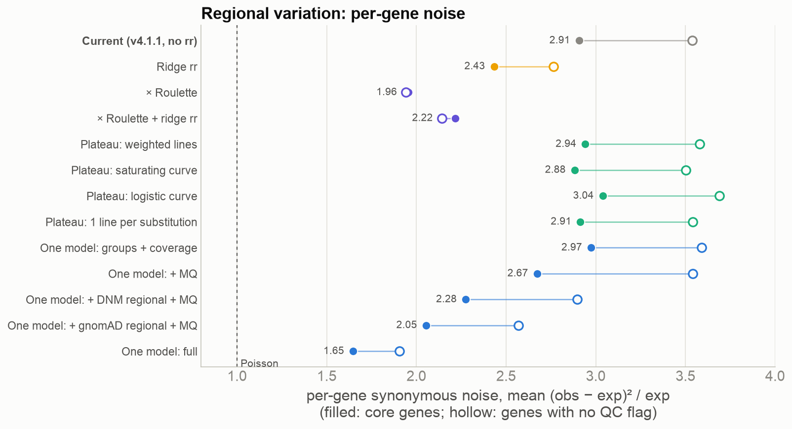

Currently 2.91 on core genes and 3.54 on genes with no QC flag.

- Ridge rr: 2.43 / 2.76.
- × Roulette: 1.96 / 1.94.
- Full one model: 1.65 / 1.91.

The plateau versions and groups + coverage don't change it.

#### Maternal hotspot regions

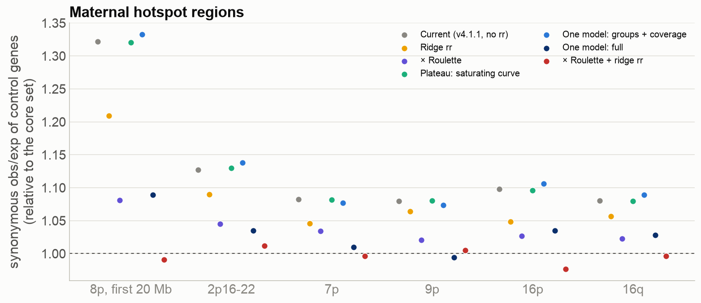

8p's control genes run at 1.32 now. They are at 1.21 with the ridge, 1.08 with × Roulette, 0.99 with × Roulette + ridge, and 1.09 with the full one model. The plateau versions and groups + coverage leave 8p at 1.32–1.33.

#### Rise in the least constrained LOEUF decile

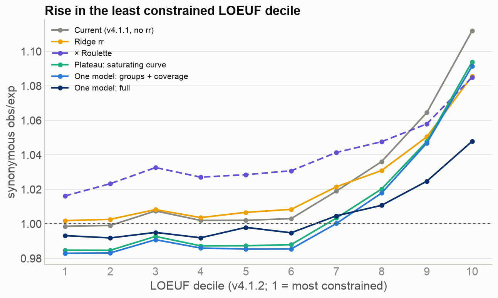

Decile 10 runs 0.110 above deciles 1–6 now. That drops to 0.080 with the ridge, 0.059 with × Roulette, 0.028 with × Roulette + ridge, and 0.054 with the full one model. The plateau versions and groups + coverage move the whole curve but keep the rise (0.106–0.111).

#### Outliers with no QC flag

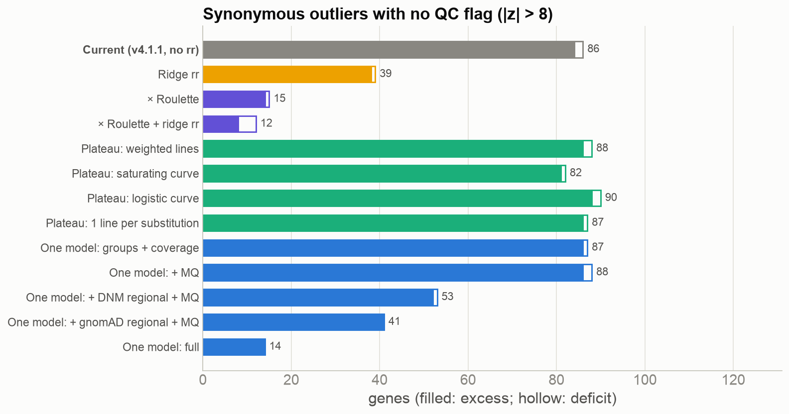

86 now. 39 with the ridge, 15 with × Roulette, 12 with × Roulette + ridge, and 14 with the full one model. The plateau versions and groups + coverage leave 82–90.

#### Genes with low mapping quality

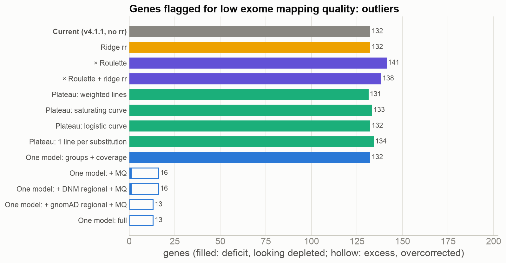

132 flagged genes are deficit outliers now, and every fix without the MQ term keeps them. With the MQ term, 0–1 remain, but 13–15 of these genes become excess outliers instead.

#### Histone genes

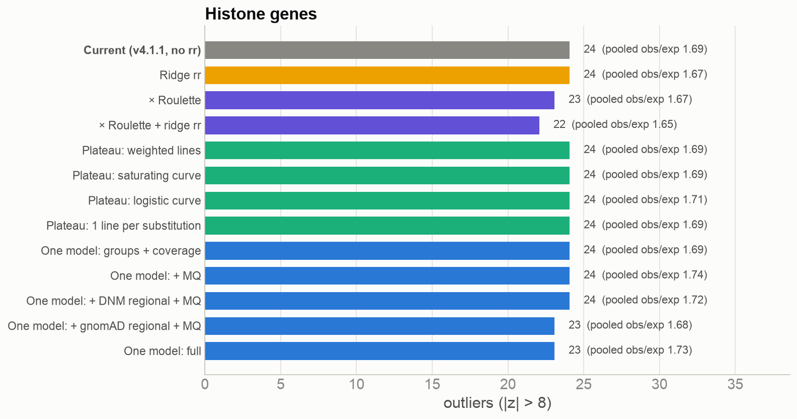

There are 22–24 histone outliers under every fix, with pooled obs/exp 1.65–1.74. None of the fixes targets them.

#### Side effects on pLoF and missense, and the NDD ranking

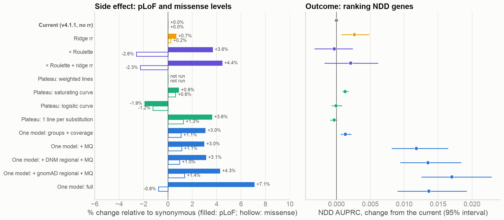

These are relative to synonymous. Expected pLoF moves from −1.9% (logistic plateau) to +7.1% (full one model), and missense from −2.6% (× Roulette) to +1.4%. NDD AUPRC improves only with the MQ term (+0.012 to +0.017); everything else stays within ±0.003. With QC-flagged genes left out, most of that gain goes (see the pLoF section above).

## What to do next

- **Promising:**
  - **Groups + coverage in one cloglog fit, in place of the plateau and coverage models.** It fixes the synonymous level (1.015 → 1.00), halves the spread between contexts and brings low-coverage obs/exp near 1 (1.34 → 1.02 at AN 20–50%), with no cost in noise. The per-variant expected Table stays. This is the cheapest change.
  - **Roulette as an offset in the same fit, with the DNM regional term.** It does best on noise (1.65 core, 1.91 outcome-free) and on strength (0.97), with 14 outliers without a QC flag. Only stack × Roulette + ridge does better in the hotspot regions (8p at 0.99 against 1.09), and that combination is too strong overall. It also sets the strengths of Roulette and the regional term itself, instead of by hand.
- **Fix regardless:** the coverage model. Weight its fit, fit it relative to the plateau rather than to μ, and don't let it go above 1, or use the fit's coverage term. The blocks below 56% AN still need a flag or a coarser treatment.
- **Worth a closer look:** window MQ. Most of the NDD and HI gain comes from it, because it stops genes with low mapping quality looking constrained. It works like a continuous version of the `low_exome_mapping_quality` flag. On synonymous variants it overcorrects 13–15 genes.
- **Not promising:** a regional term fit on gnomAD, which is gnomAD fitting gnomAD and can't be checked with synonymous variants. Also the logistic plateau.
- **Next step:** decide how far pLoF expected can move relative to synonymous (+3% with groups + coverage, +7% with the full model), and whether the MQ term should replace the mapping-quality flag. Then build the chosen model into the pipeline as per-variant multipliers, for missense z and a release.
