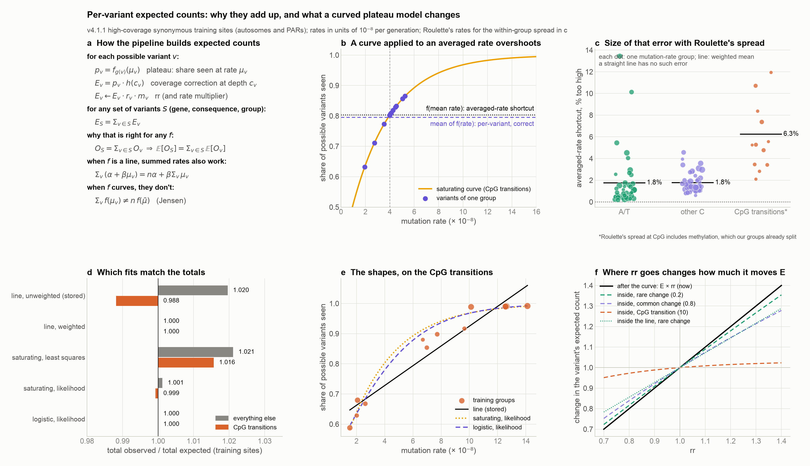
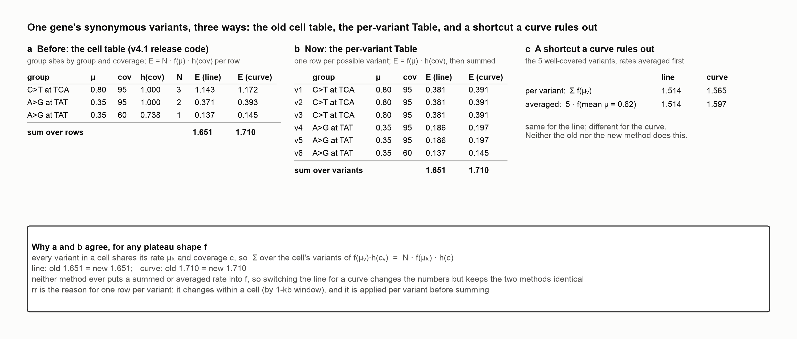

# Per-variant expected counts and the plateau model (2026-11-05)

A companion note to [the synonymous-DNM rr report](rr_syn_dnm_followup.md#questions-from-the-slack-thread-answered) (the question "Why does synonymous obs/exp sit a little above 1 under every rr?"). It works through why the pipeline's per-variant expected counts can be summed over any set of variants, why they equal what the old cell-table method gave, what changes if the plateau model becomes a curve instead of a straight line, how the fitting method decides whether total expected matches total observed, and where rr can go.

*Figure 1. The math, the averaged-rate error, the fits and where rr goes.*

## How the pipeline builds expected counts (Figure 1a)

For each possible variant $v$ (one row of the per-variant expected Table), with mutation rate $\mu_v$ (from its context, ref, alt and methylation level), exome depth $c_v$, rr $r_v$ and, in the rate versions, a per-variant rate multiplier $m_v$:

$$p_v = f_{g(v)}(\mu_v), \qquad E_v = p_v \, h(c_v) \, r_v \, m_v$$

- $f_g$ is the plateau model of the variant's model group $g$ (CpG transitions, or everything else): the expected share of possible variants seen at that rate. Now it is a straight line, $f_g(\mu) = \alpha_g + \beta_g \mu$.
- $h(c)$ is the coverage correction: 1 at high coverage, and the coverage model's value below it.
- `apply_models` in gnomad_methods computes $p_v$ and $E_v$ row by row; rr and the multiplier are applied in `--aggregate-per-variant-expected`.

The expected count of any set of variants $S$ (a gene, a consequence, a constraint group) is then

$$E_S = \sum_{v \in S} E_v .$$

## Why summing is right for any plateau shape

The observed count of a set is the sum of its variants' observed counts, $O_S = \sum_{v \in S} O_v$, and the expectation of a sum is the sum of the expectations:

$$\mathbb{E}[O_S] = \sum_{v \in S} \mathbb{E}[O_v] = \sum_{v \in S} E_v .$$

Nothing here depends on $f$ being a line. A saturating, logistic or exponential plateau model gives each variant its own $E_v$ from its own rate, and those $E_v$ add up over any set exactly as now.

## Before and after the per-variant Table: the same numbers

*Figure 2. A worked example with one gene's six synonymous variants.*

**Before (the v4.1 release code).** [`apply_models`](https://github.com/broadinstitute/gnomad-constraint/blob/ea777325322d7f349a8db77007ba715cf24102d7/gnomad_constraint/utils/constraint.py#L374-L626) in gnomad-constraint `main`, with [`compute_expected_variants`](https://github.com/broadinstitute/gnomad_methods/blob/017ee36ff05e39323189d0031acb5b35e6be2082/gnomad/utils/constraint.py#L1333-L1390) in gnomad_methods:

1. Each possible variant is exploded into its (transcript, consequence group) rows.
2. The sites are counted per cell: $N_{t,k,c}$ is the number of possible variants in transcript-and-consequence group $t$ that belong to mutation-rate group $k$ (context, ref, alt, methylation level) and have coverage $c$. Every one of them has the same rate $\mu_k$.
3. Each cell gets $N_{t,k,c} \, f_{g(k)}(\mu_k) \, h(c)$: the plateau model at the cell's own rate (`ppo_expr = mu_expr * slope + intercept`), times the coverage correction, times the count.
4. The cells are summed over $k$ and $c$ (`group_by` the grouping without coverage):

$$E_t^{\text{old}} = \sum_{k}\sum_{c} N_{t,k,c} \, f_{g(k)}(\mu_k) \, h(c) .$$

**Now (the per-variant Table).** Each possible variant $v$ gets its own expected count, and the rows of $t$ are summed:

$$E_t^{\text{new}} = \sum_{v \in t} f_{g(v)}(\mu_v) \, h(c_v) .$$

**Why they are the same.** Split the variants of $t$ by cell: $t = \bigcup_{k,c} S_{t,k,c}$, where $S_{t,k,c}$ holds the $N_{t,k,c}$ variants of group $k$ at coverage $c$. Inside a cell every variant has $\mu_v = \mu_k$ and $c_v = c$, so each term of the new sum is the same number, $f(\mu_k)\,h(c)$:

$$E_t^{\text{new}} = \sum_{k,c} \ \sum_{v \in S_{t,k,c}} f(\mu_k)\,h(c) = \sum_{k,c} N_{t,k,c} \, f(\mu_k)\,h(c) = E_t^{\text{old}} .$$

Figure 2 works one gene through both (a, b): 1.651 expected with the line and 1.710 with the saturating curve, the same either way.

**Why a curve keeps the new method valid.** Nothing in that argument uses the form of $f$. It only uses the fact that $f$ is evaluated at a single variant's (or a cell's) own rate, never at a rate summed or averaged over several groups. The old method never did that either: its docstring describes summing "possible variants × mutation rate" first, but the code applies the line to each row's own `mu_snp` and then multiplies by that row's count. So:

- with a line or a curve, the old cell table and the new per-variant Table give identical expected counts;
- switching the plateau model from a line to a curve changes the numbers, but not this equality, so there is no reason to go back to the cell table;
- what the curve does rule out is a shortcut neither method takes: averaging rates across groups before applying $f$ (Figure 2c, and the next section).

**What the per-variant Table adds.** rr changes within a cell, because it depends on each site's 1-kb window. The per-variant Table applies it site by site, $E_v = f(\mu_v)\,h(c_v)\,r_v$, before summing. The cell table could only match that by adding the window to the cell key. Because rr multiplies after $f$, it could also use each cell's mean rr, since $\sum_{v \in S} f(\mu_k)h(c)\,r_v = N f(\mu_k)h(c)\,\bar r_S$. If rr went inside the curve, as $f(\mu_v r_v)$, cells would have to be split by window.

## Where the shape does matter: summed or averaged rates (Figure 1b, c)

With a straight line, summing the rates first gives the same answer, because the line is linear in $\mu$:

$$\sum_{v \in S} (\alpha + \beta \mu_v) = n\alpha + \beta \sum_{v \in S} \mu_v .$$

With a curve it doesn't. For a concave curve (one that levels off, as the share seen does), Jensen's inequality gives

$$n \, f(\bar\mu) \ \ge \ \sum_{v \in S} f(\mu_v), \qquad \bar\mu = \tfrac{1}{n}\textstyle\sum_v \mu_v ,$$

and to second order the shortcut overstates the expected count by about $-\tfrac{1}{2} f''(\bar\mu) \sum_v (\mu_v - \bar\mu)^2$. For the saturating curve $f(\mu) = 1 - e^{-(a + b\mu)}$, $f''(\mu) = -b^2 e^{-(a + b\mu)}$, which is largest where the curve bends.

- **The pipeline never does this.** Every variant in a mutation-rate group (context, ref, alt, methylation level) has the same rate, so there is nothing to average, and the curve is evaluated per variant anyway.
- **It would matter if rates varied within a group.** For example, if Roulette's per-variant rates were fed into the plateau model instead of being multiplied on afterwards. Panel c puts Roulette's spread within each trinucleotide change around each group's rate: the averaged-rate shortcut would come out about 1.8% too high outside CpG (up to 13% in the most variable A/T group), and about 6% at CpG transitions (an overestimate, because Roulette's spread there includes methylation, which our groups already split). So a curve would have to be fit, and applied, on per-variant rates in that case. The current Roulette versions multiply after the plateau model, which is linear in $m_v$, so they aren't affected.

## Fitting: which fits match total observed (Figure 1d, e)

The plateau model is fit on the training sites summed per mutation-rate group $k$: $O_k$ observed out of $N_k$ possible, all at rate $\mu_k$. Because every variant in a group shares $\mu_k$, a fit on the group totals is the same as a fit on the individual variants: the binomial likelihood of the variants is, up to a constant, $\prod_k \binom{N_k}{O_k} p_k^{O_k} (1-p_k)^{N_k - O_k}$ with $p_k = f(\mu_k)$.

Whether total expected equals total observed depends on how the curve is fit:

- **Weighted least squares on the shares, with an intercept** ($y_k = O_k / N_k$, weights $N_k$): the normal equation for the intercept is $\sum_k N_k (y_k - \hat y_k) = 0$, that is $\sum_k O_k = \sum_k N_k \hat p_k$. Totals match exactly.
- **A binomial likelihood with the canonical (logit) link and an intercept** (or a Poisson likelihood with a log link): the score equation for the intercept is again $\sum_k (O_k - N_k \hat p_k) = 0$. Totals match exactly.
- **Unweighted least squares** (the stored models, and `build_models(weighted=False)`): the intercept's equation is $\sum_k (y_k - \hat y_k) = 0$, which matches the plain average of the shares, not the totals. Hence the 1.6% offset.
- **A likelihood fit with a non-canonical link**, like the saturating curve $1 - e^{-\eta}$: no such identity, so the totals are close but not exact.

| Fit | Everything else | CpG transitions | Both |
|---|---|---|---|
| Line, unweighted (stored) | 1.020 | 0.988 | 1.016 |
| Line, weighted | 1.000 | 1.000 | 1.000 |
| Saturating, least squares | 1.021 | 1.016 | 1.021 |
| Saturating, likelihood | 1.001 | 0.999 | 1.001 |
| Logistic, likelihood | 1.000 | 1.000 | 1.000 |

Total observed / total expected on the training sites. Panel e shows the three shapes on the CpG transitions, where the curvature is clearest.

## Where rr goes (Figure 1f)

rr can multiply the calibrated expected count afterwards (as now), or raise the rate inside the plateau model:

$$\text{after:}\ E_v = f(\mu_v)\, h(c_v)\, r_v \qquad\qquad \text{inside:}\ E_v = f(\mu_v r_v)\, h(c_v)$$

- **After:** a 10% higher rr gives 10% more expected, at every site.
- **Inside a line:** $f(\mu r)/f(\mu) = (\alpha + \beta \mu r)/(\alpha + \beta\mu)$, so the intercept damps rr, most at low rates.
- **Inside a curve:** it is damped further where the curve levels off. At CpG transitions, which are close to saturated, rr barely moves the expected count.
- **Both stay per variant,** so both still sum. The "inside" version would need rr renormalized on the resulting expected counts rather than on $E_v$ before rr. The closest local test, applying rr before saturation, made rr weaker and slightly worse (see [the rr report](rr_syn_dnm_followup.md#the-training-background-what-the-dnms-are-compared-with)).

## In short

- The per-variant Table gives exactly the expected counts the old cell table did, because every variant in a cell shares its rate and coverage. That stays true with a curved plateau model, so there is no reason to go back to the cell table.
- The per-variant expected Table, and summing it over any set of variants, stays valid whatever the plateau model's shape, because each variant's expected count comes from its own rate.
- What a curve rules out is shortcuts that apply it to a summed or averaged rate. The pipeline doesn't take any, and the plateau training groups share a rate, so fitting on them is exact.
- To keep total expected equal to total observed, fit by weighted least squares or by a likelihood with a canonical link (logit or log), with an intercept.

Code: [per_variant_expected.py](followup/per_variant_expected.py) (fits and the Roulette spread; the training groups come from [plateau_models.py](followup/plateau_models.py)), figures drawn by [make_followup_figures.py](followup/make_followup_figures.py) `draw_per_variant_math` and `draw_old_vs_new_expected` (the worked example uses the stored non-CpG line, the saturating fit and the v4.1.1 coverage model). Results: [per_variant_expected.totals.tsv](followup/per_variant_expected.totals.tsv), [per_variant_expected.jensen.tsv](followup/per_variant_expected.jensen.tsv).
