# Synonymous-DNM regional rate (rr): where things stand (2026-11-04)

## Contents

- [Resources](#resources)
- [Summary](#summary)
  - [The problem, in plain terms](#the-problem-in-plain-terms)
  - [Recommendation](#recommendation)
  - [What a good outcome looks like](#what-a-good-outcome-looks-like)
  - [Next steps for the team](#next-steps-for-the-team)
  - [Remaining decisions](#remaining-decisions)
- [Questions from the Slack thread, answered](#questions-from-the-slack-thread-answered)
- [How rr works](#how-rr-works)
  - [Pipelines at a glance](#pipelines-at-a-glance)
  - [How the rr model works](#how-the-rr-model-works)
  - [The regional features rr uses](#the-regional-features-rr-uses)
- [Results](#results)
  - [How each version performs](#how-each-version-performs)
  - [The training background: what the DNMs are compared with](#the-training-background-what-the-dnms-are-compared-with)
    - [Removing poorly covered or mapped genes from training](#removing-poorly-covered-or-mapped-genes-from-training)
  - [What the leftover noise is](#what-the-leftover-noise-is)
  - [The synonymous outliers](#the-synonymous-outliers)
    - [What explains them besides size](#what-explains-them-besides-size)
    - [Why the histone genes are outliers, and whether rr can capture them](#why-the-histone-genes-are-outliers-and-whether-rr-can-capture-them)
- [Scripts, figures and tables](#scripts-figures-and-tables)
- [Still worth trying or looking at](#still-worth-trying-or-looking-at)

## Resources

- **Ruchit's reports and their Slack threads:**
  - [`rr_syn_dnm_report.html`](ruchit_reports/rr_syn_dnm_report.html) (v1, 10/16): [Slack thread](https://atgu.slack.com/archives/C07NGV3UQKA/p1792179470507199)
  - [`rr_syn_dnm_report.v2.html`](ruchit_reports/rr_syn_dnm_report.v2.html) (10/19–21): [Slack thread](https://atgu.slack.com/archives/C07NGV3UQKA/p1792615503898679)
  - [`rr_followup_tests_report.html`](ruchit_reports/rr_followup_tests_report.html) (10/27): [Slack thread](https://atgu.slack.com/archives/C07NGV3UQKA/p1793130471776509?thread_ts=1793122617.080069&cid=C07NGV3UQKA)
  - GitHub shows HTML as source; download a file and open it in a browser to read it.
- **Code, figures and tables for this report:** [Scripts, figures and tables](#scripts-figures-and-tables).

## Summary

### The problem, in plain terms

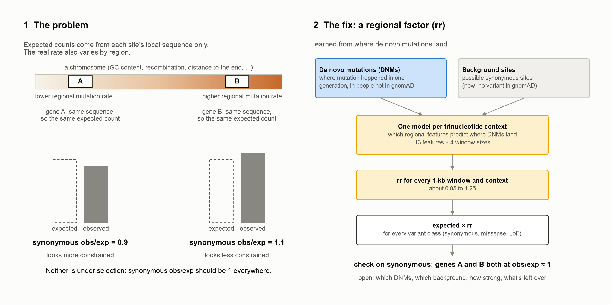

- Constraint compares how many variants we **observe** in a gene with how many we **expect** without selection.
- The expected count comes from a mutation model that only looks at each site's immediate sequence: the base, its two neighbors, and CpG methylation.
- Mutation rates also vary by **region**, with GC content, recombination and similar features. The model ignores this. Genes in more mutable regions therefore look less constrained than they are, and genes in less mutable regions look more constrained.
- Synonymous variants are the test, because they are nearly neutral and their obs/exp should be about 1 in every gene. It isn't:
  - genes scatter far more than chance allows (mean z² ≈ 2.9, where chance alone gives at most 0.7)
  - about 270 genes are extreme outliers, roughly half of them known mapping artifacts
- **The fix under test:** multiply each site's expected count by a **regional factor (rr)**, learned from where de novo mutations land. The open question is which rr to use, and how to apply it.

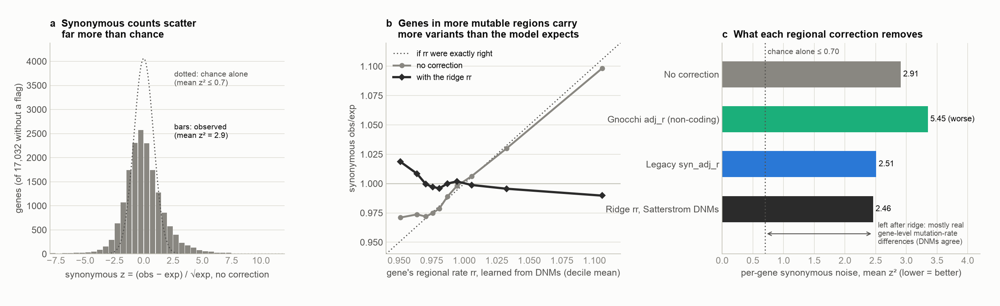

- **a.** Across 17,032 genes without a flag, the variance of synonymous z is about four times what chance allows.
- **b.** Genes binned by the regional rate the rr predicts from DNMs: without a correction, obs/exp follows that rate almost exactly (0.97 to 1.10). With the ridge rr it is flat.
- **c.** Gnocchi `adj_r` makes the noise worse. The synonymous rr versions remove about a fifth of the excess above chance. Most of what is left is real gene-level mutation-rate variation that the regional features can't see (see [What explains them besides size](#what-explains-them-besides-size)).

### Recommendation

Use a ridge-penalized rr trained on the Satterstrom DNMs, normalized per context, with no rr on chrX/Y, and leave genes with a QC flag out of training. Then confirm it with one full pipeline run. It's the black "Ridge, Satterstrom" series in every figure.

1. **Fit rr with a ridge penalty instead of a Bonferroni screen and a strength α.**
   - **How it works:** every feature goes in, and the penalty decides how much each one counts. The penalty is chosen on held-out DNMs only, with no gnomAD data.
   - **Lowest noise of the DNM-based options:** 2.46, against 2.51 for legacy `syn_adj_r`, 2.56–2.70 for Ruchit's tables, and 2.50 for [his latest pick](ruchit_reports/rr_followup_tests_report.html) (1e-2 cutoff, α 0.625).
   - **No α needed:** its calibration slope is 0.86, and adding α would gain under 1%.
   - **The DNM set stops mattering:** with ridge, the two sets perform the same.
   - **In the code:** there is no p-value cutoff to choose. In the pipeline the ridge fit is selected by passing `ridge` to `--feature-pval-cutoffs`, the argument that otherwise takes the cutoffs. It is on [`jg/rr_ridge_fit`](https://github.com/broadinstitute/gnomad-constraint/tree/jg/rr_ridge_fit), with a per-site penalty of 0.3 ([`RR_RIDGE_PENALTY`](../../resources/constants.py)). That value gave the lowest held-out DNM log loss for both DNM sets. If the training background changes, retune it.
2. **Train on the Satterstrom DNMs.** They have more DNMs, more on chrX, and newer annotation. The ~300 that differ from the old file are annotation changes, so no union is needed. They only looked worse because of the fitting rule; with ridge the two sets perform the same (see [the question on why more DNMs did worse](#dnm-sets-details)).
3. **Normalize rr per context.** Expected counts are already calibrated to exome synonymous sites. Raw rr adds about 1.4% to every gene, LoF included, and gains nothing in return.
4. **No rr on chrX/Y.** The best option there lowers noise by under 1%, and correcting only some contexts is hard to explain. Revisit this if the missing features can be recovered.
5. **Keep the training background, but leave genes with a QC flag out of training.** Switching the background to all sites made noise slightly worse. Dropping the flagged genes' DNMs and background sites gave a small, consistent gain (held-out noise 2.524 → 2.513 locally).
   - **The full pipeline run confirms it for ridge, but the gain is small:** noise 2.458 → 2.451, held-out noise 2.476 → 2.471 and outcome-free noise 2.773 → 2.762. For the current method it is mixed (see [How each version performs](#how-each-version-performs)).
   - **Confirmed in the pipeline:** no other background does clearly better. One row per variant with a penalty per DNM is a small further gain (held-out noise 2.476 → 2.441); see [The training background](#the-training-background-what-the-dnms-are-compared-with).
6. **Confirm it in the pipeline, then do one full run.** These results come from a local re-implementation on Ruchit's exports, which reproduces his numbers exactly.
   - **Done:** the rr pipeline (Bonferroni, 1e-2 and ridge; with and without the QC-flagged genes), and the constraint pipeline through the release for ridge and the current method, each with and without the exclusion, plus a run without rr.
   - The pipeline's rr tables reproduce the local numbers: for ridge, noise 2.458 against 2.46 and slope 0.86 against 0.86. Through the constraint pipeline, ridge still has the lowest noise, and LOEUF separates the ClinGen haploinsufficient genes as well as without rr (see [How each version performs](#how-each-version-performs)).

**Not worth the effort:**
- **The top-LOEUF-decile rise:** it mostly comes from how LOEUF sorts genes. Binned by s_het, the top decile reaches only 1.04.
- **The ~130 deficit outliers:** they are flagged mapping artifacts.
- **Other training backgrounds:** all sites, sampling by context, reweighting, and applying rr before saturation all did the same or slightly worse (see [The training background](#the-training-background-what-the-dnms-are-compared-with)).
  - **Confirmed in the pipeline:** all sites is worse (held-out noise 2.54 against 2.48), and sampling by context or one row per variant changes little.

### What a good outcome looks like

Nobody has written these down as a formal bar; they are the checks Ruchit's reports and the Slack threads have used ([initial report](https://atgu.slack.com/archives/C07NGV3UQKA/p1792179470507199), [first follow-up](https://atgu.slack.com/archives/C07NGV3UQKA/p1792615503898679), [second follow-up](https://atgu.slack.com/archives/C07NGV3UQKA/p1793130471776509?thread_ts=1793122617.080069&cid=C07NGV3UQKA)). All three options use the Satterstrom DNMs.

| # | The rr should… | Measured by | Current method (Bonferroni screen, no penalty) | Ruchit's latest pick (1e-2 cutoff, α 0.625) | Recommended: ridge |
|---|---|---|---|---|---|
| 1 | Not shift the overall level that the model calibration sets | mean rr over exome synonymous sites = 1 | Yes if normalized; raw rr raises every expected count by about 1.4% | Yes (normalized) | Yes (normalized) |
| 2 | Reduce per-gene noise | mean z² (no correction: 2.91) | 2.65 | 2.49 | **2.45** |
| 3 | Remove synonymous outliers without creating new ones | outliers in all genes (in genes without a QC flag); no correction: 270 (123) | 226 (79) | 221 (74) | **218 (71)** |
| 4 | Not overcorrect: genes rr calls more mutable really do carry more variants | calibration slope, 1 = right strength | 0.61, too strong | 0.82 | **0.86**; adding α gains nothing |
| 5 | Hold up on chromosomes it wasn't trained on | noise with models fit on the other chromosome half | 2.70 | 2.50 | **2.47** |
| 6 | Leave LoF and missense metrics sensible: LOEUF still separates known haploinsufficient genes, flags look reasonable | full pipeline run, compared with the run without rr | Yes: ClinGen AUC 0.867 → 0.870, LOEUF rank correlation 0.986; LoF expected −2.5% | Not run (α can't be applied in the pipeline) | **Yes:** ClinGen AUC 0.867 → 0.870, LOEUF rank correlation 0.992; LoF expected −1.1% |
| 7 | Be simple to explain and maintain | settings to choose and defend | one (the cutoff), but too strong without α | two (the cutoff and α) | none; the penalty is set on held-out DNMs |

Rows 2–5 come from the full run's rr tables, scored on Ruchit's exported synonymous counts: the current method trained on all genes, Ruchit's pick as the 1e-2 table with α 0.625 applied to the counts, and ridge with the QC-flagged genes left out. Row 6 comes from the constraint pipeline run through the release (see [How each version performs](#how-each-version-performs)). Gnocchi `adj_r` fails rows 2 and 4 (noise 5.45, slope 0.26).

Sources:
- Ruchit's reports and their Slack threads:
  - initial report: [`rr_syn_dnm_report.html`](ruchit_reports/rr_syn_dnm_report.html) (v1, 10/16), [Slack thread](https://atgu.slack.com/archives/C07NGV3UQKA/p1792179470507199)
  - first follow-up: [`rr_syn_dnm_report.v2.html`](ruchit_reports/rr_syn_dnm_report.v2.html) (10/19–21), [Slack thread](https://atgu.slack.com/archives/C07NGV3UQKA/p1792615503898679)
  - second follow-up: [`rr_followup_tests_report.html`](ruchit_reports/rr_followup_tests_report.html) (10/27), [Slack thread](https://atgu.slack.com/archives/C07NGV3UQKA/p1793130471776509?thread_ts=1793122617.080069&cid=C07NGV3UQKA)
- the 10/1 investigation report, `investigation/adj_r_investigation_report.md` on `jg/adj_r_syn_oe_analysis`
- [`rp/add_mu_adjustment`](https://github.com/broadinstitute/gnomad-constraint/tree/rp/add_mu_adjustment) at [`53a8f1d`](https://github.com/broadinstitute/gnomad-constraint/commit/53a8f1d)

### Next steps for the team

1. **Normalize rr per context** (Ruchit's open question).
   - Normalization changes only the overall level, not the noise: level-free dispersion for legacy is 4.378 raw and 4.373 normalized.
   - Raw rr averages about 1.014 over exome synonymous sites, so it raises every gene's expected count by about 1.4%, LoF and missense included. That shifts LOEUF for every gene.
   - Synonymous obs/exp by decile can't settle it. Whether the constrained deciles sit at 1.00 or 1.01 depends on which flagged genes are dropped (panel g in [How each version performs](#how-each-version-performs)), and normalization only moves the whole curve by about 1.3%.
   - Raw rr only looks better because uncorrected synonymous obs/exp is 1.015 overall, driven by the least constrained genes. That offset belongs in the model calibration, not in rr.

2. **Adopt the ridge fit in place of the cutoff and strength α.**
   - **Done in the full run:** `regional_rate_pipeline.py` fit three versions side by side on the Satterstrom DNMs, under `gs://gnomad-tmp/jg/rr_full`: the current method (Bonferroni cutoff), Ruchit's latest pick (1e-2 cutoff) and ridge (no cutoff). The pipeline picks all three through one argument, `--feature-pval-cutoffs bonferroni 1e-2 ridge`, where `ridge` means no p-value screen at all. Ridge has the lowest noise of the three, on all chromosomes (2.46) and held out (2.48).
   - Legacy `syn_adj_r` had no strength adjustment, as Kaitlin pointed out; α was introduced in the 10/1 investigation report. The ridge fit makes α unnecessary with either DNM set (see the [strength question](#strength-details)).
   - Run [`regional_rate_pipeline.py`](../../pipeline/regional_rate_pipeline.py) with the ridge fit (`--feature-pval-cutoffs ridge`; ridge has no p-value cutoff, it is just chosen through this argument) on the Satterstrom DNMs, and rerun the pipeline's own evaluation (`--evaluate-rr-cutoffs`, `--compare-rr-variants`) to confirm the local numbers.
   - The requested per-variant version of the strength figure is in [Ruchit's v2 report](ruchit_reports/rr_syn_dnm_report.v2.html), section 9, which applies α per site and gets the same α (0.75 for legacy).

3. **Leave genes with a QC flag out of rr training.** In the pipeline, the cleaner version filters the training DNMs and background on gnomAD AN and mapping quality at each site (see [Removing poorly covered or mapped genes from training](#removing-poorly-covered-or-mapped-genes-from-training)).
   - **Done in the full run:** the same run with `--exclude-qc-flagged-genes`, under `gs://gnomad-tmp/jg/rr_full_qcexcl`. It is a small gain for ridge (2.458 → 2.451) and mixed for the current method. This uses gene flags; the site-level filter isn't tested.

4. **Count outliers on genes without a QC flag.**
   - About 130 deficit synonymous outliers (obs ≪ exp) are unchanged by every rr option. 129 of them carry `low_exome_mapping_quality`, with median synonymous obs/exp about 0.2. They are segdup and paralog genes such as RIMBP3 and NBPF1.
   - The outlier counts use all 18,406 transcripts, although the dispersion core set already drops flagged genes. On genes without a QC flag, synonymous outliers fall from 123 to 66 with legacy `syn_adj_r`, 71–76 with Ruchit's tables and 71 with the ridge rr, about half. On all transcripts the change looks smaller (270 → 217–219).

5. **Decide chrX/Y.** "No masking" is not the same as "no correction".
   - Unmasked means a partial correction. On X/Y, a context gets rr only if none of its selected features is missing there. With the old DNM set that is 3 of the 13 modeled contexts (ACT, CAC, TCT).
   - The benefit is tiny. Over the 769 X/Y transcripts, level-free dispersion goes from 4.364 to 4.332 unmasked, and masking makes it worse (4.435). So no rr on X/Y costs almost nothing and is the easiest to explain.
   - Six features have no X/Y data: `recomb_male`, `recomb_female`, `met_sperm`, `Nucleosome`, `cDNM_maternal_05M` and `cDNM_paternal_05M` ([`RR_XY_MASKED_FEATURES`](../../resources/constants.py)). Gnocchi's published feature matrix covers chr1–22 only, and Ruchit rebuilt the X/Y features from the source tracks ([`build_xy_features.py`](../../pipeline/build_xy_features.py)).

6. **Open and review a PR for [`rp/add_mu_adjustment`](https://github.com/broadinstitute/gnomad-constraint/tree/rp/add_mu_adjustment).** It touches [#51](https://github.com/broadinstitute/gnomad-constraint/pull/51) and [#55](https://github.com/broadinstitute/gnomad-constraint/pull/55).
   - It is based on [`5bc7d3a`](https://github.com/broadinstitute/gnomad-constraint/commit/5bc7d3a), 22 commits behind [`jg/switch_constraint_to_per_base`](https://github.com/broadinstitute/gnomad-constraint/tree/jg/switch_constraint_to_per_base) ([#51](https://github.com/broadinstitute/gnomad-constraint/pull/51)), so it needs a rebase onto [#51](https://github.com/broadinstitute/gnomad-constraint/pull/51), including the new tests. The release gains `unadj_*` fields, so [`tests/data/constraint_metrics_row_type.txt`](https://github.com/broadinstitute/gnomad-constraint/blob/jg/switch_constraint_to_per_base/tests/data/constraint_metrics_row_type.txt) and [`tests/data/release_tsv_columns.txt`](https://github.com/broadinstitute/gnomad-constraint/blob/jg/switch_constraint_to_per_base/tests/data/release_tsv_columns.txt) have to change.
   - rr is **on by default** in [`--aggregate-per-variant-expected`](../../pipeline/constraint_pipeline.py) ([`--skip-regional-rr`](../../pipeline/constraint_pipeline.py) turns it off). The release keeps the unadjusted `exp`, `oe`, `oe_ci`, `z_raw` and `z_score` alongside the adjusted values. That is a release-schema decision.
   - It overlaps [#55](https://github.com/broadinstitute/gnomad-constraint/pull/55). Both add `additional_fields_to_sum`, and [#55](https://github.com/broadinstitute/gnomad-constraint/pull/55) also sums the non-coding `adj_r`, which every analysis now says not to use for coding. Decide whether those sums come out of [#55](https://github.com/broadinstitute/gnomad-constraint/pull/55).
   - `--feature-pval-cutoffs` now also takes `ridge`, which isn't a p-value cutoff. Consider renaming it (for example `--rr-feature-selection`) so the ridge fit doesn't read as a cutoff.
   - The 1 bp window offset has a [`--corrected-window-coords`](../../pipeline/regional_rate_pipeline.py) flag. It is off by default, which reproduces legacy. Decide whether the production table uses the corrected windows.

7. **Do one full pipeline run with the final rr.** Compare LOEUF, pLI and flags with the unadjusted values, and check that LOEUF still separates known haploinsufficient genes (row 6 of [What a good outcome looks like](#what-a-good-outcome-looks-like)). The NA-observed fix (#2298) needs the preprocessed context HT rebuilt, so do it in the same run.
   - **Done as a test run:** the constraint pipeline through the release TSV for ridge and the current method, each with and without the exclusion, plus a run without rr, under `gs://gnomad-tmp/jg/rr_downstream/`. LOEUF still separates the ClinGen haploinsufficient genes, and ridge lowers LoF expected counts by about 1% (see [How each version performs](#how-each-version-performs)). The NA-observed fix is not part of this run. The metrics step needs `hl.qgamma`, so it needs Hail 0.2.137 or newer.

**Also in progress:** Ruchit's list of why each X/Y feature is missing.

### Remaining decisions

- **Model fit:** this report recommends the ridge fit; Ruchit's latest pick is a 1e-2 cutoff with α 0.625. Ridge scored better on his data (see [Ridge against the cutoff-and-α options](#strength-details)).
- **Normalize rr per context?** Recommend yes.
- **chrX/Y:** no rr, partial rr (unmasked), or recover the missing features first. Recommend no rr.
- **Training data:** agreed on the Satterstrom 2026 DNMs, with no union. Recommend leaving genes with a QC flag out of training; the full run confirms a small gain for ridge.
- **Roulette:** worth a production test? With the ridge on top it removes about twice as much noise as the ridge alone (2.03 against 2.43) and corrects the maternal hotspot regions. But it moves LoF and missense expected counts relative to synonymous (−5% and +3%), which the model calibration can't check, so LOEUF and missense z thresholds would shift (see [How each version performs](#how-each-version-performs)). Rates built the same way from gnomAD v4.1 genomes get most of the gain (2.20) and shift LoF and missense the same way.
- **For the PR:**
  - whether rr is on by default
  - the `unadj_*` release fields
  - whether the corrected 1 bp windows are used
  - whether the non-coding `adj_r` sums leave [#55](https://github.com/broadinstitute/gnomad-constraint/pull/55)

## Questions from the Slack thread, answered

Questions raised in the Slack threads on the [initial report](https://atgu.slack.com/archives/C07NGV3UQKA/p1792179470507199), the [first follow-up](https://atgu.slack.com/archives/C07NGV3UQKA/p1792615503898679) and the [second follow-up](https://atgu.slack.com/archives/C07NGV3UQKA/p1793130471776509?thread_ts=1793122617.080069&cid=C07NGV3UQKA). **Ruchit** = his answer. **Added** = new suggestion, not from Ruchit.

- **Why are 6 of 13 features missing on chrX/Y?**
  - **Ruchit:** their source tracks (recombination, sperm methylation, nucleosome, clustered DNMs) have no chrX/Y data. He is listing why for each.
  - **Added:** male recombination couldn't be filled in anyway, because the male X doesn't recombine outside the PARs.
- **Does correcting only some contexts on chrX/Y make sense?**
  - **Ruchit:** without masking, only 3 of 13 contexts get an rr. Masking corrects all of them but adds noise. He prefers no masking.
  - **Added:** even the best option lowers per-gene synonymous noise on chrX/Y genes by under 1% (mean z² 4.36 → 4.33, unmasked). So skip rr on chrX/Y unless the features can be recovered.
- **Normalize rr per context, or keep it raw?**
  - **Ruchit:** normalizing changes only the overall level. Raw rr would raise LoF expected counts by about 1.4% and shift every LOEUF.
  - **Added:** normalize. Expected counts are already calibrated so that exome synonymous obs/exp averages about 1 (see the next question). rr should only move expected counts between regions, not add to the total. Raw rr adds about 1.4% on top, the same mistake (at a smaller scale) that left Gnocchi `adj_r` about 9% low. It gains nothing in return: per-gene noise is the same with or without normalization.
- **Why does synonymous obs/exp sit a little above 1 under every rr?**
  - **Added:** the offset comes from the baseline expected counts, and rr is built not to change it.
  - **The baseline is off by context.** Across the exported MANE Select synonymous sites with no correction, obs/exp is 1.015 overall:

    | Context class | obs/exp | Share of expected |
    |---|---|---|
    | A/T | 1.000 | 31% |
    | Other C | 1.034 | 51% |
    | CpG | 0.990 | 18% |

    Single contexts run from 0.80 (TAT) to 1.16 (AAG). Other C contexts make up half of all expected synonymous variants and run 3% high, so the total ends up about 1.5–2% above 1.
  - **Why the baseline is off.** The plateau model fits the observed share against the mutation rate with one line across all mutation-rate groups. The fit is unweighted (`build_models` uses `weighted=False`), so a common context counts the same as a rare one, and nothing forces total observed to equal total expected. It is also fit on high-coverage training sites and applied to every site. Each context keeps a leftover of about ±5–15%.
  - **Why no rr version changes it.** Every rr is normalized so that its expected-weighted mean over exome synonymous sites is 1 in each context. rr only moves expected counts between windows within a context, so each context's total, and its offset, stays as it was. That is why the decile plots sit at about 1.01–1.05 for every version.
  - **What it affects.** The noise measure in this report rescales expected counts to the observed total, so the comparisons here don't depend on the level. The context offsets do reach genes: a gene rich in other-C sites gets o/e slightly too high. LoF and missense expected counts share the same calibration, so the same kind of offset feeds into LOEUF.
  - **Possible fixes (upstream of rr):** refit the plateau models weighted by possible variants (the option exists but isn't used), which makes total observed equal total expected on the training sites; or recalibrate each context on its synonymous obs/exp (32 numbers, but taken from the synonymous counts themselves).
- **Why not apply the regional correction before calibration, and refit the plateau model?** (rr is applied after calibration, to the existing per-variant expected Table.)
  - **Ruchit:** Jeremy Guez tried something like this, and as Ruchit recalls from his presentation it increased the dispersion (noise). He has asked Jeremy for the slides and may check it himself.
  - **Added:** the closest test here, in the local approximation, agrees.
    - Applying rr inside the saturation step, so that a more mutable window raises a site's chance of being seen rather than its expected count directly (expected = n × (1 − (1 − q)^rr)), made rr weaker (calibration slope 1.11 → 1.37) and the noise slightly worse (held-out 2.524 → 2.538). See "rr applied before saturation" in [Every background run](#the-training-background-what-the-dnms-are-compared-with).
    - Refitting the plateau wouldn't add much on its own. It is fit to mutation-rate groups (context × methylation level), and rr averages to about 1 within each group, so the refit line would barely move. What changes is how rr acts on each site.
    - With the linear plateau (proportion seen = intercept + slope × rate), scaling the rate by rr moves expected counts by less than rr wherever the intercept is a large part of the prediction, mostly in the least mutable contexts. So rr before calibration acts like rr at a strength below 1 that varies by context. That exact version hasn't been tested; the saturation version above is the closest.
    - Keeping rr after calibration also lets every rr version reuse the same per-variant expected Table, without rerunning the models.
- **Is a strength adjustment needed? Legacy didn't have one.**
  - **Ruchit:** every rr fits best below full strength. For the 17k set the gain is only 2–3%; for the Satterstrom set it's about 7%. His latest pick keeps a screen, with a looser 1e-2 cutoff, and adds α 0.625.
  - **Added:** rr comes out too strong because its features are chosen by p-value and then fit without a penalty, and because it is fit on DNMs and applied to gnomAD. Correcting that is standard practice. The alternative added in this report is a ridge-penalized fit with no screen: it needs no α, makes the two DNM sets perform the same, and had lower noise than Ruchit's options on his data (2.46 against 2.50 for the 1e-2 / α 0.625 option). The details are below.

<b>Click to expand: more on the strength question.</b> Why rr comes out too strong, the alternatives tried, and ridge against the cutoff-and-α options

rr as fitted predicts bigger differences between regions than gnomAD shows. Below: why that happens and why correcting it is standard, the alternatives to a single strength adjustment that were tried, and the ridge fit against Ruchit's cutoff-and-α options.

#### Recalibrating rr is normal

- **What the strength α is.** Raising rr to a power α multiplies every fitted feature effect by α. In statistics this is recalibration with a calibration slope, or shrinkage. It is not a fudge factor.
- **Why rr needs it.** There are two standard reasons a fitted model predicts differences that are too extreme, and rr has both:
  - **It's applied to data it wasn't trained on.** rr is fit on de novo mutations and applied to gnomAD polymorphism. A model moved to new data usually needs its calibration slope refit ([Cox 1958](https://doi.org/10.1093/biomet/45.3-4.562); [Steyerberg, *Clinical Prediction Models*](https://doi.org/10.1007/978-3-030-16399-0)).
  - **Its features are chosen by p-value, then fit without a penalty.** Effects of features picked that way are biased away from zero, so predictions need shrinking ([Copas 1983](https://doi.org/10.1111/j.2517-6161.1983.tb01258.x); [van Houwelingen & le Cessie 1990](https://doi.org/10.1002/sim.4780091109)).
- **The rest of expected counts is already calibrated.** Mutation rates are estimated from genomes, then calibrated to exome synonymous sites by the plateau and coverage models. rr is the only part of the expected count used as estimated, without that calibration.
- **Not doing it before was probably an oversight.** Gnocchi multiplies expected counts by rr directly, with no calibration step, and the legacy `syn_adj_r` reused that code. Neither checked rr's calibration in coding sequence. Once checked, every version is too strong, legacy included.
- **The caveat.** A strength chosen on gnomAD synonymous counts will always look better on them. So choose it on held-out chromosomes, as Ruchit did, and judge it downstream (LOEUF after the full pipeline run).

#### Trying the alternatives

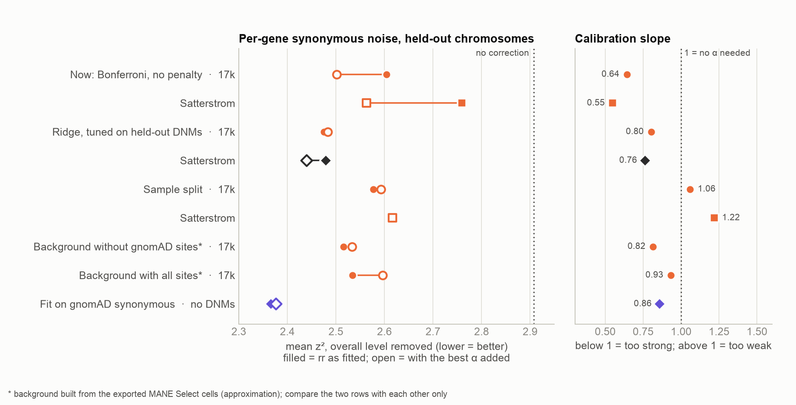

The black row is the recommended ridge fit. In this figure it's fit on held-out chromosomes, so its numbers differ slightly from the all-chromosome version in the other figures.

How these were run:
- **Data:** Ruchit's training sites and evaluation export, run locally.
- **Held-out chromosomes:** every rr is fit on one chromosome half and scored on the other. That puts the numbers a bit above the all-chromosome ones elsewhere (his 17k rr: 2.60 here vs 2.56).

| Approach | DNMs | Noise as fitted | Calibration slope | Noise with best α | Syn outliers (no QC flag) |
|---|---|---|---|---|---|
| No correction | — | 2.908 | — | — | 270 (123) |
| Now: Bonferroni features, no penalty | 17k | 2.604 | 0.64 | 2.502 | 221 (71) |
| | Satterstrom | 2.759 | 0.55 | 2.563 | 232 (83) |
| Ridge on all features, penalty chosen on held-out DNMs | 17k | 2.475 | 0.80 | 2.484 | 218 (70) |
| | Satterstrom | 2.479 | 0.76 | 2.439 | 219 (70) |
| Sample split: pick features on half, fit on the other half | 17k | 2.577 | 1.06 | 2.593 | 247 (100) |
| | Satterstrom | 2.616 | 1.22 | 2.617 | 251 (102) |
| Background without gnomAD-observed sites* | 17k | 2.516 | 0.82 | 2.533 | 227 (76) |
| Background with all possible sites* | 17k | 2.534 | 0.93 | 2.596 | 233 (83) |
| No DNMs: fit on gnomAD synonymous counts | — | 2.365 | 0.86 | 2.377 | 216 (70) |

\*These two backgrounds are built from the exported MANE Select cells, so compare them only with each other. The Satterstrom set shows the same pattern: slope 0.72 → 0.89.

- **A penalty does α's job, and does it better.** Ridge on all features, with the penalty chosen from held-out DNMs alone (no gnomAD data), beats the current method with α added (2.48 vs 2.50) and doesn't need α itself.
- **The penalty also removes the cost of more DNMs.** With ridge the two sets tie (2.475 vs 2.479). The Satterstrom set only did worse because the fit had no penalty.
- **Picking and fitting features on the same data is why rr is too strong.** Picking them on one half and fitting on the other gives a slope of about 1 with no α. It's noisier because each step sees only half the data, so ridge gets the same benefit more cheaply.
- **The background design changes strength, not noise.** Including gnomAD-observed sites moves the slope toward 1 (0.82 → 0.93) but doesn't lower the noise in this approximation.
- **Fitting regional effects on gnomAD synonymous counts does best.** Trained on one chromosome half and scored on the other, it reaches 2.37 with the fewest outliers, about 4% below the best DNM-based rr. Two caveats:
  - It learns all regional variation in synonymous counts, not just mutation rate: coverage, mapping and GC-biased gene conversion too. That's arguably what expected counts need, but it assumes the same regional effects apply to LoF and missense.
  - Synonymous counts are both the training and the test data here, on different chromosomes. So the downstream LOEUF check matters most. A cleaner test would train on intronic rare variants from gnomAD genomes.

Code: [rr_shrinkage_experiments.py](followup/rr_shrinkage_experiments.py). Results: [rr_shrinkage_experiments.tsv](followup/rr_shrinkage_experiments.tsv) and [rr_shrinkage_experiments.pass2.tsv](followup/rr_shrinkage_experiments.pass2.tsv).

#### Ridge against the cutoff-and-α options

[Ruchit's 10/27 tests](ruchit_reports/rr_followup_tests_report.html) point to the Bonferroni screen as the problem: it is a noisy filter on DNMs (see [the question on why more DNMs did worse](#dnm-sets-details)). His latest pick keeps a screen, with a looser 1e-2 cutoff, and adds α 0.625. Ridge removes the screen, so it needs neither a cutoff nor α. Here they are head to head, on his data and scored the same way; the local code reproduces his numbers for both of his options exactly.

| Option | Noise, his core set | Noise, core set not selected on outcome | Outliers | Slope |
|---|---|---|---|---|
| No correction | 2.908 | 3.504 | 270 | — |
| Old DNMs, Bonferroni, α 1 (his reference) | 2.557 / 2.606 | 2.908 / 2.978 | 218 / 221 | 0.68 |
| New DNMs, 1e-2, α 0.625 (his recommendation) | 2.496 / 2.504 | 2.859 / 2.868 | 222 / 222 | 0.81 |
| **New DNMs, ridge, no α** | **2.459 / 2.476** | **2.775 / 2.789** | **218 / 219** | **0.86** |
| Old DNMs, ridge, no α | 2.458 / 2.490 | 2.789 / 2.826 | 223 / 222 | 0.93 |

The same comparison from the full run's own rr tables, scored on the same counts (outcome-free noise for all-chromosome models only):

| Option | Noise, his core set | Noise, core set not selected on outcome | Outliers | Slope |
|---|---|---|---|---|
| Bonferroni, α 1 (the current method) | 2.650 / 2.697 | 3.026 | 226 | 0.61 |
| 1e-2, α 0.625 | 2.488 / 2.496 | 2.847 | 221 | 0.82 |
| **Ridge, no α** | **2.458 / 2.476** | **2.773** | **218** | **0.86** |
| Ridge, no α, QC-flagged genes left out of training | 2.451 / 2.471 | 2.762 | 218 | 0.86 |

Values are all-chromosome / held-out-chromosome models. His core set drops outlier-flagged genes, so it selects on the outcome being measured. The second noise column uses genes with at least 20 expected and no QC flag instead (17,706 genes). His own version of that set has 16,947 genes, so absolute values differ, but the differences between options match.

- **Ridge has lower noise than the 1e-2 / α 0.625 option in every column:** by 0.03–0.04 on his core set, and about 0.08 on the core set that doesn't select on the outcome. It has about the same or fewer outliers.
- **No cutoff and no α means two fewer settings to choose and defend.** Ruchit was unsure about adding a strength adjustment; ridge doesn't need one.
- **With ridge, the old and new DNM sets perform the same,** which matches his finding that the DNMs themselves aren't the problem.

Code: [compare_ridge_vs_cutoff_alpha.py](followup/compare_ridge_vs_cutoff_alpha.py). Results: [ridge_vs_cutoff_alpha.tsv](followup/ridge_vs_cutoff_alpha.tsv).

- **Why would more DNMs do worse?**
  - **Ruchit:** the fixed cutoff lets in weak features that predict DNMs but carry over poorly to gnomAD. His 10/27 tests rule out the newer cohorts as the cause.
  - **Added:** the new DNMs aren't worse; the fitting rule is. A fixed p-value cutoff lets in more features as the sample grows, and features that only just pass have overestimated effects, which an unpenalized fit keeps. The gap between the sets shrinks as the fit stops relying on the screen, and with a ridge fit it is gone (2.475 against 2.479). The details are below.

<b>Click to expand: more on the DNM sets.</b> What changed between them, what "worse" meant, and the evidence that the fitting rule is the cause

The new DNMs aren't worse. Choosing features by p-value and then fitting them without a penalty made the bigger set look worse. With a fit that doesn't screen features, the two sets perform the same.

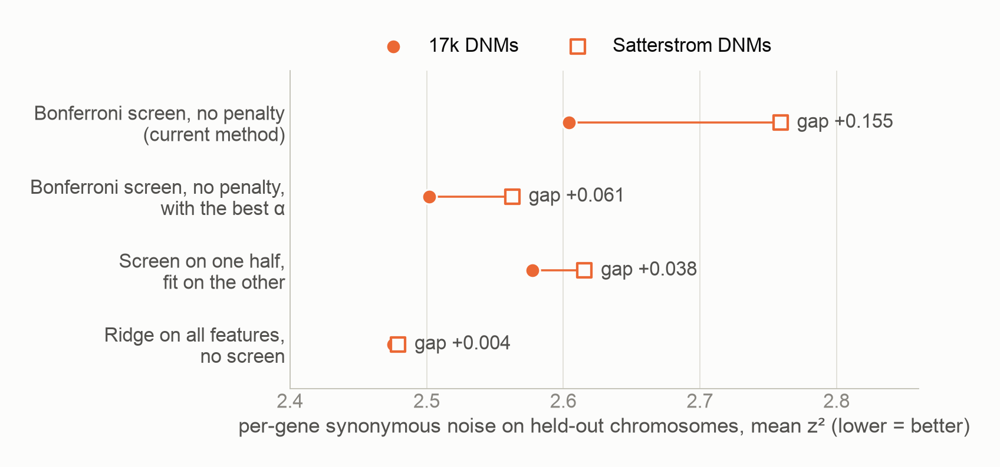

**What changed between the two sets**
- The Satterstrom 2026 files have 23,336 synonymous DNMs, against 17,059 in the old DDD+ASD file. They include the earlier DNMs, add newer cohorts, and have more on chrX.
- About 300 DNMs differ between the two versions because the providers' pipeline changed and the consequence annotations shifted a little. They are not QC or sample removals, and at about 1% of the set they are too few to change the results.

**What "worse" meant**
- With the current method, the new set gave noisier synonymous counts (2.70 against 2.56 on all chromosomes; 2.76 against 2.60 held out). Its rr was also further from the right strength: calibration slope 0.60 against 0.68.

**Why: the fitting rule, not the DNMs**
1. **A fixed p-value cutoff lets in more features as the sample grows.** With 37% more DNMs, Bonferroni kept 26 of the 34 old feature-scales, dropped 8 and added 16. Most of the new ones are GC, CpG-island and sperm-methylation features in non-CpG contexts.
2. **Features that only just pass have overestimated effects.** A feature passes partly because its estimate came out large in this sample. The fit then uses that estimate with no penalty, so rr comes out too strong.
3. **The added features predict DNMs but carry over poorly to gnomAD.** They raise the held-out DNM fit (gain 86 → 132), but only about a fifth of the rr change they cause shows up in gnomAD synonymous counts. In [Ruchit's test](ruchit_reports/rr_followup_tests_report.html), the added features carry over at 0.48 and the ones they replaced at 1.13.

**The evidence that it's the rule**
- **[Ruchit's 10/27 tests](ruchit_reports/rr_followup_tests_report.html):** random 17k subsets of the new DNMs differ from each other as much as old and new do, so the newer cohorts aren't the cause.
- **[Ruchit's 10/27 tests](ruchit_reports/rr_followup_tests_report.html):** with the old feature set, the new DNMs do better than the old ones (slope 0.68 → 0.80).
- At a strict 1e-4 cutoff, which lets in no new weak features, the two sets perform the same.
- The gap shrinks as the fit stops trusting the screen (figure): 0.155 with the current method, 0.061 with α added, 0.038 when features are chosen on one half and fit on the other, and 0.004 with ridge.

**Why DNM-predictive features might carry over poorly (untested)**
- gnomAD expected counts already account for CpG methylation and coverage.
- Polymorphism reflects long-term processes (GC-biased gene conversion, weak selection), not one generation of mutation.
- How well exome DNM calling detects variants may vary with GC differently from gnomAD.
- The training background (see [The training background](#the-training-background-what-the-dnms-are-compared-with)).

- **Why do 282 old DNMs drop out, and are they still synonymous?**
  - **Ruchit:** the new files replaced the old one rather than adding to it. Most of the 282 are DD variants, which the providers re-annotated.
  - **Resolved:** the ~300 DNMs that differ are consequence-annotation changes from the providers' updated pipeline, so no union is needed.

## How rr works

### Pipelines at a glance

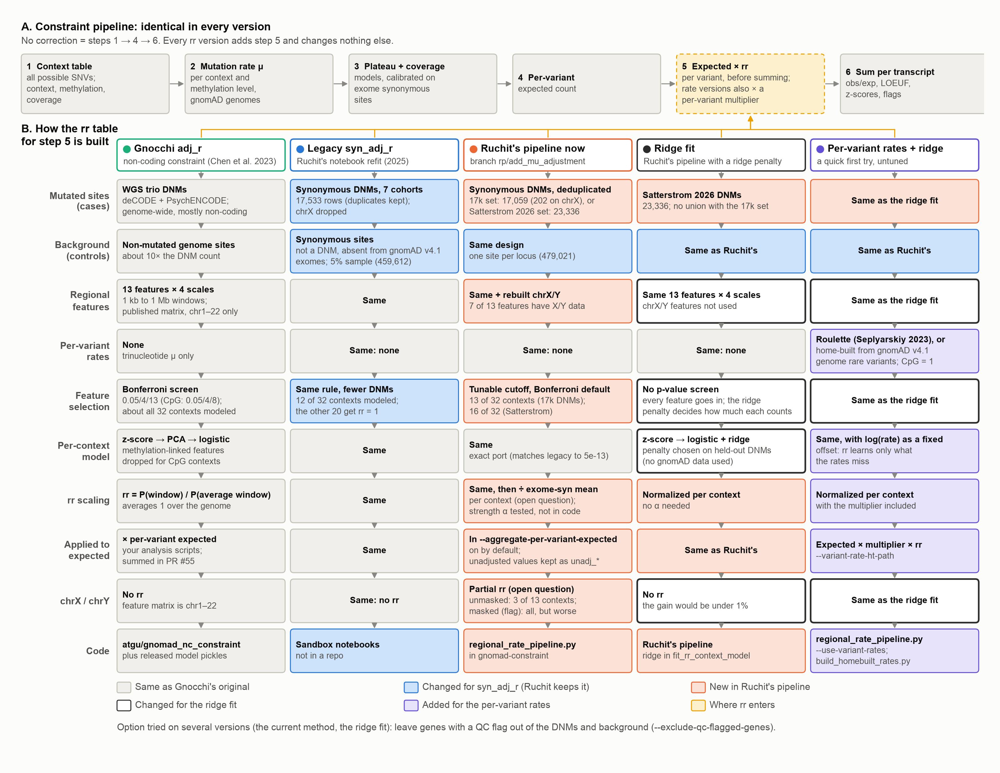

- **The same in every version:** steps 1–4 and 6, the per-context model, and rr defined as a window's rate divided by the average window's.
- **From adj_r to syn_adj_r:** only the training data changed, to synonymous DNMs against synonymous sites. With fewer DNMs, only 12 of the 32 contexts got a model.
- **From syn_adj_r to Ruchit's pipeline:** the same design, now built into the pipeline. It adds:
  - deduplicated DNMs, including chrX
  - chrX/Y features
  - a tunable feature-selection cutoff
  - per-context normalization
  - rr applied by default
- **Ridge fit (fourth lane; the recommended option):** Ruchit's pipeline with a ridge-penalized fit in place of the Bonferroni screen, normalized, and with no rr on chrX/Y.

### How the rr model works

rr comes from one logistic regression per trinucleotide context: the site's base and its two neighbours, strand-collapsed into 32 contexts. Each model asks whether the features of a site's 1-kb window predict whether a de novo mutation happened at that site.

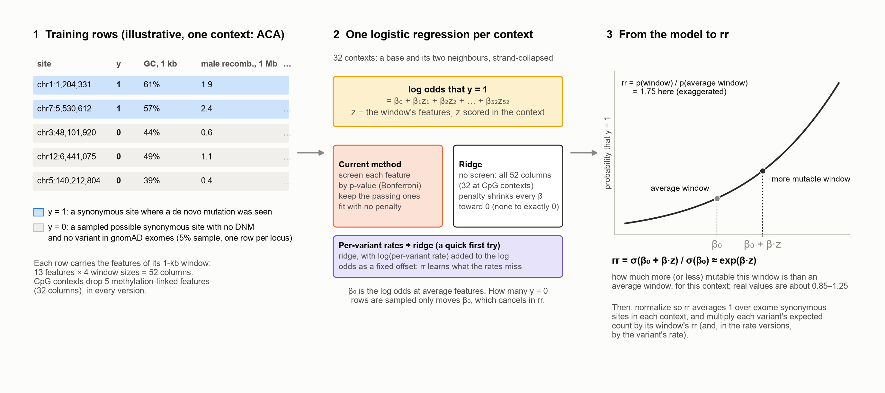

- **Outcome 1 (cases):** synonymous sites where a DNM was observed. These are the synonymous SNV DNMs from the cohorts in [`get_dnm_cohort_resources`](../../resources/resource_utils.py), deduplicated by variant: the Satterstrom 2026 ASD and DD files, deCODE and PsychENCODE, the gnomAD v4.1 de novos and four smaller studies. A DNM counts as synonymous if VEP calls it synonymous in the constraint context Table.
- **Outcome 0 (background):** a 5% random sample of possible synonymous sites that are not DNMs and have no variant in gnomAD v4 exomes, with one row per locus ([`create_rr_training_ht`](../../utils/regional_rate.py)). Why this background, and what else was tried, is in [The training background](#the-training-background-what-the-dnms-are-compared-with).
- **Predictors:** the 52 regional feature columns of the site's 1-kb window (see [The regional features rr uses](#the-regional-features-rr-uses)), z-scored within the context. The current method keeps the columns that pass a Bonferroni screen, rotates them with PCA and fits them with no penalty. The ridge fit uses every column and shrinks the coefficients.
- **From the model to rr:** for each window the model gives a probability of a DNM, p(window) = σ(β₀ + β·z), where z are the window's z-scored features and β₀ is the probability at average features. rr is the ratio to the average window, σ(β₀ + β·z) / σ(β₀). DNMs are rare, so this is close to exp(β·z): how much more or less mutable the window is than average, for that context.
- **Applying it:** rr is normalized so that its expected-weighted mean over exome synonymous sites is 1 in each context, then multiplied onto each variant's expected count after the plateau and coverage models.
- **Why the 1:0 ratio doesn't matter:** how many background sites are sampled only moves the intercept β₀, which cancels in rr. What matters is which sites the background includes.

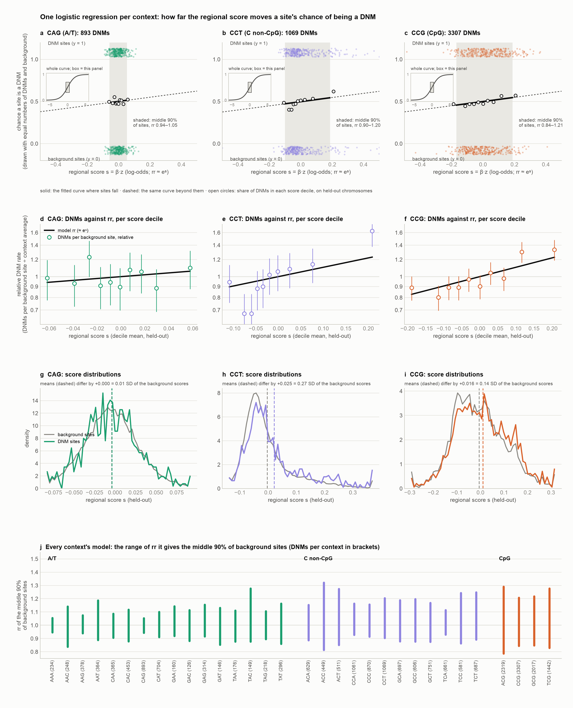

What the fitted models look like, in the full pipeline run:
- **a–c: the logistic picture** for the context with the most DNMs in each class.
  - Each dot is a site at y = 1 (DNM) or y = 0 (background), placed by its regional score s = β·z from the model fit on the other half of the chromosomes.
  - The curve is drawn as if DNMs and background were sampled in equal numbers. That only moves the intercept (see the bullet above), and it puts the curve in the middle of the panel.
- **The models work in the nearly straight middle of the S** (the insets show the whole curve).
  - The middle 90% of background sites have scores within about ±0.05–0.25. Their rr runs from about 0.9 to 1.1 in a typical A/T context, and from about 0.85 to 1.2–1.25 in C and CpG contexts.
  - **Why the y = 1 and y = 0 sites look the same:** a window's features move a site's DNM chance by only about ±10–20%, so the DNM scores sit just above the background scores. The shift is about a tenth of the spread, too small to see by eye.
    - On held-out chromosomes the models separate DNM from background sites barely better than chance: median AUC 0.52 over contexts (CAG 0.50, CCT 0.55–0.58, CCG 0.54–0.55; [rr_cv_metrics.full_run.tsv](followup/rr_cv_metrics.full_run.tsv), from the full run).
    - That is about what a perfect regional rate would give. If rr varies by about 10% between windows, even the true rate can only reach an AUC near 0.53.
    - rr still matters because a gene sums hundreds of sites. A 10% higher rate across a gene raises its expected count by 10%, as much as the chance noise in a gene with about 100 expected variants, and the shift is the same for every gene in the region.
  - **Open circles:** the share of DNMs in each score decile, on held-out chromosomes. They rise with the curve in CCT and CCG, and are roughly flat in CAG, as for A/T contexts in general (see [The training background](#the-training-background-what-the-dnms-are-compared-with)).
- **d–f: DNMs against rr.** The same deciles as rates: DNMs per background site, relative to the context's average, with 95% intervals, against the model's rr. In CCT and CCG the DNM rate follows the rr line, from about 0.8–0.9 to 1.3–1.6. In CAG it scatters around 1 with no trend.
- **g–i: the two score distributions.** DNM sites score only slightly higher than background sites: the means differ by 0.27 SD of the background scores in CCT, 0.14 SD in CCG and 0.01 SD in CAG.
- **j: every context's range of rr.** A/T contexts span the narrowest ranges (median 0.89–1.12), and CpG contexts the widest (0.84–1.25). ACC, ACG and TAC reach the furthest (about 1.3).

These come from the full run on jg1 (`gs://gnomad-tmp/jg/rr_full`): the pipeline's training set (synonymous DNMs from every cohort, 22,881 in modeled contexts, against its usual background) and its ridge models with the default per-site penalty. Code: [export_logistic_fits.py](followup/cluster/export_logistic_fits.py). Results: [rr_logistic_fits.pipeline.bins.tsv](followup/rr_logistic_fits.pipeline.bins.tsv), [rr_logistic_fits.pipeline.contexts.tsv](followup/rr_logistic_fits.pipeline.contexts.tsv), [rr_logistic_fits.pipeline.points.tsv](followup/rr_logistic_fits.pipeline.points.tsv), [rr_logistic_fits.pipeline.hist.tsv](followup/rr_logistic_fits.pipeline.hist.tsv).

<b>Click to expand: all 32 contexts' logistic regressions</b>

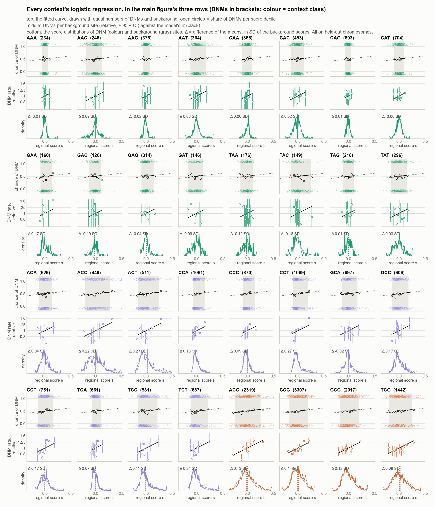

### The regional features rr uses

rr for each 1-kb window comes from 13 features. Each is measured in the window itself and in 10 kb, 100 kb and 1 Mb around it, which gives 52 columns. They are the [Gnocchi](https://doi.org/10.1038/s41586-023-06045-0) features; how each track was built is in [`generate_genomic_features.sh`](https://github.com/atgu/gnomad_nc_constraint/blob/a9c3c0eab432a67ee06ae63171a307fb3ddf4438/generate_genomic_features.sh#L21-L139).

| Feature | Column | What it measures | Source |
|---|---|---|---|
| GC content | `GC_content` | % of bases that are G or C | hg38 sequence |
| CpG islands | `CpG_island` | % of bases in CpG islands | UCSC CpG island track |
| Sperm methylation | `met_sperm` | average sperm CpG methylation over the window (zero between CpGs, so it also tracks CpG density) | single-cell bisulfite sequencing of sperm ([GEO GSE81233](https://www.ncbi.nlm.nih.gov/geo/query/acc.cgi?acc=GSE81233)), lifted from hg19 |
| Nucleosome occupancy | `Nucleosome` | average nucleosome occupancy signal | [ENCODE ENCFF000VME](https://www.encodeproject.org/files/ENCFF000VME/), lifted from hg19 |
| SINEs | `SINE` | % of bases in SINE repeats | RepeatMasker |
| LINEs | `LINE` | % of bases in LINE repeats | RepeatMasker |
| Low-complexity regions | `LCR` | % of bases in low-complexity sequence | [Li 2014](https://doi.org/10.1093/bioinformatics/btu356) low-complexity regions |
| Male recombination | `recomb_male` | recombination rate on the paternal map (cM/Mb) | deCODE sex-specific maps ([Halldorsson et al. 2019](https://doi.org/10.1126/science.aau1043)) |
| Female recombination | `recomb_female` | recombination rate on the maternal map (cM/Mb) | same |
| Distance to telomere | `dist2telo` | distance to the nearest chromosome end, as % of the chromosome's length (at most 50) | UCSC gap track |
| Distance to centromere | `dist2cent` | distance to the centromere, as % of the chromosome's length | UCSC centromere track |
| Maternal clustered DNMs | `cDNM_maternal_05M` | fraction of the window within 0.5 Mb of a maternal clustered DNM | [Goldmann et al. 2018](https://doi.org/10.1038/s41588-018-0071-6), Supplementary Table 5 |
| Paternal clustered DNMs | `cDNM_paternal_05M` | the same for paternal clustered DNMs | same |

- **CpG contexts** drop the five features that track methylation: GC content, CpG islands, sperm methylation, nucleosome occupancy and SINEs.
- **chrX/Y** have source data for only seven features. Both recombination maps, sperm methylation, nucleosome occupancy and both clustered-DNM tracks are missing there, which is why rr is off on chrX/Y.
- **The clustered-DNM tracks are sparse.** They are zero in about 90% of windows, because they mark only the neighbourhoods of clusters found in one trio study. The maternal track is nonzero in 92% of windows in the first 20 Mb of 8p, but in only 15–55% of the other maternal hotspot regions (see [What explains them besides size](#what-explains-them-besides-size)).
- **How they enter the model:** each feature is z-scored within each context. The legacy fit keeps the scales that pass a Bonferroni screen and fits them unpenalized; the ridge fit uses all 52 columns and shrinks them.
- **Ridge doesn't select features.** It pulls every coefficient toward zero but never to exactly zero, so all 52 columns stay in with smaller weights. (A lasso penalty would drop some.) The only features left out are the five methylation-related ones in CpG contexts, which is a fixed rule.

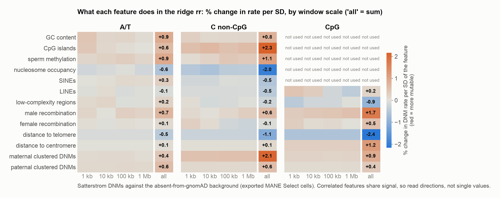

- **Effects per feature are small,** about 2% or less per SD. rr gets its range (about 0.9 to 1.1 across windows) by adding many of them up.
- **C contexts other than CpG:** more mutable in CpG islands (+2.3% per SD) and near maternal DNM clusters (+2.1%), less mutable where nucleosome occupancy is high (−2.0%), and more mutable closer to a chromosome end.
- **CpG contexts:** mostly position. They are more mutable closer to a chromosome end (−2.4% per SD of distance) and with more male recombination (+1.7%).
- **A/T contexts:** every feature changes the rate by under 1% per SD.
- Correlated features (GC content, CpG islands and methylation, or the four scales of one feature) share signal. Read the directions, not single values.

These are fit on the Satterstrom DNMs against the current background, built from the exported MANE Select cells ([rr_background_experiments.py](followup/rr_background_experiments.py), [rr_background.coefficients.tsv](followup/rr_background.coefficients.tsv)).

## Results

### How each version performs

Black is the ridge fit with the Satterstrom DNMs (the recommended option). Dotted lines show what theory or chance predicts.

**Full pipeline run.** Each version below went through `regional_rate_pipeline.py` and the constraint pipeline's aggregation, with the synonymous DNMs from every cohort. Scores come from the constraint pipeline's own per-transcript counts, not the cell-level approximation used elsewhere in this section. All rows use the same 16,438 autosomal MANE Select transcripts.

| Version | Noise (core set) | Noise (no QC flag) | Outliers (no QC flag) | Synonymous obs/exp, LOEUF decile 9 | Missense obs/exp, lowest s_het decile |
|---|---|---|---|---|---|
| No correction | 2.905 | 3.535 | 255 (110) | 1.112 | 1.028 |
| Current method (Bonferroni) | 2.638 | 3.039 | 210 (66) | 1.074 | 1.045 |
| Current method, QC-flagged genes left out | 2.629 | 3.083 | 218 (75) | 1.077 | 1.045 |
| Ridge | 2.439 | 2.776 | 207 (64) | 1.086 | 1.034 |
| **Ridge, QC-flagged genes left out** | **2.432** | **2.764** | **208 (63)** | **1.086** | **1.034** |
| Roulette, with the ridge fit on top (exploratory) | 2.029 | 1.965 | 180 (33) | 1.048 | 0.992 |
| Home-built Roulette-style rates, with the ridge fit on top (exploratory) | 2.203 | 2.136 | 193 (35) | 1.042 | 0.997 |

- **Ridge beats the current method in the pipeline too:** 2.44 against 2.64 on the core set, and 2.78 against 3.04 on the set that doesn't select on the outcome.
- **Leaving QC-flagged genes out of training barely matters:** 2.439 → 2.432 for ridge, and 2.638 → 2.629 for the current method, whose noise on the outcome-free set gets slightly worse (3.04 → 3.08).
- **Roulette's rates with the ridge on top do much better:** 2.03 on the core set, and 1.97 on the outcome-free set, against 2.76 for the best DNM-only rr. Unflagged outliers halve (63 → 33), and the LOEUF decile 9 rise falls from 1.09 to 1.05.
  - It also lowers missense obs/exp by about 3% in every decile, so Roulette rates missense sites as slightly more mutable than synonymous sites of the same trinucleotide change. Whether that is right is open. For LoF it goes the other way (see below).
- **Rates built the same way from gnomAD v4.1 genomes get most of Roulette's gain:** 2.20 on the core set and 2.14 on the outcome-free set, with 35 unflagged outliers. They come from non-coding rare variants only (exons ± 50 bp, low-complexity regions and segdups left out), with a simpler model than Roulette's (see [Still worth trying](#still-worth-trying-or-looking-at)).
  - Roulette's regional rate comes from gnomAD rare variants, so part of the gain on gnomAD counts is gnomAD fitting gnomAD. On held-out DNMs, which don't involve gnomAD, its gain over chance is 1,316 log-likelihood units against 114 for ridge alone.
- Code: [score_downstream.py](followup/score_downstream.py), from the counts written by [export_group_oe.py](followup/cluster/export_group_oe.py). Results: [downstream.scores.tsv](followup/downstream.scores.tsv), [downstream.deciles.tsv](followup/downstream.deciles.tsv).

**LoF and missense metrics in the full run.** Each version's release, against the run without rr, on the 17,641 autosomal MANE Select transcripts. ClinGen haploinsufficient genes are the 314 of them with ClinGen score 3.

| Version | LOEUF rank correlation with no rr | Genes moving 2+ LOEUF deciles | Genes newly below / no longer below LOEUF 0.6 | ClinGen HI: AUC of LOEUF | LoF expected | Missense expected | Missense z ≥ 3.09 |
|---|---|---|---|---|---|---|---|
| No correction | 1 | — | — | 0.867 | — | — | 2,238 |
| Current method (Bonferroni) | 0.986 | 1.9% | 157 / 265 | 0.870 | −2.5% | −1.0% | 2,239 |
| Current method, QC-flagged genes left out | 0.987 | 1.6% | 148 / 256 | 0.870 | −2.5% | −0.9% | 2,261 |
| Ridge | 0.992 | 0.9% | 125 / 168 | 0.870 | −1.1% | −0.4% | 2,415 |
| **Ridge, QC-flagged genes left out** | **0.992** | **0.9%** | **125 / 167** | **0.870** | **−1.1%** | **−0.4%** | **2,443** |
| Roulette, with the ridge fit on top (exploratory) | 0.981 | 2.8% | 100 / 496 | 0.869 | −5.1% | +2.9% | 4,203 |
| Home-built Roulette-style rates, with the ridge fit on top (exploratory) | 0.970 | 5.1% | 130 / 593 | 0.870 | −6.1% | +1.8% | 3,780 |

- **The rr leaves LOEUF's ranking and what it finds intact.**
  - With ridge, 0.9% of genes move two or more LOEUF deciles. 22% move one, because decile edges are close together.
  - The ClinGen haploinsufficient genes separate as well as before (AUC 0.867 → 0.870), with 62% in the most constrained decile under every version.
  - Genes where ClinGen finds dosage sensitivity unlikely (score 40) stay out of that decile under every version. With ridge, the share of autosomal recessive genes (score 30) in it goes from 1.2% to 1.7%.
- **The rr lowers LoF expected counts by about 1%,** although it averages 1 over synonymous sites. Over LoF sites the ridge rr averages about 0.99, and the current method's about 0.975.
  - LoF obs/exp rises in LOEUF deciles 0–7 and falls in the least constrained decile (1.25 → 1.22).
  - So, net, 42 fewer genes are below LOEUF 0.6 and 30 fewer have pLI ≥ 0.9 (3,238 → 3,208).
- **Missense constraint gets sharper, not shifted.**
  - Missense expected moves by under 1% with ridge.
  - 9% more genes reach missense z ≥ 3.09, mostly because the z-scores' scale shrinks. The pipeline divides each gene's raw missense z by one spread, measured on genes with excess missense, and the rr narrows it (2.35 → 2.19).
  - Missense outlier flags fall from 215 to 167, and synonymous outlier flags from 262 to 210.
- **Roulette moves the levels.** Against the run without rr, it lowers LoF expected counts by 5% and raises missense by 3%.
  - LoF: 496 genes rise above LOEUF 0.6 and 100 fall below it; genes with pLI ≥ 0.9 go from 3,238 to 2,971. ClinGen separation is unchanged (AUC 0.869).
  - Missense: obs/exp in the least constrained LOEUF decile goes from 1.085 to 1.006. Missense-constrained genes nearly double (2,238 → 4,203), because the level falls and the z-scale shrinks from 2.35 to 1.69. Missense outlier flags fall from 215 to 60.
  - The home-built rates move them the same way (LoF −6.1%, missense +1.8%; 593 genes rise above LOEUF 0.6 and 130 fall below it), so the shift isn't specific to Roulette's model.
  - The model calibration uses synonymous sites only, so it can't check these shifts. Using either would need a decision on them, and new LOEUF and missense z thresholds.
- Code: [score_release.py](followup/score_release.py), on slim copies of each version's release TSV ([export_release_slim.py](followup/cluster/export_release_slim.py)). Results: [release.scores.tsv](followup/release.scores.tsv), [release.deciles.tsv](followup/release.deciles.tsv), [release.flags.tsv](followup/release.flags.tsv).

The panels below are the cell-level approximation; the full run's rr tables give nearly the same values ([full_run.metrics.tsv](followup/full_run.metrics.tsv)).

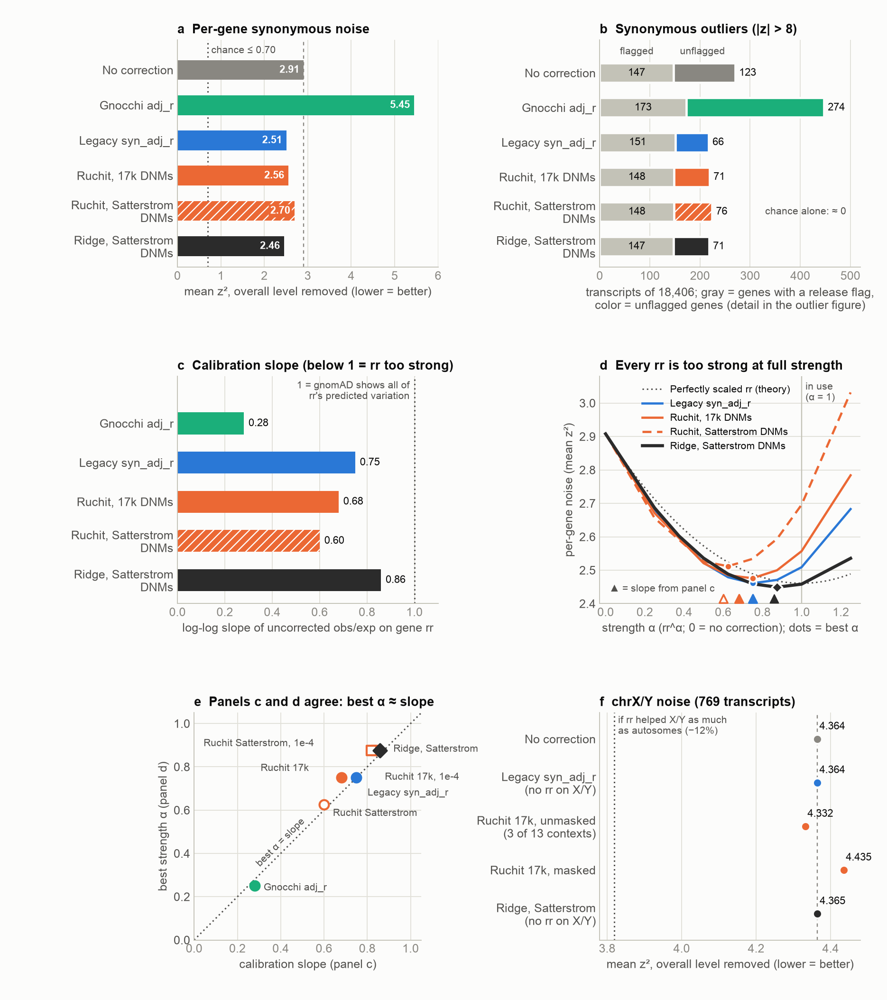

- **a, c:** Gnocchi `adj_r` fails on both. It nearly doubles the noise and has a slope of 0.28.
- **a:** chance alone would give a mean z² of at most 0.70, because each site is either observed or not. The best rr removes only about 18% of the noise above that level (2.91 → 2.51).
- **a, b:** legacy `syn_adj_r` and Ruchit's pipeline with the 17k DNMs are nearly tied. The Satterstrom DNMs do worse at full strength.
- **b:** by chance there would be essentially no outliers.
  - Gray is genes that already carry a release flag: about 150 under every synonymous rr, mostly the mapping-artifact genes (see [The synonymous outliers](#the-synonymous-outliers)).
  - Color is unflagged genes, the part rr changes: 123 → 66–76.
- **c, d and e measure the same thing two ways: how strong rr should be.**
  - **c** looks gene by gene. When rr says a gene should get X% more synonymous variants, gnomAD shows about slope × X% more.
  - **d** applies rr^α and finds the α with the lowest noise. α = 0 means no correction and α = 1 means rr as built. If rr were exactly right, the curve would bottom out at α = 1 (the dotted theory curve). Every rr bottoms out below 1, and that is what "too strong" means.
  - **e** shows the link: the best α in d lands on the slope from c, as theory says it should. If the real effect is slope × rr, then rr^α leaves the least error when α = slope.
  - c gives where the bottom is, and d gives how much it costs to miss it. For legacy and the 17k set, using α = 1 costs only 2–3%. Gnocchi `adj_r` bottoms out at α ≈ 0.25 and reaches 5.45 at α = 1, off the chart.
- **f:** on chrX/Y the versions differ by less than 2%, so skipping rr there costs almost nothing. The dotted line marks what rr might do on X/Y if it helped as much as on autosomes (−12%).

Panels a and c–f come from [Ruchit's v2 report](ruchit_reports/rr_syn_dnm_report.v2.html), sections 1, 4, 5 and 9 (v4.1.1 expected counts, 18,406 Ensembl MANE Select transcripts). Panel b is recomputed from his evaluation export. The recommended rr (Satterstrom DNMs, fit on all chromosomes) is scored the same way, with code that reproduces his numbers. Every rr is normalized except Gnocchi `adj_r`. The figures are drawn by [make_followup_figures.py](followup/make_followup_figures.py).

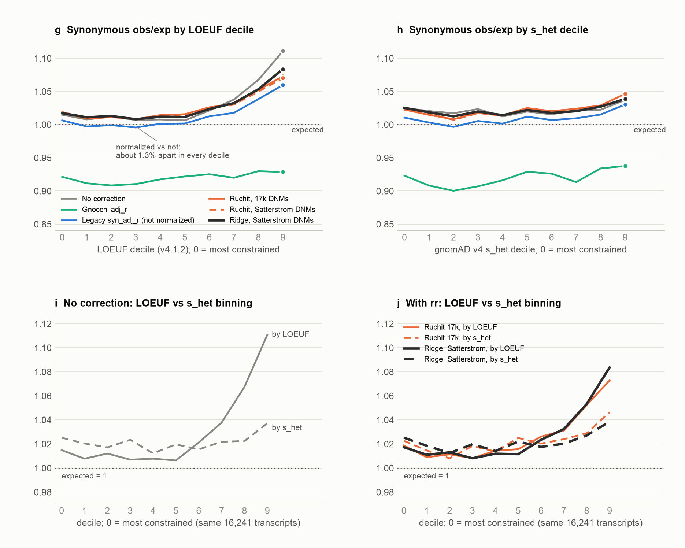

- **g:** by LOEUF decile, Gnocchi `adj_r` sits about 8% low everywhere. Normalized and non-normalized `syn_adj_r` run about 1.3% apart in every decile. Every version still rises in the top deciles: to 1.11 with no correction and 1.06–1.08 with a synonymous rr.
- **h:** by s_het decile, every synonymous rr stays nearly flat at 1.00–1.05, with only a small uptick in decile 9.
- **i:** with no correction, the top decile rises to 1.11 when genes are binned by LOEUF, but only to 1.04 by s_het. Most of the rise comes from how LOEUF sorts genes, not from mutation rate.
- **j:** Ruchit's rr and the recommended rr behave the same. They remove about a third of the LOEUF rise (decile 9: 1.11 → 1.07–1.08) and stay within 1.01–1.05 by s_het.

<b>Click to expand: panels g–j with the explained outliers removed</b>

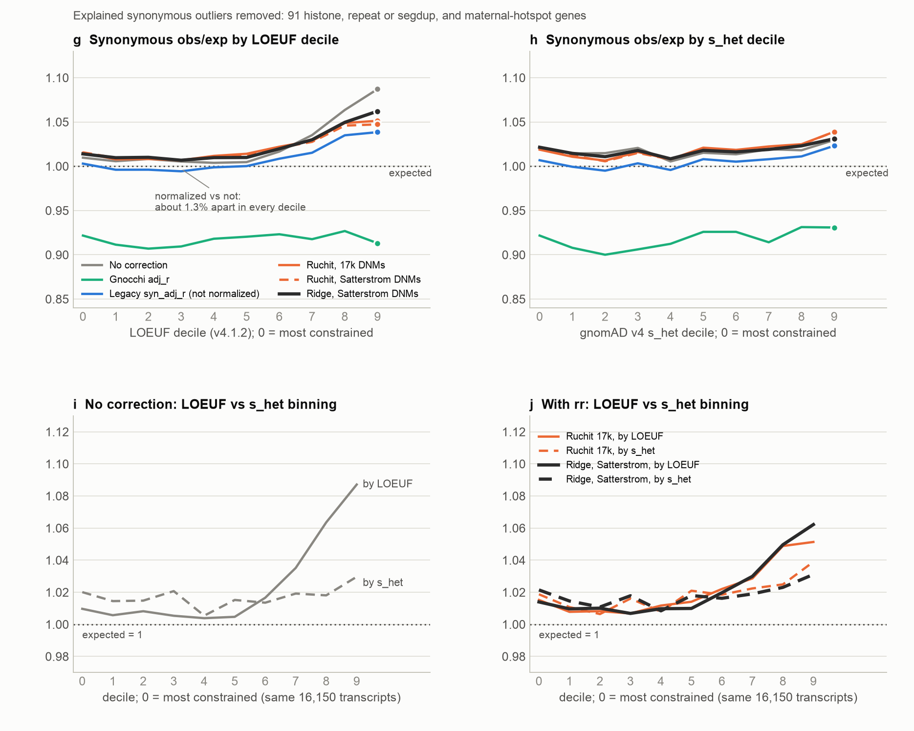

Removed: the 91 transcripts that are synonymous outliers (|z| > 8) under no correction or any synonymous rr, and whose excess has an explained cause. That is 50 in a maternal hotspot region, 22 histone genes, and 19 repeat or segdup genes (see [What explains them besides size](#what-explains-them-besides-size)). The 32 unexplained outliers stay.

- **g:** the top-decile rise shrinks by about a fifth in every version: 1.11 → 1.09 with no correction, 1.08 → 1.06 with the ridge rr, 1.07 → 1.05 with Ruchit's 17k rr.
- **h:** by s_het the curves were already flat. The top decile drops slightly, 1.04 → 1.03.
- **i:** the gap between LOEUF and s_het binning stays (1.09 against 1.03). So most of the LOEUF rise is still how LOEUF sorts genes, not the explained outliers.
- **j:** with the explained outliers out, the ridge rr's top LOEUF decile (1.06) sits slightly above Ruchit's (1.05). By s_het both are at 1.03–1.04.

Code: [decile_explained_removed.py](followup/decile_explained_removed.py). On the full set it reproduces the summary above exactly. Removed transcripts: [explained_outliers_removed.tsv](followup/explained_outliers_removed.tsv).

Panels g–j are remapped from Ruchit's evaluation export (`gs://gnomad-tmp/rp/gnomad_v4.1.1/constraint/regional_rate/rr_eval_export/`), with his actual rr tables applied:
- **Data:** v4.1.1 expected counts; the same 16,241 autosomal Ensembl MANE Select transcripts in every panel, each with a v4.1.2 LOEUF decile and an s_het.
- **Filter:** genes with a release QC flag (mapping quality or coverage) are dropped, but outlier-flagged genes are kept. The outlier flags come from the same uncorrected z-scores being plotted, so dropping them would flatten the curves by construction. With his full set (QC-flagged genes kept too), the curves match section 3 of his [v2 report](ruchit_reports/rr_syn_dnm_report.v2.html) exactly.
- **s_het:** gnomAD v4 s_het from Kar et al. 2026, [Supplementary Table 3](https://zenodo.org/records/20587463).
- **Checks:** the export reproduces his no-correction noise exactly (2.908, and 5.081 over all transcripts), and his normalized tables average exactly 1.
- **Code:** [remap_rr_to_shet.py](followup/remap_rr_to_shet.py), run locally.

### The training background: what the DNMs are compared with

The rr model contrasts DNM sites with background sites. The pipeline's background is possible synonymous sites with no variant in gnomAD v4 exomes. [Ruchit's 10/27 report](ruchit_reports/rr_followup_tests_report.html) and this one both flagged that this rule depends on gnomAD. The question was whether a different background would do better.

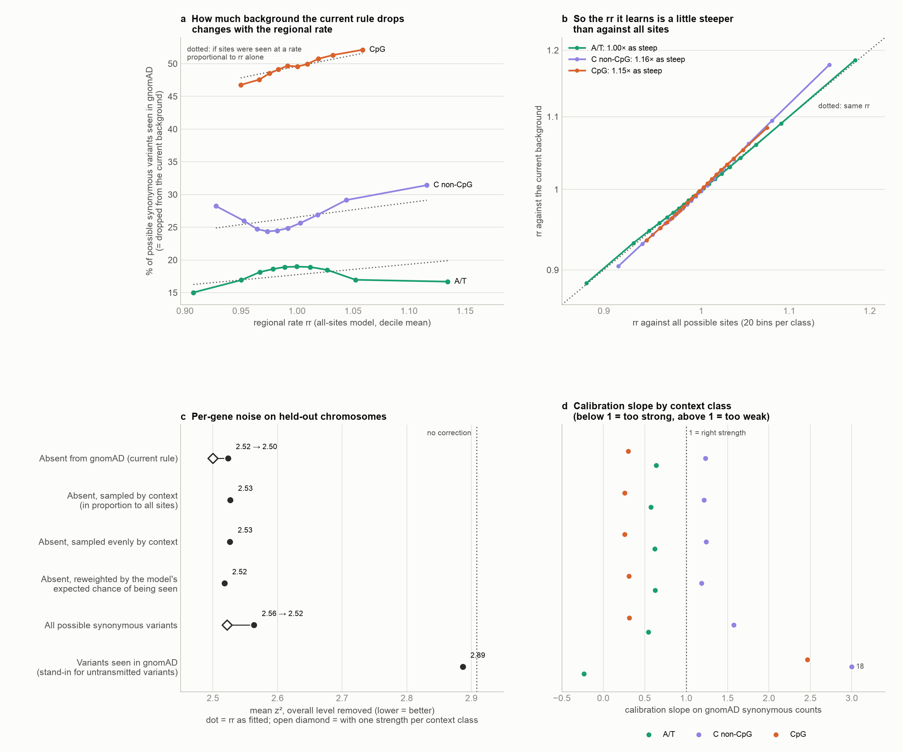

**Pipeline runs.** Each design was rerun through `regional_rate_pipeline.py` with the full run's DNMs and features, each in its own folder under `gs://gnomad-tmp/jg/rr_bg/`, and scored on Ruchit's exported counts like the full run. Each is fit with ridge at the default penalty (0.3 per site) and at 10 per DNM, which gives backgrounds of different sizes the same shrinkage.

| Background | Penalty | Noise | Held-out noise | Outcome-free noise | Outliers (no QC flag) | Slope | Slope A/T / other C / CpG |
|---|---|---|---|---|---|---|---|
| No correction | — | 2.908 | 2.908 | 3.504 | 270 (123) | — | — |
| **Absent from gnomAD, one row per locus (current)** | **per site** | **2.458** | **2.476** | **2.773** | **218 (71)** | **0.86** | **2.09 / 0.86 / 0.15** |
| Absent from gnomAD, one row per locus (current) | per DNM | 2.441 | 2.451 | 2.810 | 224 (76) | 1.12 | 1.96 / 1.00 / 0.40 |
| Absent from gnomAD, one row per variant | per site | 2.465 | 2.478 | 2.795 | 221 (73) | 0.90 | 2.47 / 0.95 / 0.15 |
| Absent from gnomAD, one row per variant | per DNM | 2.424 | 2.441 | 2.766 | 223 (74) | 0.96 | 1.80 / 0.86 / 0.34 |
| All sites, one row per locus | per site | 2.528 | 2.538 | 2.919 | 223 (77) | 1.24 | 2.73 / 1.44 / 0.17 |
| All sites, one row per locus | per DNM | 2.516 | 2.522 | 2.931 | 228 (82) | 1.51 | 2.13 / 1.44 / 0.40 |
| All sites, one row per variant | per site | 2.626 | 2.630 | 3.082 | 240 (91) | 1.83 | 3.40 / 2.54 / 0.20 |
| All sites, one row per variant | per DNM | 2.548 | 2.555 | 2.973 | 233 (85) | 1.63 | 2.14 / 1.65 / 0.35 |
| Absent, sampled by context in proportion to all sites | per site | 2.489 | 2.518 | 2.804 | 217 (71) | 0.81 | 1.89 / 0.89 / 0.12 |
| Absent, sampled by context in proportion to all sites | per DNM | 2.444 | 2.461 | 2.809 | 224 (76) | 1.08 | 1.87 / 1.00 / 0.30 |
| Absent, sampled evenly by context | per site | 2.489 | 2.522 | 2.786 | 219 (72) | 0.76 | 1.74 / 0.78 / 0.14 |
| Absent, sampled evenly by context | per DNM | 2.449 | 2.465 | 2.812 | 224 (76) | 1.06 | 1.80 / 1.01 / 0.29 |

- **No background does clearly better than the current one.** Its default run reproduces the full run's ridge exactly (2.458 / 2.476).
- **All sites is worse,** as in the local test: held-out noise 2.538 against 2.476, and the rr comes out too weak (slope 1.24). All sites with one row per variant is worse still (2.630).
- **One row per variant instead of per locus barely matters.** With the default penalty it is 2.478 against 2.476. With a penalty per DNM it is slightly better on every noise measure (held-out 2.441 against 2.451, outcome-free 2.766 against 2.810), the lowest held-out noise of any run, but by little.
- **Sampling by context changes little with a penalty per DNM** (held-out 2.461–2.465 against 2.451). With the default per-site penalty it is worse (2.518–2.522), because sampling drops background rows and so weakens the penalty: the rr comes out stronger (slope 0.76–0.81).
- **By context class, every run has the CpG rr far too strong (0.12–0.40) and the A/T rr too weak (1.7–3.4).** The local approximation below found A/T too strong; see panel d.
- Code: [run_backgrounds.sh](followup/cluster/run_backgrounds.sh), scored by [run_bg_scores.sh](followup/cluster/run_bg_scores.sh) with [full_run_scores.py](followup/full_run_scores.py) `--rr-names`. Results: [rr_bg_pipeline.metrics.tsv](followup/rr_bg_pipeline.metrics.tsv), [rr_bg_pipeline.strength.tsv](followup/rr_bg_pipeline.strength.tsv).

**Local approximation.** The rest of this section is the earlier local comparison, which also covers options the pipeline doesn't have (reweighting, one strength per class, applying rr before saturation, no rr at CpG).

How this was run:
- **DNMs:** the Satterstrom 2026 synonymous SNVs (`isSyn`), 20,636 of them in the exported windows.
- **Backgrounds:** built from Ruchit's exported MANE Select cells, one row per possible variant (the pipeline keeps one row per locus).
- **Fit:** the ridge fit on all features, with the penalty scaled by the number of DNMs so that backgrounds of different sizes get the same shrinkage. The penalty was chosen on held-out DNMs and came out the same (10 per DNM) for every background.
- **Comparing:** this is an approximation of the pipeline, so compare the rows with each other rather than with the 2.46 elsewhere in this report.

| Background or option | Noise | Held-out noise | Slope | Slope by class (A/T / other C / CpG) |
|---|---|---|---|---|
| No correction | 2.908 | 2.908 | — | — |
| **Absent from gnomAD (current rule)** | **2.502** | **2.524** | 1.11 | 0.64 / 1.23 / 0.30 |
| Absent, sampled by context in proportion to all sites | 2.506 | 2.527 | 1.05 | 0.57 / 1.22 / 0.26 |
| Absent, sampled evenly by context | 2.507 | 2.526 | 1.07 | 0.62 / 1.24 / 0.26 |
| Absent, reweighted by the model's expected chance of being seen | 2.497 | 2.518 | 1.08 | 0.63 / 1.18 / 0.31 |
| All possible synonymous variants | 2.549 | 2.564 | 1.37 | 0.54 / 1.57 / 0.31 |
| Current rule, one strength per context class | 2.464 | 2.500 | — | set to 1 / 1 / 1 |
| All sites, one strength per context class | 2.474 | 2.522 | — | set to 1 / 1 / 1 |
| Current rule, rr applied before saturation | 2.525 | 2.538 | 1.37 | 0.69 / 1.47 / 0.51 |
| Current rule, no rr at CpG | 2.498 | 2.516 | 1.35 | 0.64 / 1.23 / — |

- **a, b. The bias is real but small.**
  - The current rule drops a share of the background that changes with the regional rate. At CpG the share rises steadily with rr (47% to 52%). In other C contexts it is U-shaped (28% at the lowest rr, 24% in the middle, 31% at the top). In A/T contexts it is nearly flat.
  - So the rr learned against it is steeper than against all sites: 1.16 times as steep for C contexts, and the same for A/T. That is less than a simple calculation predicts (1.2–1.7 times), because whether gnomAD has seen a site depends on more than its regional rate.
- **c. Switching to all sites doesn't help.** Against all sites the rr comes out too weak (slope 1.37), and noise is worse (2.56 against 2.52 on held-out chromosomes). gnomAD's synonymous counts vary more between regions than the DNM rate differences alone predict. The current rule's slight steepening happens to move rr toward that. In effect it trains partly on gnomAD, by using which sites gnomAD has not seen.
  - **Confirmed in the pipeline** (table above): held-out noise 2.538 against 2.476, slope 1.24.
- **Sampling by context changes nothing**, whether in proportion to all sites or evenly (2.53 for both, against 2.52). Each context has its own model, so a context's total background only moves that model's intercept, which cancels out of rr. Reweighting the absent sites by the model's expected chance of being seen is also the same (2.52).
  - **Confirmed in the pipeline with a penalty per DNM** (2.461–2.465 against 2.451). With the default per-site penalty, sampling also weakens the penalty, which makes rr too strong (table above).
- **d. The bigger effect is strength by context class, under every background.** A/T contexts are too strong (slope 0.54–0.64), other C contexts are too weak (1.2–1.6), and CpG contexts are far too strong (about 0.3).
  - Giving each class its own strength, measured on one chromosome half and scored on the other, lowers held-out noise more than any background change (2.52 → 2.50 for the current rule). It also brings the two backgrounds close together.
  - **The pipeline's rr differs in A/T contexts.** The full run's ridge has class slopes A/T 2.09, other C 0.86 and CpG 0.15 ([full_run.metrics.tsv](followup/full_run.metrics.tsv)), and every pipeline background run has A/T at 1.7–3.4. CpG is far too strong there too, but A/T comes out too weak rather than too strong, although its rr still spans about 1.26-fold between the 5th and 95th percentile of sites. The pipeline uses the DNMs from every cohort and its own penalty; why A/T differs hasn't been checked.
  - It uses gnomAD to set three numbers, as α does.
- **Smaller checks:**
  - Applying rr before saturation (expected = n × (1 − (1 − q)^rr)) weakens rr and doesn't help.
  - Dropping rr at CpG changes nothing (2.52), so the CpG rr adds little to gnomAD fit here.

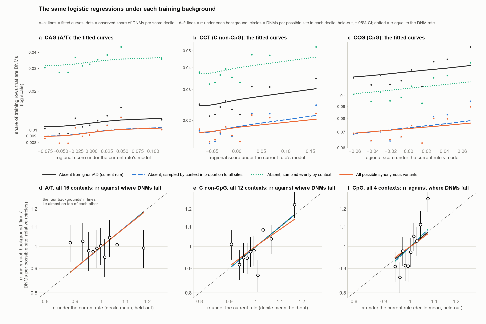

The same logistic regressions as in [How the rr model works](#how-the-rr-model-works), fit under each background ([rr_logistic_fits.py](followup/rr_logistic_fits.py), [rr_logistic_fits.bins.tsv](followup/rr_logistic_fits.bins.tsv)):

⏳ **Not yet redrawn:** these curves are from the local approximation. The pipeline runs are done (table above), but the figure hasn't been redrawn from them.

- **a–c. The background moves each curve up or down; it barely changes the slope.**
  - Sampling by context changes how many background rows a context has. Its curve sits higher or lower but rises at the same rate.
  - All sites adds the sites gnomAD has seen. That lowers the curve and, in C contexts, flattens it a little.
- **d–f. So rr barely changes.** rr is the curve divided by its value at the average window, so the height cancels. The four backgrounds' rr lines lie almost on top of each other; all sites is slightly flatter for other C contexts (the 1.16× of panel b above).
- **Where DNMs fall (circles, held-out chromosomes):**
  - In other C contexts, DNMs follow the rr.
  - In CpG contexts, DNMs rise more steeply than the rr. By DNMs alone, the CpG rr is if anything too weak, yet it is far too strong for gnomAD (slope 0.30). The likely reason is saturation: half of the possible CpG synonymous variants are already seen in gnomAD, so their counts can't rise much further.
  - In A/T contexts, DNMs show no trend. On held-out chromosomes, the A/T rr doesn't predict where DNMs fall (slope 0.01 ± 0.19 in a Poisson fit of DNM counts per cell, from [roulette_combo.v2.metrics.tsv](followup/roulette_combo.v2.metrics.tsv)). That fits its gnomAD slope of 0.64 (too strong). It is one more reason to look at one strength per class, and worth testing no rr at all in A/T contexts.

**"Unmutated is the best way to get absent from de novo."** In this cohort there is one synonymous DNM per thousand possible synonymous variants, so a random sample of sites is already 99.9% absent from de novo. "Absent from gnomAD" is a different condition: no mutation in the population's history, which also depends on mutation rate and coverage. In theory that biases rr, but in this data it works as well as, or slightly better than, all sites.

**What this suggests:**
1. Keep the current background.
2. Look at one strength per context class (A/T, other C, CpG), and at why the classes differ.
3. Drop genes with a QC flag (or, better, low-quality sites) from training (see [Removing poorly covered or mapped genes from training](#removing-poorly-covered-or-mapped-genes-from-training) below).
4. One thing this can't test locally is one background row per locus (the pipeline) against one per variant. Loci with several synonymous alternatives get one background row but several chances for a DNM. That needs a cluster run.
   - **Done in the pipeline:** one row per variant barely differs from one per locus (held-out 2.478 against 2.476 at the default penalty; 2.441 against 2.451 with a penalty per DNM).

**Every background run**

| Background | Applied as | Penalty per DNM | Noise | Held-out noise | Best α (odd / even half) | Held-out noise at best α | Outliers (no QC flag) | Slope | Slope A/T / other C / CpG |
|---|---|---|---|---|---|---|---|---|---|
| No correction | — | — | 2.908 | 2.908 | — | — | 270 (123) | — | — |
| Absent from gnomAD (current rule) | rr as fitted | 10 | 2.502 | 2.524 | 1 / 1.25 | 2.536 | 225 (76) | 1.11 | 0.64 / 1.23 / 0.30 |
| Absent from gnomAD (current rule) | rr applied before saturation | 10 | 2.525 | 2.538 | 1.25 / 1.5 | 2.530 | 229 (82) | 1.37 | 0.69 / 1.47 / 0.51 |
| Absent from gnomAD (current rule) | no rr at CpG | 10 | 2.498 | 2.516 | 1.25 / 1.25 | 2.495 | 232 (83) | 1.35 | 0.64 / 1.23 / — |
| Absent from gnomAD (current rule) | one strength per class | 10 | 2.464 | 2.500 | per class: A/T: 0.64, other C: 1.23, CpG: 0.3 | — | 227 (77) | — | 1.00 / 1.00 / 1.00 |
| Absent, sampled by context in proportion to all sites | rr as fitted | 10 | 2.506 | 2.527 | 1 / 1 | 2.521 | 225 (76) | 1.05 | 0.57 / 1.22 / 0.26 |
| Absent, sampled by context in proportion to all sites | rr applied before saturation | 10 | 2.524 | 2.536 | 1.25 / 1.25 | 2.517 | 229 (81) | 1.31 | 0.62 / 1.45 / 0.44 |
| Absent, sampled evenly by context | rr as fitted | 10 | 2.507 | 2.526 | 1 / 1 | 2.521 | 225 (76) | 1.07 | 0.62 / 1.24 / 0.26 |
| Absent, sampled evenly by context | rr applied before saturation | 10 | 2.526 | 2.537 | 1.25 / 1.5 | 2.532 | 229 (81) | 1.33 | 0.68 / 1.48 / 0.44 |
| Absent, reweighted by expected chance of being seen | rr as fitted | 10 | 2.497 | 2.518 | 1 / 1 | 2.512 | 225 (76) | 1.08 | 0.63 / 1.18 / 0.31 |
| Absent, reweighted by expected chance of being seen | rr applied before saturation | 10 | 2.518 | 2.530 | 1.25 / 1.25 | 2.509 | 229 (81) | 1.32 | 0.67 / 1.41 / 0.51 |
| All possible synonymous variants | rr as fitted | 10 | 2.549 | 2.564 | 1.25 / 1.25 | 2.544 | 230 (83) | 1.37 | 0.54 / 1.57 / 0.31 |
| All possible synonymous variants | rr applied before saturation | 10 | 2.580 | 2.589 | 1.5 / 1.5 | 2.542 | 237 (89) | 1.66 | 0.59 / 1.86 / 0.53 |
| All possible synonymous variants | no rr at CpG | 10 | 2.560 | 2.572 | 1.5 / 1.5 | 2.530 | 235 (86) | 1.66 | 0.54 / 1.57 / — |
| All possible synonymous variants | one strength per class | 10 | 2.474 | 2.522 | per class: A/T: 0.54, other C: 1.57, CpG: 0.31 | — | 230 (80) | — | 0.99 / 0.99 / 1.00 |

- **Best α:** one strength for all contexts, chosen on one chromosome half from 0.25–3 and scored on the other. For most backgrounds the chosen α does no better on the other half than α = 1, so a single strength isn't the fix. "One strength per class" sets each class's strength to its calibration slope, also measured on one half and scored on the other.
- **Penalty:** a first pass used a penalty per row of training data, as the pipeline does. That gives a bigger background more shrinkage, which made the all-sites background look worse than it is (noise 2.63, slope 1.6). The table uses a penalty per DNM instead, chosen on held-out DNMs from 3, 10, 30 and 100. With the pipeline's fixed 5% background the two are the same, but they differ once the background changes.
- **Earlier approximation:** [Trying the alternatives](#strength-details) has an older test of the same question (Bonferroni features, no penalty, the 17k and Satterstrom sets). It found the same direction: all sites made rr weaker (there the unpenalized fit was too strong, so the slope moved toward 1), and changed noise little either way (17k: 2.52 → 2.53; Satterstrom: 2.57 → 2.54).

Code: [rr_background_experiments.py](followup/rr_background_experiments.py). Results: [rr_background.class_slopes.tsv](followup/rr_background.class_slopes.tsv), [rr_background.coefficients.tsv](followup/rr_background.coefficients.tsv), [rr_background.frac_seen_by_rr.tsv](followup/rr_background.frac_seen_by_rr.tsv), [rr_background.metrics.tsv](followup/rr_background.metrics.tsv), [rr_background.penalty_tuning.tsv](followup/rr_background.penalty_tuning.tsv), [rr_background.rr_absent_vs_all.tsv](followup/rr_background.rr_absent_vs_all.tsv), [rr_background.strength.tsv](followup/rr_background.strength.tsv).

#### Removing poorly covered or mapped genes from training

Both datasets lose calls in genes with a QC flag: DNMs there are well below expected (DNM obs/exp 0.44), and so are gnomAD's counts. That can teach the model that features of those regions mean a low mutation rate. This test drops those genes' DNMs and background sites before fitting, and scores as before. rr is still applied to every gene.

| Removed from training | Transcripts | DNMs dropped | Background dropped | DNM obs/exp in what's dropped | Noise | Held-out noise | Slope |
|---|---|---|---|---|---|---|---|
| Nothing (current) | 0 | 0 | 0% | — | 2.502 | 2.524 | 1.11 |
| Genes with a QC flag (`low_exome_coverage`, `low_exome_mapping_quality`) | 677 | 218 (1.1%) | 2.8% | 0.44 | 2.491 | 2.513 | 1.15 |
| Also segdup ≥ 0.5 or AN90 < 0.5 | 1,455 | 762 (3.7%) | 6.4% | 0.59 | 2.491 | 2.513 | 1.17 |

- **Yes, drop them.** It is a small but consistent gain (held-out noise 2.524 → 2.513) for removing 1% of DNMs. Going further, to segdup and low-AN90 genes, adds nothing.
- **The full pipeline run confirms it for ridge, with a smaller gain:** with the real training set and background, noise goes 2.458 → 2.451, held-out noise 2.476 → 2.471 and outcome-free noise 2.773 → 2.762. For the current method it is mixed: held-out noise improves (2.697 → 2.685), but outcome-free noise gets worse (3.026 → 3.068) ([full_run.metrics.tsv](followup/full_run.metrics.tsv)).
- **In the pipeline,** the cleaner version is a site-level filter on the training DNMs and background (gnomAD AN and mapping quality at each site) rather than gene flags. The gene flags are built from those same metrics.

Code: [rr_training_exclusion.py](followup/rr_training_exclusion.py). Results: [rr_training_exclusion.class_slopes.tsv](followup/rr_training_exclusion.class_slopes.tsv), [rr_training_exclusion.metrics.tsv](followup/rr_training_exclusion.metrics.tsv).

### What the leftover noise is

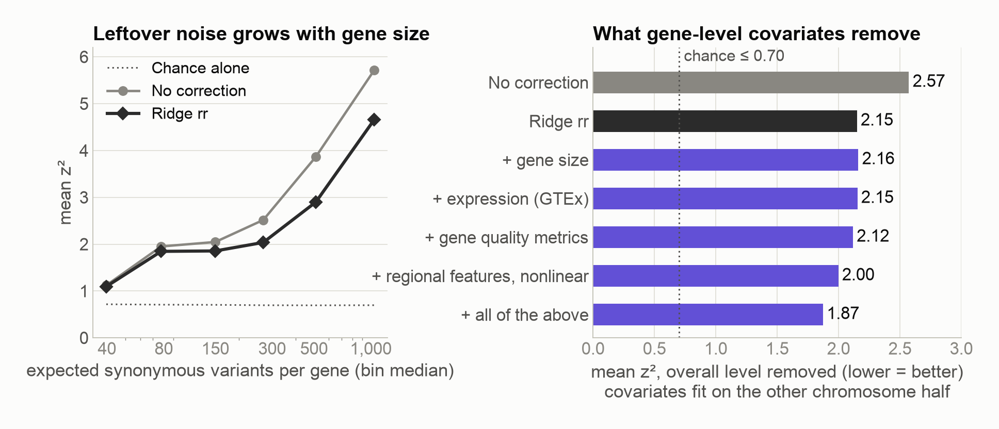

This uses the 17,459 genes with no release flag of any kind and at least 20 expected synonymous variants; the flags already handle the rest. On this set, noise is 2.57 with no correction and 2.15 with the ridge rr, against at most 0.70 from chance.

- **About half of the leftover excess doesn't grow with gene size** (left). Even small genes sit well above chance (1.1–1.9). That part comes from individual sites, for example the three possible variants at a position sharing its coverage and mappability. No regional correction can remove it; a better per-site model could.
- **The other half grows with gene size**, as a gene-wide rate error of about 5% would. That is the part a regional or gene-level correction can reach.
- **It's concentrated in a few hundred genes.** The noisiest 5% of genes carry half the leftover excess, and 61% of the excess comes from genes with more variants than expected. The noisiest unflagged genes include:
  - histone cluster genes (synonymous o/e ≈ 1.8, despite clean coverage and mapping)
  - mucins and other tandem-repeat genes
  - HLA genes
  - a few highly constrained, broadly expressed genes (HNRNPA2B1, SFPQ, BRD2, USP34)
- **Gene-level covariates help a little** (right). Each model is fit on gnomAD synonymous counts from the other chromosome half.
  - Gene quality metrics, gene size and GTEx expression barely help on their own: at most 1.5%.
  - A nonlinear model of the same 13 regional features removes another 7%, so the per-context logistic rr isn't using everything these features carry.
  - Everything together removes 13% (2.15 → 1.87), about a fifth of what's left above chance.
- **Most of the gene-level part is real.** Synonymous DNMs follow gnomAD synonymous obs/exp across genes, at about two-thirds of the slope expected if all the spread above chance were mutation rate (see [What explains them besides size](#what-explains-them-besides-size)). Histone genes are included: their DNMs are 2.8 times expected.

What this suggests:
1. Treat what's left as two problems. The site-level part belongs to the mutation model (per-site coverage, wider sequence context). The gene-level part belongs to the regional correction.
2. For the gene-level part, the most promising route is a model trained on gnomAD rare variants that uses the regional features flexibly (nonlinearly). This matches the "fit on gnomAD synonymous" result earlier.
3. Check histone clusters for paralog artifacts. Consider flagging repeat and segdup genes, whose excess DNMs don't confirm.
4. Expression breadth (a stand-in for transcription-coupled repair) adds little on its own. Replication timing is untested; it needs an external track.

Code: [residual_noise.py](followup/residual_noise.py). Results: [residual_noise.by_size.tsv](followup/residual_noise.by_size.tsv), [residual_noise.covariates.tsv](followup/residual_noise.covariates.tsv), [residual_noise.top_genes.tsv](followup/residual_noise.top_genes.tsv).

### The synonymous outliers

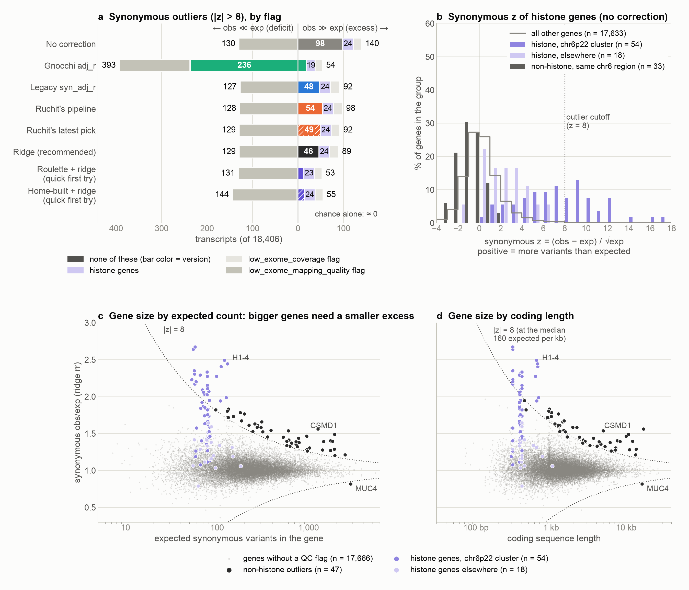

- **Left (obs ≪ exp):** under every synonymous rr, all but 0–1 of these carry `low_exome_mapping_quality`. They are segdup and paralog genes, with median syn o/e about 0.2. No rr can fix them, and none should.
- **Right (obs ≫ exp):** rr changes these, but not all of them.
  - **Histone genes (lavender):** 23–24 excess outliers under every version. None has a QC gene flag, though the release already marks all 24 `outlier_syn`. No rr removes any of them.
    - There are 72 histone genes in all: 54 in the chr6p22 cluster, 5 in the chr1q21 cluster, and 13 elsewhere. Every outlier is in the chr6p22 cluster, which is 24 of its 54 genes.
    - The excess covers the whole cluster, not just the outliers: pooled syn o/e is 1.88 in the chr6p22 cluster, 1.32 in chr1q21 and 1.23 elsewhere. 45 of the 72 genes have o/e above 1.5.
    - **Panel b:** the whole chr6p22 histone cluster is shifted to the right of every other gene: median z 7.4, against 0.1 for all other genes without a QC flag. The histone genes elsewhere sit in between, at a median of 2.3. The 24 outliers are just the part of that shifted distribution that crosses z = 8. The 33 non-histone genes in the same 25–28.5 Mb stretch sit slightly *below* expected (median z −1.1), the opposite of their histone neighbours.
    - **It's specific to histone genes, not the region.** The 33 non-histone genes interleaved in the same chr6 stretch (25–28.5 Mb) have pooled o/e 0.92, and the neighbouring MHC has 0.91. So neither regional mutation rate nor MHC diversity explains it, which is why no rr helps. Synonymous DNMs in the cluster are 2.8 times expected (see [What explains them besides size](#what-explains-them-besides-size)), so a real mutation-rate excess is likely. Paralog mis-mapping could still affect both gnomAD and DNM calls.
  - **`low_exome_coverage` (light gray, right):** 18–20 genes with too many variants. It's the only release gene flag besides `low_exome_mapping_quality`. These genes have more variants than the coverage-corrected expected count.
  - **Everything else without a flag:** these drop from 98 to 42 with legacy `syn_adj_r`, 48–52 with Ruchit's tables, and 46 with the ridge rr.
- **Gnocchi `adj_r`** creates about 236 deficit outliers among genes without a flag, by pushing ordinary genes below their expected counts.
- **Unflagged genes only:** synonymous outliers fall from 123 to 66 (legacy), 71–76 (Ruchit's tables) and 71 (ridge), about half. After rr, histone genes are about a third of the unflagged outliers left.

- **Panels c and d, gene size:** for the same relative excess, z grows with the square root of a gene's expected count. Panel c plots expected count, which is what z depends on. Panel d plots coding length; there are about 160 expected synonymous variants per kb, so the two track each other closely.
  - Large genes cross |z| = 8 with only 20–50% more variants than expected. CSMD1, for example, is at obs/exp 1.49 with about 1,900 expected.
  - Histone genes have only about 60–130 expected, so they need nearly double.
  - The non-histone outliers are mostly large genes: median 599 expected, against 212 for all genes.
  - So outlier counts favour large genes, and a fixed |z| cutoff is not a fixed effect size.

**The 47 non-histone outliers left with the ridge rr** (46 with too many variants, plus MUC4 with too few). These genes carry no QC gene flag, but 45 carry a release outlier flag (41 `outlier_syn`, 37 `outlier_mis`), and 37 are outliers under all four synonymous rr versions.

#### What explains them besides size

Size decides which genes cross |z| > 8, not why they have extra variants: gnomAD obs/exp doesn't change with gene size (1.01 to 1.00 across size fifths). For most of the 46, the mutation rate is genuinely higher than the model predicts.

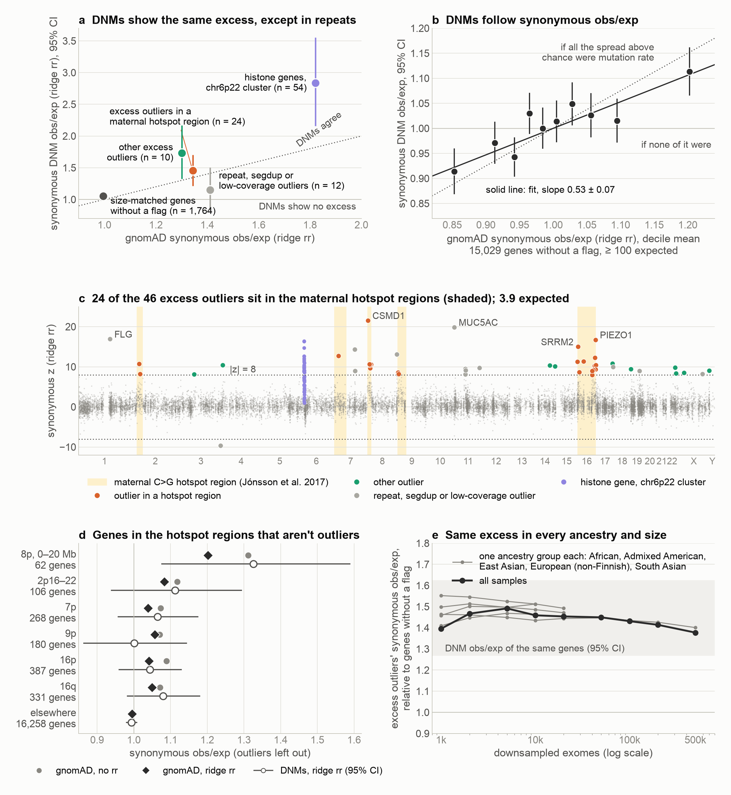

- **a. De novo mutations (DNMs) show the same excess.** DNMs measure the mutation rate directly, in different people, so they don't share gnomAD's population history or most of its artifacts. Here they are the Satterstrom 2026 synonymous DNMs, with obs/exp scaled so genes without a flag are at 1.

  | Outliers with too many variants | Genes | gnomAD obs/exp | DNM obs/exp (95% CI) |
  |---|---|---|---|
  | in a maternal hotspot region | 23 | 1.36 | 1.47 (1.21–1.73) |
  | other | 11 | 1.31 | 1.73 (1.33–2.16) |
  | repeat, segdup or low coverage | 12 | 1.41 | 1.15 (0.83–1.51) |
  | histone genes, chr6p22 cluster | 54 | 1.83 | 2.84 (2.16–3.56) |
  | genes of the same size without a flag | 1,808 | 1.00 | 1.05 (1.02–1.08) |

  - The excess holds in non-CpG contexts alone (DNMs 1.51), so it isn't from methylation, which the DNM expectation leaves out.
  - **Repeat genes are the exception:** DNMs don't confirm their excess. These are the ones likely to be mapping artifacts in gnomAD: FLG, MUC5AC, MUC3A, MUC17, the olfactory receptors, PSG2, CT47B1, ACTG1, HSPA8 and MROH1.
  - **Histone genes:** DNMs are 2.8 times expected (63 against 22), more than gnomAD shows. So the histone excess is not only a gnomAD paralog artifact.
- **b. Across all genes, DNMs follow synonymous obs/exp** (slope 0.51 ± 0.07). If all the gene-to-gene spread above chance were mutation rate, the slope would be about 0.75. So about two-thirds of the spread the rr leaves behind is real mutation-rate variation.
- **c. Half the outliers sit in known maternal mutation hotspots.** 23 of the 46 are in the regions where [Jónsson et al. 2017](https://doi.org/10.1038/nature24018) found raised maternal C>G DNM rates: the first 20 Mb of 8p, 2p16–22, 7p, 9p, 16p and 16q. Chance would put about 4 there (p = 3 × 10⁻¹³).
  - This explains the chr16 and chr8p clusters, and also adds ZFP36L2 and MSH6 (2p), DNAH11 (7p), and KCNV2 and KIAA2026 (9p).
  - [Goldmann et al. 2018](https://pubmed.ncbi.nlm.nih.gov/29507425/) link these regions to double-strand breaks in aging oocytes.
- **d. The rr only partly corrects these regions,** even for genes that aren't outliers.
  - Across the six regions, the ridge rr moves obs/exp only from 1.09 to 1.06. DNMs agree with what's left: 1.07 (1.02–1.12).
  - On 8p it moves from 1.31 to 1.20, and DNMs are at 1.32.
  - **In the full run** (DNMs from every cohort, the pipeline's ridge rr), the rr corrects most of the regions: 16p 1.09 → 1.02, 16q 1.08 → 1.03, 7p 1.08 → 1.02, 2p16–22 1.13 → 1.07 and 9p 1.05 → 1.03. The first 20 Mb of 8p is the exception: 1.31 → 1.19, with DNMs at 1.39 (133 DNMs).
  - **Why the maternal clustered-DNM feature doesn't fix 8p,** although it is nonzero in 92% of 8p's windows:
    - It only says "near a maternal DNM cluster". Each context gets one coefficient for it, learned from all such windows, most of them outside 8p and with a smaller excess. So it gives 8p an rr of about 1.10, not the 1.3–1.4 the DNMs show.
    - 8p's excess isn't specific to maternal C>G. It is there in every context class (DNMs: A/T 1.32, other C 1.60, CpG 1.26; gnomAD 1.27, 1.41 and 1.13), and C>G is only 11% of 8p's C-site DNMs against 8% elsewhere. A broad regional rise like this needs a broad regional term.
    - Roulette's empirical regional rate puts 8p at 1.34 times the average (outside CpG), about what the DNMs show. **In the pipeline it fixes 8p:** with Roulette's rates and the ridge on top, 8p's genes go from 1.32 to 1.02, and the other five regions to 0.99–1.01 ([downstream.hotspots.tsv](followup/downstream.hotspots.tsv); genes without a QC flag that aren't outliers). The home-built rates slightly overcorrect 8p (0.94) and bring the other regions to 0.97–0.99.
- **The region isn't what makes these 23 genes outliers.** Their own excess is far above their region's:
  - The genes are at 1.24–1.91 (median 1.38), but the 3 Mb around each is only at 1.03–1.26 (median about 1.10), and each region as a whole at 1.05–1.31. So the region explains a small part; most of the excess belongs to the gene itself.
  - It covers the whole gene (almost every 1-kb window is up), not one exon.
  - It isn't maternal C>G. It is as large in A/T contexts (median 1.45), which can't have a C>G change, as in other C contexts (1.54), and smaller at CpG (1.10), where gnomAD is near saturation.
  - DNMs confirm it (1.47 pooled, 120 DNMs), so it is a real, gene-scale rise in mutation rate that the 13 regional features don't measure. Many of these genes sit near chromosome ends (16p13.3, 16q24, 8p23, 9p24), where they overlap the hotspot regions.
  - **Roulette's regional rate does see it.** Outside CpG, Roulette's 50 kb empirical rate puts these genes at a median of 1.44 (1.12–2.00), against their gnomAD obs/exp of 1.38; CSMD1, CTSB, FDFT1, GSE1, PIEZO1 and WWOX all match closely. It misses a few (MAZ 1.16 against 1.63, ZFP36L2 1.12 against 1.52, CARHSP1 1.49 against 1.91).
  - **In the pipeline, 21 of the 23 stop being outliers** with Roulette's rates and the ridge on top, against 2 with the ridge alone. Only MAZ (1.52) and ZFP36L2 (1.44) remain, and the home-built rates leave the same two. Roulette's regional rate comes from gnomAD rare variants, so part of this is gnomAD fitting gnomAD, but the DNMs show the same excess.
- **e. The excess is the same in every ancestry group, and at every sample size from 1,000 to 500,000** (about 1.4–1.6 everywhere).
  - That rules out ancestry-specific causes such as copy-number or diversity differences.
  - It also rules out per-sample sequencing errors, which would grow with sample size.
  - It sits inside the DNM range for the same genes (gray band).
- **Other checks:**
  - **It covers the whole gene.** A median of 99% of each gene's 1-kb windows are above expected, against 50% in genes of the same size. Only FLG, MUC5AC, MUC3A, MROH1, WFS1, ARHGAP8, CT47B1 and MECP2 have it concentrated in part of the gene.
  - **It shows in every context class.** CpG sites show less (A/T 1.36, other C 1.46, CpG 1.11) because they are close to saturated in gnomAD.
  - **Missense rises by the same factor**, as a mutation-rate cause would predict.
  - **Compared with genes of the same size,** the outliers are closer to a chromosome end (median 9% against 23% of the chromosome's length), and the rr already raises them slightly (1.02 against 0.98). Coverage, mapping quality, segdup fraction and testis expression don't differ.

Code: [outlier_drivers.py](followup/outlier_drivers.py). Results: [outlier_drivers.all_genes.tsv](followup/outlier_drivers.all_genes.tsv), [outlier_drivers.covariates.tsv](followup/outlier_drivers.covariates.tsv), [outlier_drivers.dnm_by_oe_decile.tsv](followup/outlier_drivers.dnm_by_oe_decile.tsv), [outlier_drivers.downsampling.tsv](followup/outlier_drivers.downsampling.tsv), [outlier_drivers.genes.tsv](followup/outlier_drivers.genes.tsv), [outlier_drivers.groups.tsv](followup/outlier_drivers.groups.tsv), [outlier_drivers.regions.tsv](followup/outlier_drivers.regions.tsv).

<b>Click to expand: table of the 47 genes, sorted by z</b>

| Gene | Chr | Group | Syn obs | Syn exp (ridge) | Obs/exp | z (ridge) | DNMs obs / exp | Missense also high | Release outlier flag | Notes |
|---|---|---|---|---|---|---|---|---|---|---|
| CSMD1 | 8 | hotspot 8p | 2,862 | 1,919 | 1.49 | 21.5 | 13 / 8.8 | yes | outlier_syn, outlier_mis | 8p23–p22 |
| MUC5AC | 11 | repeat / segdup | 1,975 | 1,264 | 1.56 | 20.0 | 7 / 10.6 | yes | outlier_syn, outlier_mis | tandem repeats; segdup 0.57; AN90 0.12 |
| FLG | 1 | repeat / segdup | 2,551 | 1,829 | 1.39 | 16.9 | 7 / 7.2 | yes | outlier_syn, outlier_mis | tandem repeats; segdup 0.87 |
| PIEZO1 | 16 | hotspot 16q | 2,427 | 1,730 | 1.40 | 16.8 | 14 / 8.0 | yes | outlier_syn, outlier_mis | 16q23–24 |
| SRRM2 | 16 | hotspot 16p | 2,025 | 1,454 | 1.39 | 15.0 | 9 / 6.5 | yes | outlier_syn, outlier_mis | 16p13.3 |
| MUC3A | 7 | repeat / segdup | 1,398 | 954 | 1.46 | 14.4 | 8 / 5.3 | yes | outlier_syn, outlier_mis | tandem repeats; AN90 0.42 |
| MROH1 | 8 | repeat / segdup | 921 | 599 | 1.54 | 13.2 | 4 / 4.3 | yes | outlier_syn, outlier_mis | AN90 0.27 |
| DNAH11 | 7 | hotspot 7p | 2,461 | 1,908 | 1.29 | 12.7 | 8 / 7.4 | yes | outlier_syn, outlier_mis |  |
| GSE1 | 16 | hotspot 16q | 1,115 | 776 | 1.44 | 12.2 | 12 / 3.7 | yes | outlier_syn, outlier_mis | 16q23–24 |
| MAZ | 16 | hotspot 16p | 510 | 307 | 1.66 | 11.5 | 4 / 2.0 | no | outlier_syn | AN90 0.66 |
| CACNA1H | 16 | hotspot 16p | 2,202 | 1,730 | 1.27 | 11.3 | 14 / 8.6 | yes | outlier_syn, outlier_mis | 16p13.3 |
| FDFT1 | 8 | hotspot 8p | 351 | 199 | 1.77 | 10.8 | 1 / 0.8 | yes | outlier_syn, outlier_mis | 8p23–p22 |
| ZFP36L2 | 2 | hotspot 2p16–22 | 600 | 388 | 1.55 | 10.7 | 2 / 2.7 | yes | outlier_syn, outlier_mis |  |
| PCM1 | 8 | hotspot 8p | 1,085 | 787 | 1.38 | 10.6 | 0 / 2.8 | yes | outlier_syn, outlier_mis | 8p23–p22 |
| DNAH17 | 17 | other | 3,031 | 2,502 | 1.21 | 10.6 | 19 / 11.8 | no | outlier_syn |  |
| FANCA | 16 | hotspot 16q | 1,014 | 730 | 1.39 | 10.5 | 3 / 3.2 | yes | outlier_syn, outlier_mis | 16q23–24 |
| CTSB | 8 | hotspot 8p | 320 | 179 | 1.78 | 10.5 | 1 / 0.8 | yes | outlier_syn, outlier_mis | 8p23–p22 |
| RP1L1 | 8 | hotspot 8p | 1,813 | 1,419 | 1.28 | 10.5 | 10 / 6.0 | yes | outlier_syn, outlier_mis | 8p23–p22 |
| IRF2BPL | 14 | other | 768 | 529 | 1.45 | 10.4 | 2 / 3.4 | no | outlier_syn |  |
| WFS1 | 4 | other | 860 | 608 | 1.41 | 10.2 | 5 / 3.0 | yes | outlier_syn, outlier_mis |  |
| ACTG1 | 17 | repeat / segdup | 422 | 259 | 1.63 | 10.2 | 2 / 1.3 | no | outlier_syn | segdup 1.00 |
| SLC38A8 | 16 | hotspot 16q | 447 | 278 | 1.61 | 10.2 | 0 / 1.3 | yes | outlier_syn, outlier_mis | 16q23–24 |
| HSP90AA1 | 14 | other | 477 | 301 | 1.58 | 10.1 | 5 / 1.2 | no | outlier_syn |  |
| EP300 | 22 | other | 1,340 | 1,027 | 1.31 | 9.8 | 7 / 3.9 | no | outlier_syn |  |
| HSPA8 | 11 | repeat / segdup | 436 | 275 | 1.59 | 9.7 | 1 / 1.0 | no | outlier_syn | segdup 1.00 |
| DLC1 | 8 | hotspot 8p | 986 | 727 | 1.36 | 9.6 | 5 / 3.1 | yes | outlier_syn, outlier_mis | 8p23–p22 |
| OR4A5 | 11 | repeat / segdup | 245 | 134 | 1.83 | 9.6 | 3 / 0.5 | yes | outlier_syn, outlier_mis | paralog family; segdup 1.00 |
| MED16 | 19 | other | 897 | 653 | 1.37 | 9.5 | 8 / 3.2 | yes | outlier_syn, outlier_mis |  |
| ATP2C2 | 16 | hotspot 16q | 804 | 576 | 1.40 | 9.5 | 9 / 2.8 | yes | outlier_syn, outlier_mis | 16q23–24 |
| CTU2 | 16 | hotspot 16q | 482 | 316 | 1.53 | 9.3 | 1 / 1.5 | yes | outlier_syn, outlier_mis | 16q23–24 |
| MECP2 | X | other | 310 | 185 | 1.67 | 9.2 | 4 / 1.3 | no | outlier_syn |  |
| OR4C16 | 11 | repeat / segdup | 233 | 129 | 1.81 | 9.2 | 1 / 0.4 | yes | outlier_syn, outlier_mis | paralog family |
| WWOX | 16 | hotspot 16q | 359 | 223 | 1.61 | 9.1 | 2 / 1.1 | yes | outlier_syn, outlier_mis | 16q23–24 |
| PSG2 | 19 | repeat / segdup | 261 | 151 | 1.73 | 9.0 | 1 / 0.6 | yes | outlier_syn, outlier_mis | paralog family; segdup 1.00 |
| MUC17 | 7 | repeat / segdup | 2,325 | 1,931 | 1.20 | 9.0 | 10 / 7.2 | yes | outlier_mis | tandem repeats |
| PKD1L3 | 16 | hotspot 16q | 996 | 752 | 1.32 | 8.9 | 2 / 2.8 | yes | outlier_mis |  |
| DMD | X | other | 1,223 | 955 | 1.28 | 8.7 | 7 / 5.4 | yes | outlier_syn, outlier_mis |  |
| KCNV2 | 9 | hotspot 9p | 518 | 356 | 1.46 | 8.6 | 3 / 1.8 | yes | outlier_syn, outlier_mis |  |
| CARHSP1 | 16 | hotspot 16p | 161 | 83 | 1.95 | 8.6 | 0 / 0.4 | yes | outlier_syn, outlier_mis | 16p13.3 |
| CT47B1 | X | repeat / segdup | 228 | 133 | 1.72 | 8.3 | 0 / 1.0 | yes | outlier_syn, outlier_mis | paralog family; segdup 1.00 |
| ARHGAP8 | 22 | other | 375 | 245 | 1.53 | 8.3 | 2 / 1.2 | yes | outlier_syn, outlier_mis |  |
| OR4C46 | 11 | repeat / segdup | 224 | 130 | 1.72 | 8.2 | 2 / 0.4 | yes | outlier_mis | paralog family; segdup 1.00 |
| MSH6 | 2 | hotspot 2p16–22 | 830 | 625 | 1.33 | 8.2 | 2 / 2.4 | yes | outlier_syn, outlier_mis |  |
| KIAA2026 | 9 | hotspot 9p | 1,222 | 967 | 1.26 | 8.2 | 5 / 3.8 | yes | outlier_syn, outlier_mis |  |
| LRIG1 | 3 | other | 772 | 577 | 1.34 | 8.1 | 5 / 2.7 | no | — |  |
| ID1 | 20 | other | 176 | 97 | 1.82 | 8.1 | 1 / 0.6 | yes | outlier_mis |  |
| MUC4 | 3 | repeat / segdup | 2,351 | 2,874 | 0.82 | -9.8 | 23 / 13.6 | no | — | tandem repeats; segdup 0.63; AN90 0.69 |

"Missense also high" means release missense z < −8, which is the release's sign for too many variants. "DNMs obs / exp" counts Satterstrom 2026 synonymous DNMs in the gene against the number expected from context rates and the ridge rr; per-gene counts are small, so read them in groups. Group: in a maternal hotspot region; repeat or segdup (segdup fraction ≥ 0.5, AN90 < 0.5, or a MUC, OR or PSG gene); or other. Data: [ridge_unflagged_outliers.tsv](followup/ridge_unflagged_outliers.tsv), [outlier_drivers.genes.tsv](followup/outlier_drivers.genes.tsv).

Histone genes are assigned by gene symbol (H1-, H2AC, H2BC, H3C, H4C, H2AW, H2BW, H3- and H4-). A histone transcript with a release flag is counted under its flag.

The counts are recomputed from Ruchit's evaluation export: all 18,406 Ensembl MANE Select transcripts including X/Y, raw |z| > 8, and his calibrated tables. Flags come from the v4.1.2 release. The totals reproduce his reported counts (270, 447, 217, 219 and 224). Code: [remap_rr_to_shet.py](followup/remap_rr_to_shet.py) `--outliers` (histone pattern in `GENE_FAMILIES`).

#### Why the histone genes are outliers, and whether rr can capture them

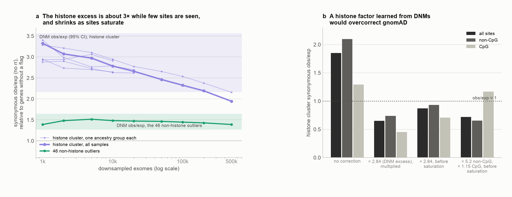

**What we know**
- **The excess:** the 54 genes of the chr6p22 histone cluster carry about 1.85 times the expected synonymous variants (2.1 times at non-CpG sites, 1.3 times at CpG). 24 of them are outliers under every rr.
- **It is the genes, not the region.** The 33 non-histone genes interleaved in the same stretch sit at 0.92.
- **DNMs show it, more strongly.** There are 63 synonymous DNMs against 22 expected (2.8 times): 5.2 times at non-CpG sites and 1.15 times at CpG. Most of that DNM excess copies a paralog's base, though (see [Do the extra variants copy a paralog?](#paralog-test)).
- **a. It looks like a higher rate that saturates.** In gnomAD the excess is about 3 times in 1,000–5,000 exomes and falls to 1.9 times at 500,000, the same in every ancestry group. A rate about 3 times higher does this: once a site has been seen, more mutation there adds nothing. The level in small samples matches the DNM excess.
  - The 46 non-histone outliers, for comparison, stay flat at about 1.5 times, close to their own DNM excess (1.45).
  - A fixed set of artifact variants would also fall with sample size, so this alone doesn't rule artifacts out. The DNM excess is harder to explain that way, because a DNM call needs a variant absent from both parents.

**Possible causes**
1. **Gene conversion between histone paralogs.**
   - Histone genes come in many near-identical copies that exchange sequence by gene conversion. Their proteins are almost identical, so the copies differ mostly at synonymous sites.
   - A conversion copies a stretch from another copy and changes several of those sites at once. That would raise synonymous variation more than missense, mostly away from CpG, and could produce clustered DNMs.
   - Several histone DNMs sit within tens of bp of each other in the same gene (H4C5, H4C12, H3C1). The DNM files used here have no sample IDs, so it isn't known whether they are in the same person.
   - **Tested below:** it accounts for a fifth of the gnomAD excess at most, but for most of the DNM excess.
2. **Transcription during replication.** Replication-dependent histone genes are among the most highly transcribed genes while DNA is being copied. Conflicts between transcription and replication are a known source of mutation.
3. **Mis-mapped paralog reads.** Reads from one copy placed on another would create false variants in both gnomAD and DNM calls. Mapping quality is normal for these genes, so this is less likely, but it isn't ruled out.
   - **Tested below:** there's no sign of it in gnomAD's filters. For DNMs it can't be told apart from gene conversion.

**Do the extra variants copy a paralog?** In gnomAD, mostly not: alleles that no paralog carries are nearly as elevated as the rest (1.67 against 1.80 times expected), and copying alleles aren't filtered more often. In DNMs, mostly yes: 58 of 62 copy a paralog's base (4.4 times expected), against 1.1 times for the rest.

<b>Click to expand: the paralog-copying test</b>

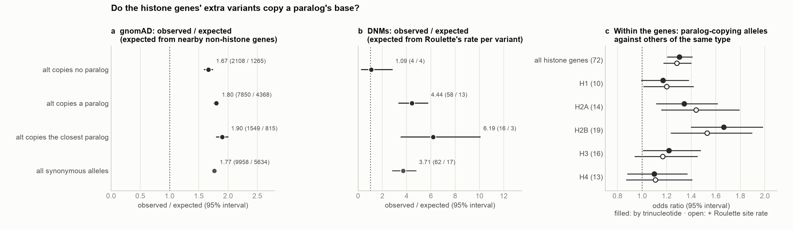

The test, on the 72 histone genes:
- **Paralog alleles:** each gene's protein is aligned to every other member of its family (H1, H2A, H2B, H3, H4). Each possible synonymous variant is then marked by whether its alt is the base a paralog carries at that position, and whether it is the most similar paralog's base.
- **The logic:** gene conversion, or reads from a paralog placed on the wrong copy, would favour those alleles. A higher point-mutation rate would not.

What it shows:
- **a. In gnomAD, the excess is almost as large at alleles no paralog carries.**
  - Expected counts come from the rate in the 33 nearby non-histone genes for the same mutation type.
  - Against that, alleles that copy no paralog are at 1.67 times, alleles that copy a paralog at 1.80 times, and alleles that copy the closest paralog at 1.90 times.
- **c. Within the genes, copying alleles are seen a little more often.**
  - The odds ratio is 1.30 (1.21–1.41) against other alleles of the same mutation type. With Roulette's own rate for each variant as a covariate it is 1.28, so the effect isn't just more mutable sites.
  - It is strongest in H2B (1.67) and absent in H4 (1.10).
  - That makes about 880 extra variants: a fifth of the roughly 3,990 the histone genes carry above expectation.
- **b. In DNMs, the excess is almost all at copying alleles.**
  - 58 of 62 DNMs copy a paralog: 4.4 times expected. The 4 that don't are at 1.1 times (95% interval 0.3–2.8).
  - These are the DNMs from every cohort in the pipeline's DNM Table, at the variants Roulette covers. Expected counts are Roulette's rate per variant, scaled to the genome-wide DNM count.
- **No sign of mis-mapping in gnomAD.** Copying alleles fail gnomAD's filters no more often than others (11% against 13% of calls). Only one site in these genes fails the inbreeding-coefficient filter.
- **What it means:**
  - Most of the gnomAD excess isn't paralog-templated. It is a higher rate at alleles of every kind, which fits the saturation pattern in panel a above.
  - The DNM excess mostly is paralog-templated: de novo gene conversion, or DNM calls made from a paralog's reads (the two can't be told apart here). So the DNMs confirm the gnomAD excess less directly than they seemed to. That also explains why a DNM-learned histone factor (2.84) overcorrects (panel b above).

Code: [histone_gene_conversion.py](followup/histone_gene_conversion.py). Results: [histone_gene_conversion.excess.tsv](followup/histone_gene_conversion.excess.tsv), [histone_gene_conversion.tests.tsv](followup/histone_gene_conversion.tests.tsv), [histone_gene_conversion.paralog_identity.tsv](followup/histone_gene_conversion.paralog_identity.tsv), [histone_gene_conversion.roulette_mu_by_context.tsv](followup/histone_gene_conversion.roulette_mu_by_context.tsv), [histone_gene_conversion.sites.tsv.gz](followup/histone_gene_conversion.sites.tsv.gz).

**Can rr capture it?**
- **Not with regional features.** The interleaved non-histone genes are normal, so any regional feature that raises the histone genes would wrongly raise their neighbours too.
- **b. A histone term learned from DNMs would overcorrect.**
  - Multiplying expected by the DNM excess (2.84) leaves the cluster at obs/exp 0.65.
  - Applying it before saturation gives 0.87, and doing it by CpG status gives 0.72.
  - The DNM excess is larger than what gnomAD shows, even after allowing for saturation.
- **Options that would work:**
  - **Flag the cluster's genes.** They already carry `outlier_syn`. A gene flag would keep their missense and LoF metrics from being read as constraint. It is still the simplest call.
  - **A gene-level adjustment** from each gene's own synonymous obs/exp, shrunk toward 1. The paralog test supports it: the gnomAD excess applies to alleles of every kind, which is what one factor per gene assumes. Its pros and cons are in [Still worth trying or looking at](#still-worth-trying-or-looking-at).

Code: [histone_checks.py](followup/histone_checks.py). Results: [histone_checks.dnm_factor.tsv](followup/histone_checks.dnm_factor.tsv), [histone_checks.downsampling.tsv](followup/histone_checks.downsampling.tsv).

## Scripts, figures and tables

The scripts are in [followup/](followup/); the ones in [followup/cluster/](followup/cluster/) run on Dataproc and the rest locally. Each script lists its inputs at the top.

| Script | What it does | Tables it writes |
|---|---|---|
| [make_followup_figures.py](followup/make_followup_figures.py) | Draws every figure in this report from the tables listed here. | Figures: [rr_concept.png](followup/rr_concept.png), [rr_problem_summary.png](followup/rr_problem_summary.png), [rr_pipelines_diagram.png](followup/rr_pipelines_diagram.png), [rr_performance.png](followup/rr_performance.png), [rr_by_decile.png](followup/rr_by_decile.png), [rr_by_decile.explained_removed.png](followup/rr_by_decile.explained_removed.png), [rr_features.png](followup/rr_features.png), [rr_alternatives.png](followup/rr_alternatives.png), [rr_dnm_sets.png](followup/rr_dnm_sets.png), [rr_background.png](followup/rr_background.png), [rr_leftover_noise.png](followup/rr_leftover_noise.png), [rr_outliers.png](followup/rr_outliers.png), [rr_outlier_drivers.png](followup/rr_outlier_drivers.png), [rr_histones.png](followup/rr_histones.png), [rr_model.png](followup/rr_model.png), [rr_logistic_fits.png](followup/rr_logistic_fits.png), [rr_logistic_fits.all_contexts.png](followup/rr_logistic_fits.all_contexts.png), [rr_logistic_fits.backgrounds.png](followup/rr_logistic_fits.backgrounds.png), [rr_logistic_fits.pipeline.png](followup/rr_logistic_fits.pipeline.png), [rr_logistic_fits.pipeline.all_contexts.png](followup/rr_logistic_fits.pipeline.all_contexts.png), [rr_histone_conversion.png](followup/rr_histone_conversion.png) |
| [remap_rr_to_shet.py](followup/remap_rr_to_shet.py) | Applies each rr version to Ruchit's evaluation export: obs/exp by LOEUF and s_het decile, outliers by flag, and per-gene z. | [syn_oe_by_decile.rr_eval_export.tsv](followup/syn_oe_by_decile.rr_eval_export.tsv), [syn_outliers_by_flag.rr_eval_export.tsv](followup/syn_outliers_by_flag.rr_eval_export.tsv), [syn_z_by_histone_group.tsv](followup/syn_z_by_histone_group.tsv) |
| [rr_shrinkage_experiments.py](followup/rr_shrinkage_experiments.py) | Alternatives to a strength α (ridge, sample split, background approximation, fitting on gnomAD), and the recommended ridge rr scored at each strength. | [rr_shrinkage_experiments.tsv](followup/rr_shrinkage_experiments.tsv), [rr_shrinkage_experiments.pass2.tsv](followup/rr_shrinkage_experiments.pass2.tsv), [recommended_rr_metrics.tsv](followup/recommended_rr_metrics.tsv) |
| [compare_ridge_vs_cutoff_alpha.py](followup/compare_ridge_vs_cutoff_alpha.py) | Ridge against Ruchit's cutoff-and-α options, with his model-fitting code. | [ridge_vs_cutoff_alpha.tsv](followup/ridge_vs_cutoff_alpha.tsv) |
| [residual_noise.py](followup/residual_noise.py) | What the noise left after the ridge rr is: by gene size, and what gene-level covariates remove. | [residual_noise.by_size.tsv](followup/residual_noise.by_size.tsv), [residual_noise.covariates.tsv](followup/residual_noise.covariates.tsv), [residual_noise.top_genes.tsv](followup/residual_noise.top_genes.tsv) |
| [outlier_drivers.py](followup/outlier_drivers.py) | DNM, maternal-hotspot, ancestry, sample-size, within-gene and covariate checks of the synonymous outliers. | [outlier_drivers.all_genes.tsv](followup/outlier_drivers.all_genes.tsv), [outlier_drivers.covariates.tsv](followup/outlier_drivers.covariates.tsv), [outlier_drivers.dnm_by_oe_decile.tsv](followup/outlier_drivers.dnm_by_oe_decile.tsv), [outlier_drivers.downsampling.tsv](followup/outlier_drivers.downsampling.tsv), [outlier_drivers.genes.tsv](followup/outlier_drivers.genes.tsv), [outlier_drivers.groups.tsv](followup/outlier_drivers.groups.tsv), [outlier_drivers.regions.tsv](followup/outlier_drivers.regions.tsv) |
| [decile_explained_removed.py](followup/decile_explained_removed.py) | The LOEUF and s_het decile summary with the explained outliers removed. | [syn_oe_by_decile.explained_removed.tsv](followup/syn_oe_by_decile.explained_removed.tsv), [explained_outliers_removed.tsv](followup/explained_outliers_removed.tsv) |
| [rr_background_experiments.py](followup/rr_background_experiments.py) | Training backgrounds, strength sweeps, one strength per context class, and the ridge coefficients. | [rr_background.class_slopes.tsv](followup/rr_background.class_slopes.tsv), [rr_background.coefficients.tsv](followup/rr_background.coefficients.tsv), [rr_background.frac_seen_by_rr.tsv](followup/rr_background.frac_seen_by_rr.tsv), [rr_background.metrics.tsv](followup/rr_background.metrics.tsv), [rr_background.penalty_tuning.tsv](followup/rr_background.penalty_tuning.tsv), [rr_background.rr_absent_vs_all.tsv](followup/rr_background.rr_absent_vs_all.tsv), [rr_background.strength.tsv](followup/rr_background.strength.tsv) |
| [rr_logistic_fits.py](followup/rr_logistic_fits.py) | What each context's logistic regression looks like under each training background, scored on held-out chromosomes. | [rr_logistic_fits.bins.tsv](followup/rr_logistic_fits.bins.tsv), [rr_logistic_fits.contexts.tsv](followup/rr_logistic_fits.contexts.tsv), [rr_logistic_fits.points.tsv](followup/rr_logistic_fits.points.tsv) |
| [cluster/export_logistic_fits.py](followup/cluster/export_logistic_fits.py) | The same logistic-fit tables from a pipeline run's training set and models (run on the cluster). | [rr_logistic_fits.pipeline.bins.tsv](followup/rr_logistic_fits.pipeline.bins.tsv), [rr_logistic_fits.pipeline.contexts.tsv](followup/rr_logistic_fits.pipeline.contexts.tsv), [rr_logistic_fits.pipeline.points.tsv](followup/rr_logistic_fits.pipeline.points.tsv), [rr_logistic_fits.pipeline.hist.tsv](followup/rr_logistic_fits.pipeline.hist.tsv) |
| [roulette_combo.py](followup/roulette_combo.py) | Roulette's rates alone, split into sequence and regional parts, and combined with the ridge rr; scored on gnomAD and on held-out DNMs. | [roulette_combo.v2.metrics.tsv](followup/roulette_combo.v2.metrics.tsv), [roulette_combo.v2.feature_coef.tsv](followup/roulette_combo.v2.feature_coef.tsv) |
| [rr_training_exclusion.py](followup/rr_training_exclusion.py) | Leaving poorly covered or mapped genes out of training. | [rr_training_exclusion.class_slopes.tsv](followup/rr_training_exclusion.class_slopes.tsv), [rr_training_exclusion.metrics.tsv](followup/rr_training_exclusion.metrics.tsv) |
| [histone_checks.py](followup/histone_checks.py) | The histone cluster's excess by sample size and ancestry, and what a DNM-learned histone factor would do. | [histone_checks.dnm_factor.tsv](followup/histone_checks.dnm_factor.tsv), [histone_checks.downsampling.tsv](followup/histone_checks.downsampling.tsv) |
| [histone_gene_conversion.py](followup/histone_gene_conversion.py) | Whether the histone genes' extra gnomAD variants and DNMs copy a paralog's base. | [histone_gene_conversion.excess.tsv](followup/histone_gene_conversion.excess.tsv), [histone_gene_conversion.tests.tsv](followup/histone_gene_conversion.tests.tsv), [histone_gene_conversion.paralog_identity.tsv](followup/histone_gene_conversion.paralog_identity.tsv), [histone_gene_conversion.roulette_mu_by_context.tsv](followup/histone_gene_conversion.roulette_mu_by_context.tsv), [histone_gene_conversion.sites.tsv.gz](followup/histone_gene_conversion.sites.tsv.gz) |

- [ridge_unflagged_outliers.tsv](followup/ridge_unflagged_outliers.tsv): the 47 non-histone outliers with their release flags, built from [syn_z_by_histone_group.tsv](followup/syn_z_by_histone_group.tsv) and the release TSV.
- **Ruchit's reports:** [`rr_syn_dnm_report.html`](ruchit_reports/rr_syn_dnm_report.html) (v1, 10/16; [Slack thread](https://atgu.slack.com/archives/C07NGV3UQKA/p1792179470507199)), [`rr_syn_dnm_report.v2.html`](ruchit_reports/rr_syn_dnm_report.v2.html) (10/19–21; [Slack thread](https://atgu.slack.com/archives/C07NGV3UQKA/p1792615503898679)) and [`rr_followup_tests_report.html`](ruchit_reports/rr_followup_tests_report.html) (10/27; [Slack thread](https://atgu.slack.com/archives/C07NGV3UQKA/p1793130471776509?thread_ts=1793122617.080069&cid=C07NGV3UQKA)), in [ruchit_reports/](ruchit_reports/). GitHub shows HTML as source; download a file and open it in a browser to read it.
- **Inputs:** Ruchit's rr evaluation export and training tables (`gs://gnomad-tmp/rp/gnomad_v4.1.1/constraint/regional_rate/`), the v4.1.2 constraint release TSV, the Satterstrom 2026 DNM files ([`get_dnm_cohort_resources`](../../resources/resource_utils.py)), gnomAD v4 s_het from Kar et al. 2026 ([Supplementary Table 3](https://zenodo.org/records/20587463)), the UCSC hg38 reference (`hg38.2bit`), GTEx v8 median TPM, Roulette's rates for high-quality synonymous variants (`all_hq_synonymous_variants.tsv.gz`, from the [Roulette downloads](http://genetics.bwh.harvard.edu/downloads/Vova/Roulette/)), the gnomAD v4.1 exome sites VCFs (read remotely from the [public bucket](https://gnomad.broadinstitute.org/downloads)), coding exons from the [Ensembl REST API](https://rest.ensembl.org), and the pipeline's synonymous DNM Table (`syn_dnm.tsv.bgz`, from the full run). Two small inputs are checked in: the export's per-transcript table, [transcripts.tsv.bgz](followup/data/rr_eval_export/transcripts.tsv.bgz), and the ClinGen haploinsufficiency scores, [ClinGen_haploinsufficiency_gene_GRCh38.bed](followup/data/ext_clingen/ClinGen_haploinsufficiency_gene_GRCh38.bed) (from [ClinGen](https://ftp.clinicalgenome.org/ClinGen_haploinsufficiency_gene_GRCh38.bed), for the LOEUF check). The rest are not: the DNM files list individual samples and their families, the exported cells, window features and hg38 reference are tens to hundreds of MB, and the s_het table is linked rather than copied.

## Still worth trying or looking at

- **Train regional effects on gnomAD rare variants.** The local version, trained on exome synonymous counts from the other chromosome half, scored best of all (2.37, about 4% below the best DNM-based rr). The cleaner version trains on intronic rare variants from gnomAD genomes and needs the cluster.
- **One rr strength per context class.** A/T contexts are too strong, other C contexts too weak and CpG contexts far too strong under every background. One strength per class lowered held-out noise more than any background change (see [The training background](#the-training-background-what-the-dnms-are-compared-with)). It is worth understanding why the classes differ.
- **One background row per locus or per variant.** The pipeline keeps one row per locus, although a locus with several synonymous alternatives has several chances for a DNM. In the pipeline it barely matters: with a penalty per DNM, one row per variant lowers held-out noise from 2.451 to 2.441, the lowest of any background run. A small gain if the background is revisited.
- **A broad regional term for 8p.** In the full run the rr corrects most of the maternal hotspot regions but leaves about 60% of the excess in the first 20 Mb of 8p (1.31 → 1.19; DNMs 1.39). The excess there is in every context class, not just maternal C>G, so a smoothed, Mb-scale DNM density or a regional term learned from gnomAD rare variants would fit it better than the clustered-DNM track. Roulette's regional rate, one such term, puts 8p at 1.34, and in the pipeline it brings 8p's synonymous obs/exp to 1.02 (see [What explains them besides size](#what-explains-them-besides-size)).
- **A gene-level adjustment.** DNMs confirm about two-thirds of the gene-to-gene spread the rr leaves. A gene's own synonymous obs/exp, shrunk toward 1, could adjust its missense and LoF expected counts.
  - **For:**
    - One mechanism handles every gene-level excess the DNMs confirm (the histone genes, the maternal hotspot regions, the unexplained "other" outliers) without needing its cause. For the histone genes, the gnomAD excess applies to alleles of every kind (see [Do the extra variants copy a paralog?](#paralog-test)), which is what one factor per gene assumes.
    - Shrinkage keeps the added noise small. From the leftover noise by gene size ([residual_noise.by_size.tsv](followup/residual_noise.by_size.tsv)), genes vary by roughly 6–12% in rate beyond chance. A typical gene (about 150 expected synonymous variants) would keep about half of its own deviation; small genes would move much less.
    - It wouldn't pull down constrained genes. Synonymous obs/exp is about 1.01 in LOEUF deciles 0–6 and 1.01–1.04 in every s_het decile ([syn_oe_by_decile.rr_eval_export.tsv](followup/syn_oe_by_decile.rr_eval_export.tsv)).
  - **Against, and what it could break:**
    - Synonymous obs/exp becomes about 1 by construction, so it can no longer check the model. Checks would need held-out halves of each gene's sites, or DNMs, and `outlier_syn` would have to be computed before adjusting.
    - **False constraint where the excess is an artifact.** In repeat or segdup genes, mis-mapped synonymous calls would raise expected LoF, while LoF calls there are often filtered, so the gene would look constrained. Those genes need excluding or flagging instead.
    - One factor per gene ignores mutation type. An excess from a maternal C>G hotspot doesn't carry over to LoF sites, many of which are CpG transitions. Splitting by context class adds noise.
    - It mostly moves the unconstrained end (LOEUF decile 9 has synonymous obs/exp 1.11), so LOEUF deciles would shift. LOEUF's interval should include the factor's uncertainty.
    - It has to be applied after rr and re-estimated whenever rr changes (for example with Roulette).
- **Combine Roulette with the DNM rr.** [Roulette](https://doi.org/10.1038/s41588-023-01562-0) (Seplyarskiy et al. 2023) gives a rate for every possible SNV, learned from gnomAD v3 genome rare variants. It uses the pentanucleotide, wider sequence, methylation, transcription and an empirical regional rate (the observed mutability of each trinucleotide in 50 kb windows). A local test with its published rates for all high-quality synonymous variants ([roulette_combo.py](followup/roulette_combo.py), [roulette_combo.v2.metrics.tsv](followup/roulette_combo.v2.metrics.tsv), [roulette_combo.v2.feature_coef.tsv](followup/roulette_combo.v2.feature_coef.tsv)):
  - **Roulette alone, outside CpG, removes more than twice as much noise as the ridge rr:** held-out 2.91 (no correction) → 2.52 (ridge) → 2.00 (Roulette). On the outcome-free core set: 3.50 → 2.87 → 2.01.
  - **The DNMs back it, independently of gnomAD.** On held-out DNMs, Roulette's slope is near 1 (A/T 0.94, other C 1.13), and it gains 17–30 log-likelihood units per 1,000 DNMs. The ridge rr gains 3 or less, and nothing in A/T contexts.
  - **Most of the DNM gain is wider sequence context; most of the gnomAD gain is regional.** Roulette's rate splits into a heptamer part (what the three bases on either side add to our trinucleotide rates) and a regional part.
    - The heptamer part carries most of the DNM gain in A/T contexts, but little of the gene-level gnomAD gain (2.84), because it averages out over a gene.
    - The regional part carries most of the gnomAD gain (2.05).
  - **The best combination fits our ridge on top of Roulette:** Roulette as a fixed offset, with the ridge learning only what Roulette misses.
    - Held-out noise is about the same as Roulette alone (1.995 against 1.998). Outcome-free noise is the lowest of any version (1.93), and unflagged outliers drop from 76 to 40.
    - Multiplying the two without refitting over-corrects (slopes 0.70–0.73). Adding Roulette as one more ridge feature barely helps (2.46), because the penalty shrinks its coefficient about tenfold.
  - **Not at CpG.** Roulette's CpG rates mostly carry methylation, which our expected counts already model. Applied there too, noise rises to 4.13.
  - **Caveats:**
    - Roulette's regional rate is estimated from gnomAD rare variants, so part of its gnomAD gain is gnomAD fitting gnomAD. The DNM test is the independent check.
    - It is a cell-level approximation (Roulette's average per window and context), on the autosomes only, and Roulette has no rates at its low-quality sites.
  - **Pipeline version (added on this branch):**
    - [`regional_rate_pipeline.py`](../../pipeline/regional_rate_pipeline.py) `--import-variant-rates` imports Roulette's per-chromosome VCFs over GENCODE coding exons. Each variant's multiplier is its rate over the average of its mutation-rate group (context, ref, alt, methylation level); CpG contexts get 1 unless `--variant-rate-include-cpg` is set.
    - `--use-variant-rates` adds the log multiplier to the rr training set as a fixed offset, so the ridge only learns what Roulette misses, and normalizes rr on expected counts that include the multipliers.
    - [`constraint_pipeline.py`](../../pipeline/constraint_pipeline.py) `--variant-rate-ht-path` multiplies expected counts by the multiplier along with rr.
  - **Done in the pipeline:** Roulette's rates imported, the ridge rr refit on top of them, and the constraint pipeline run with both through the release, under `gs://gnomad-tmp/jg/rr_roulette` and `gs://gnomad-tmp/jg/rr_downstream/roulette_ridge`. It roughly doubles the noise reduction and corrects the maternal hotspot regions, but it lowers LoF expected counts by 5% and raises missense by 3% (see [How each version performs](#how-each-version-performs)).
  - **Done in the pipeline, home-built:** the same two parts rebuilt from gnomAD v4.1 genome rare variants ([build_homebuilt_rates.py](followup/cluster/build_homebuilt_rates.py)), instead of Roulette's published rates. The regional part is each trinucleotide change's observed share of possible variants in 50 kb windows, relative to its genome-wide share, shrunk toward the window's rate. The sequence part is each heptamer change's genome-wide share, relative to its trinucleotide change's. Windows where gnomAD genomes see under 30% of the expected variants are taken as poorly called and get no regional part, and the regional part is capped at 3. The ridge rr is refit on top, and the constraint pipeline is run with both, under `gs://gnomad-tmp/jg/rr_homebuilt` and `gs://gnomad-tmp/jg/rr_downstream/homebuilt_ridge`. It gets most of Roulette's gain (noise 2.20 against 2.03) and shifts LoF and missense expected counts the same way (see [How each version performs](#how-each-version-performs)).
- **Recover the missing X/Y features**, or confirm they can't be recovered. Only this could make an X/Y correction worth more than about 1%.
- **Split the leftover noise into its two parts** (see [What the leftover noise is](#what-the-leftover-noise-is)). The site-level part belongs to the mutation model. The gene-level part could be reached by a nonlinear model trained on gnomAD rare variants, which removed 13% more locally.
- **Open threads on the synonymous outliers** (see [The synonymous outliers](#the-synonymous-outliers)):
  - **The 11 "other" outliers** (HSP90AA1, EP300, MECP2, WFS1, MED16 and others): DNMs confirm the excess (1.73), but nothing measured explains it.
  - **Histone genes:** the paralog test found the gnomAD excess at alleles of every kind, and the DNM excess mostly at alleles that copy a paralog (see [Do the extra variants copy a paralog?](#paralog-test)). Flag them, or adjust them gene by gene.
  - **Repeat and segdup genes the QC flags miss** (FLG, MUC genes, olfactory receptors, PSG2, CT47B1, ACTG1, HSPA8): DNMs don't confirm their excess. Consider a flag.
  - **`low_exome_coverage` genes:** they all have too many variants, which suggests the coverage correction pulls expected counts too low. DNMs can't test this, because the DNM cohorts lose calls there too (DNM obs/exp 0.29).
  - **The outlier cutoff:** a size-aware rule, since a fixed |z| > 8 favours long genes.
